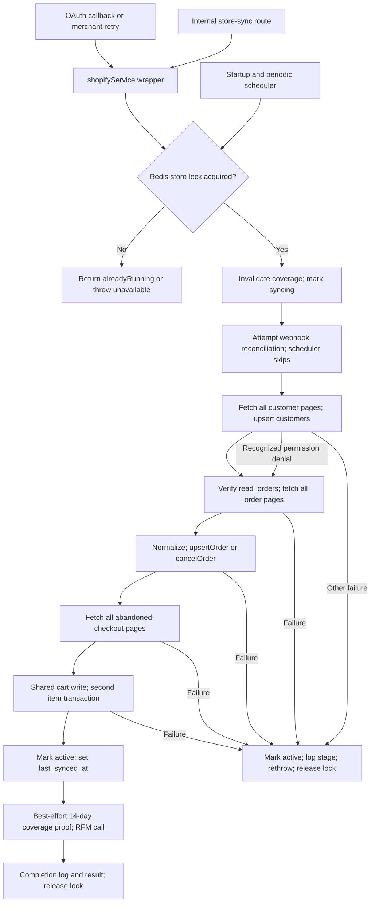

# REVLUMA — TASK 008 EXECUTION REPORT

## A. Task Identification

- **Task ID:** 008 — Map historical Shopify synchronization job.
- **Mode:** Read-only architecture inspection; no production synchronization, API mutation, database write, deployment, or source change.
- **Repository:** Revluma-Organization/Revluma.
- **Inspected branch:** Production service tracks `main`; local inspection used a detached checkout of its deployed commit.
- **Inspected and production backend commit:** `cfb41b7b468bfecd537d841d55c450ff21673342`.
- **Production alignment:** Verified against Render's live deployment `dep-dbhqdso8v5cc7395g6i0` for `Revluma-backend` (`srv-db9m6pom7kps73dtk1tg`) in the previously authorized My Workspace. Render reported it live, finished 29 October 2026 at 21:06:35 WAT. This establishes the deployed revision, not runtime synchronization correctness.
- **Repository head when checked:** `d41074872561cd84edf47d7d2374dfc6df847f37`. It was not assumed deployed. Comparing Backend between those revisions returned no changes.
- **Earlier baseline:** A targeted Library title search did not locate a Task 001 report; current Render deployment evidence supplies the baseline independently.
- **Limits:** No live token, granted-scope set, environment override, imported-row completeness, lock behavior, or full purchase lifecycle was tested. No AGENTS.md was found in the checkout. Test setup installed local dependencies with lifecycle scripts disabled and generated the local Prisma client; neither operation ran migrations or connected to production.

All source references below refer to the immutable production revision, not moving `main`. `S1`–`S15` are linked in the source register at the end. Source-supported risks are distinguished from observed production incidents.

## B. Synchronization Implementation

**Main signature:** `syncShopifyStore(store, { reconcileWebhooks = true } = {})`, `Backend/src/services/shopifySync.js:321` (S1).

| Mechanism | Verified entrypoint and call path | Runtime |
|---|---|---|
| Initial OAuth setup | `shopifyController.shopifyCallback` → `shopifyService.upsertStore` → wrapper `shopifyService.syncShopifyStore` → S1 main runner | Unawaited promise in the Node web process; no durable queue/job row. Invocation occurs before cookie cleanup/redirect, even though a log labels it deferred. S2:292–323; S3:96–161. |
| Merchant retry | Authenticated `POST /api/v1/shopify/retry-setup` → `retryShopifySetup` → same wrapper | Returns 202 after launching promise; recent `syncing` store (<15 minutes) returns 409. Optional store UUID, active membership/owner organization lookup and organization-scoped store lookup. S2:98–147; S10. |
| Internal synchronization | Internal-key-protected `POST /internal/store-sync` → `internalController.syncStore` → same wrapper | Awaits runner, returns outer `{success:true,data:result}`; inner result may say already running. Validates UUID/platform, looks up nondeleted store. S11:60–83; S12. |
| Periodic reconciliation/recovery | Server startup → `startScheduler` → startup `runStoreSync` and interval → direct S1 runner with `{reconcileWebhooks:false}` | Same web process, sequential stores, up to 10 per pass; default interval 15 minutes. S4:64–67,736–779,786–840; S13:14–25. |
| Bounded order coverage verification | Main runner → `verifyShopifyOrderCoverage` | Second Shopify read of 14 full UTC days; compares to local rows then may persist a coverage attestation. Not a separate import/backfill. S1:420–431; S8. |
| Catalog observation utility | `observeShopifyInventory` | Separate read-only function, found exported and used by tests; no production caller found in Backend. Does not persist catalog rows and is not in initial sync. S9. |

No separate bulk-operation importer, durable historical-sync queue, or standalone historical backfill worker was found in the inspected Backend. The scheduler reruns the same full accessible-resource fetch; it is not an updated-since incremental import.

## C. Shopify Resource Inventory

| Resource | Status | Source function / API operation | Destination | Limitations |
|---|---|---|---|---|
| Customers | Implemented; live import not exercised | `syncCustomers` / `customers` | `customers` | Before orders; explicitly recognized customers-field access denial can be skipped. All other errors fatal. |
| Orders | Implemented; live completeness unverified | `syncOrders` / scopes query, then `orders` | `customers`, `orders`, `order_items`; possibly existing `abandoned_carts` | Cancelled/FAILED/VOIDED entries only call `cancelOrder`, which does not insert missing orders. No complete financial/fulfillment lifecycle representation. |
| Abandoned/recovered checkout subset | Implemented but not verified live | `syncAbandonedCheckouts` / `abandonedCheckouts` | `customers`, `abandoned_carts`, `abandoned_cart_items` | Not every checkout start or completed order; permission depends on Shopify. Nested line items capped at 250. |
| Product/variant references in line items | Partial | Order/checkout nested `product {id}`, `variant {id}` and line-item fields | `order_items`, `abandoned_cart_items` | References and historical names/prices, not catalog synchronization. |
| Products and variants catalog | No initial/persisted historical sync found | Separate `observeShopifyInventory` / `products`, nested `variants` | In-memory observation only | Requires `read_products`; no production caller found; rejects incomplete variant pagination. |
| Collections, standalone refunds/transactions, inventory history | No historical synchronization found in this path | None | None | Order current net total is imported; individual refund evidence/history is not. |
| All historical checkout starts / general completed checkouts | Not found as a complete import | No general checkout query | None | No fabricated checkout per order; incomplete source availability prevents funnel completeness claims. |

Evidence: S1:71–319; S5:117–337; S9:47–85.

## D. API Integration

- **Client:** Axios POST through `shopifyGraphql(store, query, variables)` to `https://{store.shop_domain}/admin/api/{version}/graphql.json`; 30-second timeout; redirects disabled. Encrypted `store.access_token` is decrypted and sent in `X-Shopify-Access-Token`. S6:15–61.
- **Version:** Actual requests call centralized `getShopifyApiVersion()`: valid explicit `SHOPIFY_API_VERSION`, otherwise the current calendar quarter, which is `2026-10` for this task date. The helper rejects malformed/future/older-than-supported-window quarters. The exported constant in S6 also says `2026-10` by default, but is not what builds requests. No production environment override was read, so the effective override is unverified. Webhook registration uses the same client/helper. S7:3–28; S6:5,21; S14:1–3.
- **Requested OAuth scopes:** Configured scopes union mandatory `read_orders`, `read_customers`, `write_discounts`. `read_all_orders` and `read_products` are not automatically added. Do not confuse requested scopes with granted scopes. OAuth response scope string is persisted; order sync verifies actual grants from `currentAppInstallation.accessScopes`. S7:146–166; S3:58,109–132; S1:150–182.
- **Operations:** `Customers`, `Orders`, `AbandonedCheckouts`, `RevlumaGrantedScopes`; coverage uses `RevlumaCoverage`. Catalog utility uses `RevlumaCatalogScopes` and `RevlumaInventoryObservation`. Webhook reconciliation uses `WebhookSubscriptions` and `CreateWebhook`; those mutations exist in production code but were not invoked during this inspection.
- **Permissions:** Missing/unverified `read_orders` aborts sync; only a narrow `SHOPIFY_GRAPHQL_ERROR` with `ACCESS_DENIED` mentioning the customers field is downgraded. Checkout authorization failure is fatal. No verified live permission set was obtained.
- **Official compatibility check:** Shopify's 2026-10 documentation supports `abandonedCheckouts`, includes abandoned and recovered records, and requires `read_orders` plus the applicable abandoned-checkout user permission. It does not establish complete historical checkout coverage. The queried `AbandonedCheckoutLineItem` fields are present in the documentation. Order access normally covers 60 days unless additional historical access is granted. These documentation checks do not verify a particular store's authorization or response. See official links below.
- No REST pagination or GraphQL bulk-operation strategy was found in this synchronization path. No unsupported-operation conclusion is justified solely from the source.

## E. Execution Architecture

Verified function trace:

`shopifyCallback` → token exchange → encrypted store upsert → service wrapper → `syncShopifyStore` → Redis store lock → invalidate prior order coverage → mark syncing → attempt webhook reconciliation → customers → verify order scope → orders → abandoned checkouts → mark active / last_synced_at → optional bounded coverage proof → RFM gateway → completion log / return → owner-checked lock release.

Webhook reconciliation is attempted first, but its failure does not block imports. Scheduled runs skip it entirely. Customer permission limitation is another allowed partial capability; order or checkout failure prevents the normal success path.

Each resource first accumulates its entire root connection in memory, then writes sequential records. Per-page persistence/progress is not present. Exceptions elsewhere inside the main try also reach the same catch/finally; the diagram emphasizes the ingestion branches. S1:52–69,321–466.

## F. Pagination and Rate Limits

| Resource | Query/filter | Pagination | Historical range / ordering | Completeness limits |
|---|---|---|---|---|
| Customers | No search/date filter | Root cursor connection, 100 per page | All API-accessible records within cap; sort unspecified | No source snapshot/checkpoint; each resource held in memory before persistence. |
| Orders | No status/date search filter | Same root pagination | API-accessible history; `CREATED_AT`, reverse true | Normally scope-limited history; cancelled records may be omitted locally; 250 nested items without their pagination metadata. |
| Abandoned checkouts | No search/recovery-state/date filter | Same root pagination | API-accessible checkout subset; `CREATED_AT`, reverse true | 250 nested items; not complete funnel history. |
| Coverage proof | `created_at >= start`, `< end` | Same helper | Prior 14 full UTC days, excluding current UTC day | Only a bounded financial/order-set proof; lifetime and funnel coverage remain uncertified. |
| Catalog utility | No date filter | Root helper; nested variants first 250 | Current observation, not history | Rejects `variants.pageInfo.hasNextPage !== false`; does not fetch subsequent variant pages. |

**Actual algorithm:** Start with null cursor. Before each request increment pages; reject above 100. Request `{first:100,after:cursor}`. Require root, nodes array, pageInfo and boolean hasNextPage. If more pages, require nonempty endCursor different from immediately preceding cursor. Append nodes; repeat until explicit terminal page. Empty terminal pages are accepted. No nodes-count assertion is made for a nonterminal empty page. Root import above 10,000 records cannot complete with pages of 100; it fails rather than marking the truncated import successful. A multi-cursor cycle is not separately tracked, but the 100-page bound prevents indefinite looping. S1:10–11,43–69.

A fetch failure discards the resource's in-memory fetched pages before any writes for that resource; earlier completed resources remain committed. No cursor, page count or continuation token is persisted. Concurrent Shopify mutations during descending pagination have no fixed source snapshot or high-water mark, so exact once-only source coverage is not established.

**Throttling:** No Shopify HTTP retry, Retry-After handling, exponential backoff, query-cost/throttleStatus inspection, jitter or request pacing was found in S6. HTTP 429 becomes `SHOPIFY_GRAPHQL_HTTP_ERROR`; GraphQL THROTTLED becomes `SHOPIFY_GRAPHQL_ERROR`; both abort the current resource/run unless in a specifically optional boundary. Normal resource fetch/write loops are sequential, but other stores, webhook processing and overlapping lock-expired runs can still compete for capacity. Scheduler later retries the whole import, not the failed page. Redis connection retry policy is unrelated to Shopify throttling.

## G. Database Persistence

| Model | Operation and identity | Transaction boundary | Missing/stale data behavior |
|---|---|---|---|
| `customers` | Prisma upsert `(store_id,external_id)` unique | Standalone customer import upsert; order customer upsert inside order transaction; checkout customer upsert outside cart transaction | Missing email becomes `{id}@redacted.invalid`; name/phone become null. Historical customer consent absent → false and consent_updated_at is import time, not queried source consentUpdatedAt. No customer freshness check. |
| `orders` | Upsert unique `(store_id,external_order_id)` | Customer, order, items, optional cart matching and customer totals within one transaction | Existing fields explicitly overwritten; no source-updated timestamp guard. Recovery status becomes completed before optional matching; existing relationship fields omitted from update remain. |
| `order_items` | Upsert unique `(store_id,external_line_item_id)` | Same order transaction | Create stores source product/variant IDs, name, quantity, original unit price and order date. Update changes quantity/price/line_total/date, preserving prior product/name fields. Removed source lines are not deleted. |
| Cancelled order | Find unique, update recovery_status cancelled; recompute customer totals | One transaction | If missing locally, returns null; does not import cancelled order or its related records. |
| `abandoned_carts` | Find first by store/external cart ID, then create/update | Advisory transaction lock `hashtext(store.id), hashtext(externalId)` | Index is not unique. Shared handler rejects stale noncompletion payload, preserves recovered state and empty item lists. Missing customer/reference/value fields can overwrite existing values on accepted events. |
| `abandoned_cart_items` | Delete/createMany for nonempty source list | Shared handler cart transaction, then **another** transaction in sync | Second replacement runs even when shared handler returned an existing cart for stale input. It lacks the shared advisory lock and source freshness check. Empty list preserves old items in both paths. |
| `stores` | Update id | Separate from imported records | `status` and `updated_at`, successful last_synced_at; failure restores active rather than storing failed run. |
| `intelligence_order_coverage` | Delete at sync start; possible later certificate upsert | Separate coverage workflow | A successful generic sync does not itself certify completeness. |

Evidence: S5:57–90,117–355; S1:71–113,270–319,351–459; S15:241–421,1164–1184.

Tenant binding: OAuth resolves organization from user, then creates/upserts store by `(organization_id,shop_domain)` with encrypted credentials. Sync receives that store and uses its domain, token and internal ID; resource identities and order matching use store-scoped keys. Product IDs are external strings rather than required catalog foreign keys, so deleted/missing source products need not prevent line insertion. No production cross-merchant test was performed.

Important boundary: stores are not globally unique by domain, and webhook `findStore` uses first nondeleted provider/domain match (S5:26–34), so duplicate domain ownership across organizations is a routing ambiguity. The sync runner trusts the supplied store object rather than independently reauthorizing it. Merchant retry scopes lookup correctly; the internal route relies on its internal key, not merchant membership.

## H. Webhook Consistency

Order imports reuse `upsertOrder`/`cancelOrder`; checkout imports reuse `upsertAbandonedCart`; customer imports use a separate upsert implementation. Live dispatcher `processCommerceWebhook` calls those same order/cart helpers (S5:358–387). Webhook delivery claiming deduplicates `(provider,delivery_id)` and can reclaim failed deliveries, but historical sync does not create delivery rows; shared resource identities are what prevent duplicate orders/customers.

Unique constraints prevent a second order/customer/item identity for the same store; they do not establish last-update-wins correctness. No order/customer source timestamp comparison exists, so a fetched older snapshot can overwrite a newer webhook. Order customer totals are recomputed per transaction; consistency under overlapping transactions remains untested.

Cart advisory locks serialize cooperating cart writers for one external identifier. Existing recovered status is sticky and stale noncompletion events return early. However, order reconciliation does not acquire that advisory lock, and the second historical item transaction bypasses it. Therefore neither shared handlers nor the Redis import lock prove full webhook/import ordering safety. Alternate identifiers for the same Shopify checkout also do not share an alias map or lock key.

## I. Checkout Reconciliation

Historical order flow: Shopify `orders` query → `orderPayload` → `upsertOrder` or `cancelOrder` → order/customer/items and optional existing-cart update.

**Critical gap:** The order query and `orderPayload` contain no checkout_id, cart_token or checkout_token (S1:115–147,184–223). Shared `upsertOrder` tries those three identifiers only when present (S5:210–224), so the primary matching route is unavailable for historical order imports. It may fall back to a discount code associated with `sequence_sends` metadata, scoped to store. That is not authoritative exact checkout identity and requires its own false-match review.

When matched, cart status becomes recovered with recovered_at equal to order creation time; order gets abandoned_cart_id/session_id/recovered status. No unresolved relationship record is persisted. No customer/email/amount/time fallback exists in this helper. Historical orders run before checkout import; if no cart exists then, there is no reverse lookup in `upsertAbandonedCart` to find the already imported order. Checkout completedAt independently makes its cart recovered but does not link it to an order. The order model does not retain the three source checkout identifiers for later resolution.

Repeated historical order upsert explicitly sets recovery_status completed. If it cannot match again, an existing abandoned_cart_id can remain while its status loses recovered; that relationship/status mismatch is a source-supported risk, not a live incident observed here.

## J. Abandonment Integrity

Historical checkout payload preserves createdAt, updatedAt and completedAt (S1:225–246). Shared cart handler uses source last activity for updated_at, creation time for initial abandoned_at, and returns pending for accepted noncompleted input. completedAt or existing recovered status yields recovered; delayed noncompletion payload cannot reopen it. Missing/invalid activity timestamp falls back to ingestion time. S5:300–315; checkoutInactivity.js:5–24.

Scheduler `runStoreSync` first promotes already persisted pending carts with no recovered_at and updated_at <= now minus 15 minutes (S4:719–746). This is before that pass imports historical checkouts. Thus a newly imported old pending checkout is normally promoted on a later scheduler pass. Conversely, repeated accepted checkout imports can reset abandoned → pending; next promotion can flip it back. Same-timestamp payload is accepted because stale comparison is strict `<`.

No historical-source flag or completed-order existence check appears in promotion. Classification uses inactivity, pending status and lack of recovered_at; an unresolved historical order can therefore leave misleading abandonment classification. Shopify's abandonedCheckouts subset is positive source evidence of checkout activity, but it is not a full ledger of starts or completions. Sync does not synthesize checkouts from absent orders. Bounded order coverage deliberately does not certify checkout funnel history; existing test verifies that suppression.

The optional cart prediction branch only runs for a returned abandoned cart with matching customer feature snapshot; it has a 12-second timeout wrapper. The timeout does not cancel the underlying promise. No prediction or campaign was executed by this task. This legacy branch is documented without expanding the MVP scope.

## K. Progress and Runtime Reliability

| State / field | Actual updater and meaning | Limitation |
|---|---|---|
| `stores.status = syncing` and updated_at | Main runner after coverage invalidation | No durable run identifier/start row, per-resource status or heartbeat. |
| `stores.status = active`, last_synced_at | After customer/order/checkout loops return | Completion can include skipped customer access and failed webhook setup; before coverage proof and RFM finish. |
| Failure state | Catch sets active and updated_at; preserves old last_synced_at; emits stage/error log | No sync-specific failed/partial status, attempt counter or persisted last_error. |
| Merchant `sync_status` | `storeController.getStores` derives in_progress / failed / complete / pending | Active + old last_synced_at can display complete after a later failed attempt. First failure may look in_progress for 15 minutes, then pending. |
| Webhook registration fields | `webhook_registrations.status`, attempt_count, started_at, completed_at, last_error | Topic subscription progress, **not** historical import progress. |
| Source coverage attestation | Optional separate 14-day verifier | Does not certify customer lifetime or checkout completeness. |

S1:334–459; storeController.js:80–118; S14:124–168; S15:1389–1406.

No persistent cursor/checkpoint exists. Process crash/redeploy loses in-flight promise and memory; committed earlier resources/records remain. Store can stay syncing until scheduler retry eligibility (20 minutes from updated_at). Manual retry rejects recently syncing state for 15 minutes, then relies on Redis. Scheduler selects active/error stores with null or sufficiently old last_synced_at plus syncing stores stale >=20 minutes, ordered by last_synced_at, take 10. Scheduler default interval is 15 minutes, so eligibility time is not a guaranteed immediate retry. S4; shopifySyncRecovery.js:3–22.

Redis per-store `SET NX EX 900` is fail-closed on unavailability and returns alreadyRunning when held. Release compares ownership before delete. No renewal/fencing exists. A run exceeding 15 minutes can continue after lock expiration while another begins. Scheduler adds a process boolean and another Redis lock (default 300 seconds), also without renewal; neither adds a database one-active-run constraint. Interrupted-job recovery starts again from the beginning, not from saved progress.

Shutdown clears scheduler timers and closes connections but does not await these untracked synchronization promises (S13:33–51; S4:868 onward). Failure after locking but before the main try/finally is another TTL-based recovery boundary; a hung previous-state database lookup has no explicit deadline in the runner.

## L. Error Handling and Observability

| Failure | Actual behavior | Retry / progress | Impact |
|---|---|---|---|
| Missing Redis readiness | Throw SHOPIFY_SETUP_LOCK_UNAVAILABLE before import | No immediate retry; later trigger | No initial import can run even if DB/Shopify available. |
| Lock already held | Return success:false, alreadyRunning:true | Skip now | Merchant retry route may already have returned 202; internal envelope can still be success:true. |
| Missing/invalid token, HTTP 401/403 | Client wrapper throws; runner logs stage and restores active | Whole-run retry later; no auto reauthorization | Connection state may remain connected despite unusable access. |
| Missing read_orders | Explicit reauthorization-required error | No in-run retry | Orders/checkout stages do not complete. |
| Explicit customers-field ACCESS_DENIED | Skip customers with customerSyncLimited=true | Continue orders/checkouts | Limited success; capability limitation not persisted as a sync-run field. |
| Other customer/data/DB error | Fatal | Earlier records/resources retained; restart all | Partial import without durable per-resource failed state. |
| HTTP 429 / GraphQL THROTTLED / timeout | Client throws; no backoff | Restart full run later | Repeated expensive imports and delayed completeness. |
| Missing/malformed root, stalled cursor, 101st page | Throw before resource persistence | No cursor checkpoint | No falsely successful capped root import; earlier resources remain. |
| Order/customer unique collision or DB transaction failure | Exception reaches runner; no special P2002 retry in import | Transaction rolls back; prior records survive | Upsert constraints help identity but do not prove all concurrent races recover. |
| Webhook reconciliation failure | Catch, warn, continue import | Scheduled runs skip registration; merchant retry can attempt it | Sync success can coexist with missing live topics. |
| Coverage proof failure | Warn, continue | Next run may retry | Sync complete does not mean evidence certified. |
| Optional prediction timeout/rejection | Warn, continue | No durable retry created here | Timeout bounds waiting, not cancellation of underlying work. |
| RFM unsuccessful gateway response | Warn and return rfm:false | Gateway default timeout 45 seconds; later full run | last_synced_at already advanced; no RFM coverage guarantee. |
| Crash/restart | Untracked in-memory work disappears | TTL expiry/stale scheduler selection | No checkpoint resume; committed partial rows retained. |
| Failure-state DB write / lock release failure | Separate sanitized log; original error preserved | Lock expiry / future run | State can remain syncing; diagnostic logs required. |

Logs provide store ID, stages started/completed, resource completion counts, selected error types/status/network codes, checkout processing IDs and scheduler latency. No durable history-sync run ID, page cursor/page count, created/updated/skipped breakdown, per-record failed list or resume marker exists. Counts are fetched/processed counts: cancelled orders absent locally still increment completed. Engineers can infer stage from logs but cannot reliably reconstruct durable page progress or overlap from a sync-run record.

Token values and full customer payloads are not deliberately logged in the inspected paths. Provider error messages are truncated, not a general PII scrubber, so safe-message naming alone is not proof of PII redaction. No live logs containing customer data or secret values were retrieved. RFM correlation IDs and optional coverage run IDs do not supply a top-level import run ID. S1; S6:7–13; S4:764–778; mlService.js:211–265,766–791.

## M. Existing Tests and Observed Results

**Selected isolated run: 40 test-runner entries passed, 0 failed, across 11 files.** Three assertion-style scripts each appear as one runner entry; this is not a claim of 40 independent integration scenarios. Existing tests only; no tests were authored. DB/Redis/Python connection environment settings were unset, dummy encryption/JWT/cookie values supplied, no server started. Tests use pure functions, supplied mock clients/databases, module mocks or source assertions; real Prisma persistence and Shopify API responses were not exercised.

Initial attempts exposed missing local dependencies and then a missing dummy encryption key; both were test environment setup issues. After dependency installation, client generation and dummy test configuration, the selected run passed. No full backend suite was claimed.

| Executed file (under Backend/) | Coverage and test type | Result |
|---|---|---|
| src/tests/intelligenceShopifyPagination.test.js | Injected fetch client/pure helpers: terminal/malformed pages, two pages, stalled cursor, scope gate, net-total normalization, 100-page cap, optional prediction deadline/rejection | 9 passed |
| src/tests/shopifySyncRecovery.test.js | Pure eligibility predicate: stale/recent syncing, old/fresh active, non-Shopify/disconnected | 4 passed |
| src/tests/shopifyRefundTotals.test.js | Pure refund math: full/partial, failed/pending, malformed, no refunds | 5 passed |
| src/tests/intelligenceShopifyCoverageProducer.test.js | Mock DB/API: matching financial certificate; missing/stale/cancelled/gapped data; missing permission | 3 passed |
| src/tests/shopifyInventoryObservation.test.js | Injected API: scope verified, denied scopes, partial variants, missing fields/duplicate products | 4 passed |
| src/tests/intelligenceOrderCoverage.test.js | Mock issuer: required proofs, ownership, bounded nonlifetime manifest | 3 passed |
| src/tests/mvpCheckoutCoverage.test.js | Mock findings: order coverage never implies complete checkout funnel | 1 passed |
| src/services/__tests__/checkoutInactivity.test.js | Pure helpers: timing boundary, activity reset, historical timestamp, pending/recovered/stale/invalid cases | 8 passed |
| src/services/__tests__/shopifyWebhookService.test.js | Module mocks: rejection isolation, list failure preservation, retry, persistence failure | Assertion script passed (1 runner entry) |
| src/controller/__tests__/shopify.callback.test.js | Module mocks: deferred sync failure, state/HMAC, persistence stage, retry, safe status projection, webhook priority/retry | Assertion script passed (1 runner entry) |
| src/controller/__tests__/integration.contract.test.js | Static contract checks including internal sync wiring | Assertion script passed (1 runner entry) |

No direct end-to-end `syncShopifyStore` orchestration test was found among these tests. Dedicated coverage was not found for live empty-store import, real API 429/backoff, network timeout recovery, database import failures, full-run partial success, real duplicate order/customer/cart import, order-versus-webhook overlap, source freshness, lock-expiry overlap, worker crash/checkpoint resume, multi-merchant persistence, historical purchase linkage, or large-store database import. Pagination tests cover empty terminal connection and simulated 100-page cap, not a complete empty/large merchant lifecycle.

### Exact executed test names

**src/tests/intelligenceShopifyPagination.test.js** — executed, passed; mock/pure/static as classified above.

- pagination finishes only with an explicit terminal page
- rejects malformed, cursorless, and stalled Shopify pages
- multi-page Shopify sync preserves all fetched records in order
- Shopify sync rejects cursor stall without silently truncating records
- order permission gate rejects missing and unverified read_orders
- order import prefers Shopify adjusted total over original total
- Shopify sync refuses unbounded pagination rather than claiming partial success
- optional ML prediction timeout does not block Shopify checkout ingestion
- optional ML prediction rejection is contained

**src/tests/shopifySyncRecovery.test.js** — executed, passed; mock/pure/static as classified above.

- stale syncing store is selected after 20 minutes
- recent syncing store is excluded to avoid duplicate execution
- active store with old sync is eligible but fresh active store is not
- non-Shopify and disconnected stores are never retried

**src/tests/shopifyRefundTotals.test.js** — executed, passed; mock/pure/static as classified above.

- Shopify full refund yields zero net revenue
- Shopify partial refunds reconcile without double subtraction
- failed or pending refunds do not reduce revenue
- malformed refund transactions fail closed
- nonrefunded Shopify orders retain original total

**src/tests/intelligenceShopifyCoverageProducer.test.js** — executed, passed; mock/pure/static as classified above.

- certifies matching refund-adjusted source and local orders
- fails closed on missing order, stale refund, unresolved webhook, and cancelled source
- does not certify if Shopify granted scopes cannot be verified

**src/tests/shopifyInventoryObservation.test.js** — executed, passed; mock/pure/static as classified above.

- reads catalog only after Shopify product scope is verified
- denied or unverified permissions fail closed
- partial variant pagination cannot be mistaken for a complete observation
- missing availability and duplicate product IDs fail closed

**src/tests/intelligenceOrderCoverage.test.js** — executed, passed; mock/pure/static as classified above.

- coverage issuer rejects every missing historical proof
- coverage issuer verifies tenant ownership before persisting
- verified manifest records bounded coverage without lifetime certification

**src/tests/mvpCheckoutCoverage.test.js** — executed, passed; mock/pure/static as classified above.

- certified order coverage does not silently certify checkout funnel coverage

**src/services/__tests__/checkoutInactivity.test.js** — executed, passed; mock/pure/static as classified above.

- a checkout remains active before 15 minutes
- checkout becomes eligible at 15 minutes
- new checkout activity resets the timer
- synchronization respects the original Shopify updated timestamp
- new and active checkouts stay pending
- completed checkouts remain recovered even after late webhook events
- stale webhook events do not reset status
- invalid timestamps do not qualify as abandoned

**src/services/__tests__/shopifyWebhookService.test.js** — executed, passed; mock/pure/static as classified above.

- verifyTopicRejectionDoesNotStopOtherTopics
- verifyInitialSubscriptionListFailureIsLoggedAndPreserved
- verifyRetryCanRecoverAfterShopifyRejection
- verifyPersistenceFailureDoesNotBlockRemainingTopics

**src/controller/__tests__/shopify.callback.test.js** — executed, passed; mock/pure/static as classified above.

- verifyCallbackSurvivesDeferredSetupFailure
- verifyInvalidHmacAndStateAreRejected
- verifyPersistenceFailureReportsStageWithoutSecrets
- verifyAuthorizationDenialAndRetrySetup
- verifyPersistedStoreIsReturnedWithoutCredentials
- verifyHistoricalFailuresDoNotOverrideActiveWebhooks
- verifyFailedWebhookDeliveryCanRetryOnce

**src/controller/__tests__/integration.contract.test.js** — executed, passed; mock/pure/static as classified above.

- Assertion script; source contract assertions.

## N. Findings and Risks

Severity expresses potential merchant impact supported by source; it does not imply a demonstrated live incident. Related task numbers below are existing items in the current Atomic MVP Execution Backlog, not new scope or work started here.

| ID | Severity | Exact source evidence | Potential merchant impact | Related future tasks |
|---|---|---|---|---|
| F01 | High | S1:115–147,184–223 omit checkout IDs; S5:210–255 requires them or coupon fallback | Historical purchase may not resolve an existing abandoned checkout; order-first linkage also absent | 024–028,041,044–045 |
| F02 | High | S6:20–60 single Axios call, no retry/cost handling | Throttling or transient error aborts import; repeated full imports can fail again | 072,097,349–350 |
| F03 | High | S1:414–416,437–459 and storeController.js:84–97 | Prior last_synced_at can make a failed later import appear complete; no durable failed/partial run | 069–070,124,259–260 |
| F04 | High | S1:330,460–465 fixed 900-second lock; no renewal | Long run can overlap another after TTL, allowing conflicting import writes | 071,073–075,351–352 |
| F05 | High | S5:148–185 unconditional order/customer updates; S1 customer updater lacks source timestamp | Older fetched snapshot can overwrite live webhook changes and cancellation status | 034,036,074,077,348 |
| F06 | High | S1:270–290 second item transaction; S5:303–304 early stale return | Stale historical checkout items can replace newer webhook items even when cart header was protected | 006,036,076 |
| F07 | High | S1:212–216 invokes cancelOrder; S5:265–269 returns if missing | Existing cancelled source orders not imported locally; imported count can still include them | 066,077,080,114 |
| F08 | High | S1:199–205,257–263 `lineItems(first:250)` without nested pageInfo | Item history can silently truncate while root sync reports success | 066–067,076,080 |
| F09 | Medium | S1:52–69 accumulate resource before write; S15 store fields lack cursor; S4 retry selectors | Failed resource discards fetched progress, restart repeats all work; memory grows with resource size | 069,071,351–352 |
| F10 | Medium | S1:94–110 historical customer defaults; S5:148–154 customer updates | Missing contact data can replace known values; consent time reflects import time | 080,089–090 |
| F11 | High | S5:225–239 discount-code fallback;245–253 recovered label | False matching or completion presented as campaign recovery; historical rerun can change recovery_status while retaining link | 023,046–047 |
| F12 | Medium | S5:312 / checkoutInactivity.js:17–21; S4:719–746 | Repeated historical noncompletion snapshots can flip abandoned to pending; unresolved purchases lack reverse repair | 029–033,044–045,067 |
| F13 | Medium | S9 only export/tests; S1 main path has no products stage | Product availability cannot be assumed imported/persisted after connection | 068,121–122,278 |
| F14 | Medium | S15:278 per-organization domain uniqueness; S5:26–34 first domain match | Two organizations holding the same Shopify domain can create webhook routing ambiguity | 055,082–086,093–094 |
| F15 | Medium | S15:342–372 cart nonunique index; S5:296 advisory lock only for cooperating writer | Global cart uniqueness is not DB-enforced; lock aliases/direct writers not covered | 035–036,075,094 |
| F16 | Medium | S1:415–433 completion before proof/RFM; S1:389–402 customer skip;S1:366–379 webhook optionality | Successful sync is not evidence of all capabilities, full history or finished downstream processing | 059,069–070,080,124 |
| F17 | Medium | S1 logger sites have stages/counts, no persisted run/page identity; S6 error message truncation | Troubleshooting overlap/resume is difficult; truncation does not guarantee PII scrubbing | 089–090,098,364 |
| F18 | Medium | S5:174–185 and S1 orderPayload lack persisted financial/fulfillment source state | Unpaid/authorized/refunded states collapse toward completed or adjusted totals; detailed lifecycle evidence unavailable | 015,047,077–080 |

### Explicit uncertainties

- Shopify query support is documented; the merchant's actual checkout permission and imported history completeness were not tested.
- Effective production API-version/scheduler interval/lock overrides were not read. Defaults above are source defaults.
- Prisma constraints and migrations were inspected; database migration application or database-level runtime behavior was not independently verified.
- Read-only inspection cannot prove transaction races, lock renewal needs at real volume, stale-item replacement occurrence, or end-to-end reconciliation reliability. Those remain future scoped verification work.
- No claim is made that every completed order has an accessible checkout, that missing orders establish abandonment, or that a complete API root page sequence establishes complete customer lifetime/funnel coverage.

## O. Changes Made

**No changes — read-only architecture inspection.**

No tracked repository files changed (`git status --porcelain` was empty after inspection/test setup). No commit, PR, merge, deployment, migration, token change, scope change, job trigger or production mutation. The only deliverable is this report; local dependency/test artifacts were incidental to safe isolated verification. No new tests were written.

## P. Final Status

**PARTIAL — Synchronization implementation identified, but important behavior remains unverified.**

The production revision, entrypoints, query/persistence paths, state reporting, pagination, error boundaries, restart behavior and source-level risks are mapped. The selected existing isolated tests pass. Live authorization, production import completeness, real concurrency/idempotency and purchase reconciliation remain unverified, so this report does not certify synchronization as production-ready.

## Q. Next Task

**TASK 009 — Map checkout/order Prisma models.**

Task 009 has not begun. Findings above are recorded for their existing scoped tasks; no fixes have been implemented.

## Source Register

- **S1:** [Backend/src/services/shopifySync.js](https://github.com/Revluma-Organization/Revluma/blob/cfb41b7b468bfecd537d841d55c450ff21673342/Backend/src/services/shopifySync.js)
- **S2:** [Backend/src/controller/shopifyController.js](https://github.com/Revluma-Organization/Revluma/blob/cfb41b7b468bfecd537d841d55c450ff21673342/Backend/src/controller/shopifyController.js)
- **S3:** [Backend/src/services/shopifyService.js](https://github.com/Revluma-Organization/Revluma/blob/cfb41b7b468bfecd537d841d55c450ff21673342/Backend/src/services/shopifyService.js)
- **S4:** [Backend/src/services/schedulerService.js](https://github.com/Revluma-Organization/Revluma/blob/cfb41b7b468bfecd537d841d55c450ff21673342/Backend/src/services/schedulerService.js)
- **S5:** [Backend/src/services/commerceWebhookService.js](https://github.com/Revluma-Organization/Revluma/blob/cfb41b7b468bfecd537d841d55c450ff21673342/Backend/src/services/commerceWebhookService.js)
- **S6:** [Backend/src/services/shopifyGraphql.js](https://github.com/Revluma-Organization/Revluma/blob/cfb41b7b468bfecd537d841d55c450ff21673342/Backend/src/services/shopifyGraphql.js)
- **S7:** [Backend/src/utils/shopify.js](https://github.com/Revluma-Organization/Revluma/blob/cfb41b7b468bfecd537d841d55c450ff21673342/Backend/src/utils/shopify.js)
- **S8:** [Backend/src/services/intelligenceShopifyCoverageProducer.js](https://github.com/Revluma-Organization/Revluma/blob/cfb41b7b468bfecd537d841d55c450ff21673342/Backend/src/services/intelligenceShopifyCoverageProducer.js)
- **S9:** [Backend/src/services/shopifyInventoryObservation.js](https://github.com/Revluma-Organization/Revluma/blob/cfb41b7b468bfecd537d841d55c450ff21673342/Backend/src/services/shopifyInventoryObservation.js)
- **S10:** [Backend/src/route/shopifyRoute.js](https://github.com/Revluma-Organization/Revluma/blob/cfb41b7b468bfecd537d841d55c450ff21673342/Backend/src/route/shopifyRoute.js)
- **S11:** [Backend/src/controller/internalController.js](https://github.com/Revluma-Organization/Revluma/blob/cfb41b7b468bfecd537d841d55c450ff21673342/Backend/src/controller/internalController.js)
- **S12:** [Backend/src/route/internalRoute.js](https://github.com/Revluma-Organization/Revluma/blob/cfb41b7b468bfecd537d841d55c450ff21673342/Backend/src/route/internalRoute.js)
- **S13:** [Backend/server.js](https://github.com/Revluma-Organization/Revluma/blob/cfb41b7b468bfecd537d841d55c450ff21673342/Backend/server.js)
- **S14:** [Backend/src/services/shopifyWebhookService.js](https://github.com/Revluma-Organization/Revluma/blob/cfb41b7b468bfecd537d841d55c450ff21673342/Backend/src/services/shopifyWebhookService.js)
- **S15:** [Backend/prisma/schema.prisma](https://github.com/Revluma-Organization/Revluma/blob/cfb41b7b468bfecd537d841d55c450ff21673342/Backend/prisma/schema.prisma)
- [Backend/src/controller/storeController.js](https://github.com/Revluma-Organization/Revluma/blob/cfb41b7b468bfecd537d841d55c450ff21673342/Backend/src/controller/storeController.js)
- [Backend/src/services/checkoutInactivity.js](https://github.com/Revluma-Organization/Revluma/blob/cfb41b7b468bfecd537d841d55c450ff21673342/Backend/src/services/checkoutInactivity.js)
- [Backend/src/services/shopifySyncRecovery.js](https://github.com/Revluma-Organization/Revluma/blob/cfb41b7b468bfecd537d841d55c450ff21673342/Backend/src/services/shopifySyncRecovery.js)
- [Backend/src/services/mlService.js](https://github.com/Revluma-Organization/Revluma/blob/cfb41b7b468bfecd537d841d55c450ff21673342/Backend/src/services/mlService.js)
- [Backend/src/controller/commerceWebhookController.js](https://github.com/Revluma-Organization/Revluma/blob/cfb41b7b468bfecd537d841d55c450ff21673342/Backend/src/controller/commerceWebhookController.js)

### Official Shopify API references checked

- [Abandoned checkout query and permission requirements](https://shopify.dev/docs/api/admin-graphql/2026-10/queries/abandonedCheckouts)
- [Abandoned checkout line-item fields](https://shopify.dev/docs/api/admin-graphql/2026-10/objects/AbandonedCheckoutLineItem)
- [Order historical-access limits](https://shopify.dev/docs/api/admin-graphql/2026-10/objects/Order)

The versioned URLs redirected to Shopify latest pages labeled 2026-10 when inspected. Official documentation supplements source inspection; it is not merchant-specific runtime evidence.
