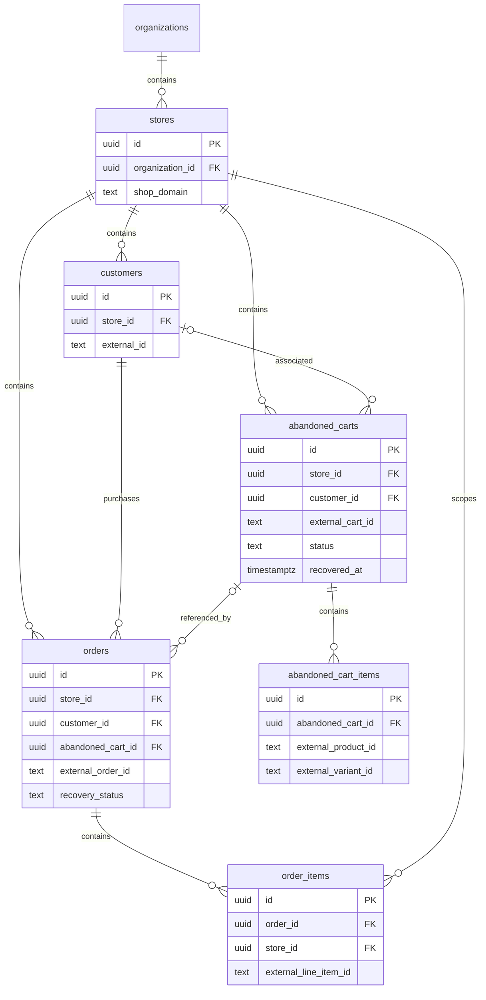

# REVLUMA — TASK 009 EXECUTION REPORT

## A. Task Identification

- **Task:** 009 — Map checkout/order Prisma models.
- **Scope:** Strictly read-only database architecture inspection.
- **Repository:** Revluma-Organization/Revluma; production service tracks `main`.
- **Inspected commit:** `cfb41b7b468bfecd537d841d55c450ff21673342`, detached local checkout.
- **Production backend revision:** Same SHA, reconfirmed through Render live deployment `dep-dbhqdso8v5cc7395g6i0` for `Revluma-backend` in the previously authorized My Workspace.
- **Authoritative Prisma schema:** `Backend/prisma/schema.prisma`.
- **Prisma / @prisma/client:** Package ranges `^6.19.3`; lockfile resolves Prisma to `6.19.3`.
- **Database:** PostgreSQL; connected Supabase project `Revluma-Database`, ref `jblpgqmbgdlzitprudgt`, eu-west-1, reported engine PostgreSQL 17.
- **Evidence boundary:** The connected Revluma database was inspected directly using catalog metadata. Render's effective DATABASE_URL was not available through a read-only environment getter, so the exact deployed backend-to-project connection was not independently proved. Database findings below are authoritative for the connected named project, without silently extending that proof to an unseen connection setting.

No schema/client generation, migrations, application tests, live synchronization, writes, commits or deployments ran during Task 009. Source references S1–S14 are immutable production-commit links in the source register. DB1–DB3 identify the read-only metadata queries described below. No customer rows, tokens or full webhook payloads were read.

## B. Prisma Architecture

**VERIFIED:** The active config is `Backend/prisma.config.ts:1–17`, specifying `prisma/schema.prisma`. The generator uses `prisma-client-js`; datasource uses PostgreSQL, `DATABASE_URL` and `DIRECT_URL` (S1:1–9). No explicit relationMode override exists. Actual PostgreSQL foreign keys were verified through DB1.

`Backend/src/configs/database.js:1–19` imports `@prisma/client`, creates/reuses one client (`global.prismaInstance` outside production), and exports the shared instance. No active import of the older generated client/schema path was found in Backend application code. Raw SQL also exists: checkout advisory locks, feature-worker selection and Rev conversation operations; it is not an exclusively Prisma-query application.

A second **tracked legacy schema**, `Backend/src/generated/prisma/schema.prisma`, contains Tenant/Store/Customer/Session and Plan/Role/Platform/SyncStatus enums. It is not the active schema and has no checkout/order models. Its global-domain uniqueness, enum statuses and `@updatedAt` definitions must not be attributed to the active models. The active schema contains no Prisma enum declarations. RLS policies and the live `app.current_org_id()` function are database objects not represented by the active Prisma models.

Relevant committed migrations:

| Migration | Relevant evidence |
|---|---|
| `0_baseline` | Defines stores, customers, abandoned_carts, abandoned_cart_items and orders, their basic keys/FKs. File is UTF-16; line references use decoded logical lines. No order_items creation. |
| `202609200001_add_pixel_event_contract` | Adds store tracking key and event provenance/receipt fields and indexes. |
| `202609200002_add_webhook_deliveries` | Delivery deduplication ledger, separate from business lifecycle. |
| `202609200003_add_training_observations` | Adds cart sensitivity fields and auxiliary training references. |
| `202609220001_add_cart_recovery_contract` | Adds recovery_url and nonunique store/external cart index. |
| `20261019180000_shopify_webhook_setup_observability` | Subscription setup timestamps/attempts, not checkout lifecycle. |
| `20261026190000_shopify_granted_scopes` | Adds stores.granted_scopes. |
| `20261027140000_intelligence_findings` | Findings and bounded order-coverage metadata; not per-purchase reconciliation. |

Other committed migration directories are included in the migration comparison in section L. `prisma/migrations/manual_changes.sql` is a UTF-16 script/output artifact, not a normal named migration; no order_items creation was found there or in `Backend/migration_temp.sql`. Every committed SQL file was searched with encoding-aware inspection where needed. The active model and live order_items table exist despite absent committed creation SQL.

## C. Store and Tenant Relationships

`stores.id` is required UUID PK with gen_random_uuid default. Required organization_id references organizations.id with cascade delete. platform/shop_domain/status are required strings; status defaults not_connected. access_token, granted_scopes, installed_at, last_synced_at and nullable creation/update timestamps hold connection metadata. There is no dedicated persisted Shopify shop numeric ID/GID. S1:241–280; DB1.

`(organization_id,shop_domain)` is unique: one organization can own multiple store rows/domains, while the same domain can appear under different organizations. No DB case-folding/normalization rule is declared. OAuth lowercases the requested domain before upsert; webhook routing uses provider/domain first-match lookup. Thus normalization and correct ownership are application responsibilities; the schema does not globally bind a Shopify domain to one merchant.

Every checkout and order has a required store_id FK. Their customer/checkout relations are **single-column UUID FKs**, with no composite same-store constraint. Existence is enforced; matching store ownership between referenced records is not. An order can structurally reference another store's customer or checkout, and an order item can reference an order whose store differs from the item's store_id. No such cross-tenant data was queried or created.

Live RLS: enabled and forced on stores/customers/abandoned_carts/abandoned_cart_items/orders. Policies filter via `app.current_org_id()` and store organization; cart items inherit through their parent cart. order_items has RLS enabled, not forced, and **no policy** in pg_policies. The helper reads `current_setting('app.current_org_id',true)::uuid`, returning null on error. No backend setter of this session setting was found in the inspected source. Effective backend DB role/bypass privileges and session setup outside source remain unverified. RLS is therefore a verified structure, not a proven end-to-end isolation guarantee. It also does not supply a composite same-store FK.

For the live FOR ALL policies, null with_check does **not** mean unchecked writes: PostgreSQL uses USING as WITH CHECK when an ALL/UPDATE policy omits it. A table with enabled RLS and no applicable policy defaults to deny for roles subject to RLS. No role-switching or production authorization test was run. [PostgreSQL policy semantics](https://www.postgresql.org/docs/17/sql-createpolicy.html).

## D. Checkout Models

| Model | Purpose | PK | Store/customer | Order relationship | Constraints |
|---|---|---|---|---|---|
| `abandoned_carts` | Stores pending/abandoned/recovered Shopify checkout subset, despite name | UUID id | Required store; optional customer | Inverse `orders[]` | PK, store/customer/sequence FKs; nonunique `(store_id,external_cart_id)` index; no lifecycle CHECK |
| `abandoned_cart_items` | Checkout product snapshots | UUID id | Through required parent cart; no independent store_id/customer_id | None | Cart FK cascade; indexes parent and product string; no business line identity uniqueness |
| `events` | Generic event/pixel stream with JSON payload | UUID id | Required store, optional customer | No typed checkout/order FK | Optional source_event_id composite unique; payload can contain event context but is not a reconciliation ledger |
| `webhook_deliveries` | Delivery receipt/status/error tracking | UUID id | Required store | No direct cart/order FK | Unique provider+delivery_id; receipt/processed timestamps, no persisted commerce payload |
| `sensitivity_training_observations` | Legacy training observations with optional cart reference | UUID id | Required store/customer/organization | None | Optional cart FK SetNull; not authoritative lifecycle history |
| `sequences`, `sequence_sends`, `sequence_events` | Legacy recovery configuration/delivery metadata | UUID ids | Store/customer relations as defined | Coupon/cart hints in JSON metadata, not purchase proof model | Not a checkout-order join table |

Core checkout fields: external_cart_id String?, recovery_url String?, session_id String?, cart_value Decimal(10,2), currency String? default USD, status String? default abandoned, abandoned_at required timestamptz, recovered_at nullable, created_at/updated_at nullable with now defaults. Legacy pss/css/tss scores, recovery_action, sensitivity model/time and optional sequence reference also exist. The full field inventory is in Appendix A. S1:342–390,459–478,1123–1161,1407–1421,1445–1466.

No dedicated Checkout, checkout-alias, checkout status history, completion-proof, unmatched-reconciliation or checkout-to-order join model was found. `intelligence_order_coverage` proves a bounded dataset interval; it does not record an individual checkout relationship.

## E. Order Models

| Model | Purpose | PK | Store/customer | Checkout relation | Constraints |
|---|---|---|---|---|---|
| `orders` | Purchase totals and legacy recovery/attribution state | UUID id | Required store and customer | Nullable abandoned_cart_id → abandoned_carts.id | Unique `(store_id,external_order_id)`; PK and FKs; customer/order-date index |
| `order_items` | Product snapshot per external order line | UUID id | Required store and parent order | Through order only | Unique `(store_id,external_line_item_id)`; parent/store FKs; time/product-type indexes |

Order fields are total/subtotal/discount_amount, currency, coupon flags/code, recovery_status, attribution channel/sequence, optional cart link/session, ordered_at, created_at and floating-point discount_pct. No paid state, financial_status, fulfillment_status, cancelled_at/reason, refund amount/list, source updatedAt or internal updated_at exists. `payment_transactions` is organization Paystack subscription billing, not Shopify order transactions/refunds; it must not be treated as store purchase history. S1:396–422,647–664,1164–1184.

## F. Shopify Identifiers

| Entity / identifier | Stored field/type | Nullable | Unique / scope | Verified usage |
|---|---|---|---|---|
| Store internal ID | stores.id String / UUID | No | PK global | Parent of all store records |
| Shopify domain | stores.shop_domain String / text | No | Composite org+domain | OAuth upsert, webhook lookup |
| Checkout internal ID | abandoned_carts.id String / UUID | No | PK | Parent line items; target order FK |
| Checkout ID or token selected from payload | external_cart_id String / text | Yes | **Not unique**; store+external index | Prefer checkout_id, then id, then cart_token, then checkout_token, then reject empty |
| Separate checkout_token / cart_token | No dedicated fields or alias rows | N/A | None | Order handler uses incoming candidates transiently; not persisted independently |
| Checkout GID | No dedicated field | N/A | None | Historical externalId strips GID prefix; webhook handler String-converts selected value |
| Order internal ID | orders.id String / UUID | No | PK | Parent order_items |
| Shopify order ID | external_order_id String / text | No | Unique store+ID | Upsert key; historical GID tail, webhook String(payload.id/order_id) |
| Shopify order GID / name | No dedicated fields | N/A | None | Full GID and order display name not retained in this model |
| Order source checkout IDs/tokens | No dedicated fields | N/A | None | Only resulting internal abandoned_cart_id can persist |
| Customer external ID | customers.external_id String / text | No | Unique store+ID | Customer upserts; guest fallback `order:{payload.id}` |
| External order line | order_items.external_line_item_id String / text | No | Unique store+line ID | Shopify line ID or constructed fallback |
| Checkout external line ID | No dedicated field | N/A | None | Snapshot rows rebuilt; only internal UUID PK |
| Product / variant references | external_product_id, external_variant_id text | Checkout product required; other product/variant refs nullable | No product FK/unique business key | Snapshot fields survive catalog deletion |

S1 core fields; S2:57–70,117–120,188–220,275–298; S3:34–36,116–145,225–245.

Text columns can store large numeric identifiers without DB integer overflow. However webhook JSON is parsed with ordinary JSON.parse (S4:52), so a numeric literal above JavaScript's safe integer range can lose precision **before** String conversion; changing storage to text alone does not fix that boundary. This is a source-supported precision risk, not a claim that received Shopify IDs were too large. GID-tail normalization only on historical paths can also differ from a raw full-GID webhook value; payload evidence has not been inspected in this task.

Missing order identifiers are not rejected by `String(payload.id || payload.order_id)`: both missing can become literal `undefined`, a nonnull text value that the unique key will accept once per store. Empty strings and alternate-format aliases are not DB-constrained. Multiple tokens for one checkout are not represented as an identity set; lookup may choose one of multiple candidate records by updated_at.

## G. Checkout-to-Order Relationships

| Source | Field → target | Cardinality / required | Live enforcement |
|---|---|---|---|
| orders | abandoned_cart_id → abandoned_carts.id | Each order zero/one cart; each cart zero/many orders | Nullable FK, **not unique**, DELETE SET NULL |
| abandoned_carts | orders[] → orders | Zero/many inverse | Same FK; not a second stored relationship |
| orders | customer_id → customers.id | One required customer; many orders per customer | Required FK, DELETE RESTRICT |
| abandoned_carts | customer_id → customers.id | Optional customer; many carts per customer | Nullable FK, DELETE SET NULL |
| order_items | order_id → orders.id | One parent; parent zero/many lines | Required FK, DELETE CASCADE |
| abandoned_cart_items | abandoned_cart_id → abandoned_carts.id | One parent; parent zero/many lines | Required FK, DELETE CASCADE |

S1:364–367,410–419,1178–1179; DB1.

An order has one FK slot, so it cannot simultaneously point to several carts in that field. A cart can be claimed by several orders because no uniqueness exists on orders.abandoned_cart_id. FKs cannot determine whether a match is authoritative. No verified-vs-inferred flag, matching method/source evidence, conflict status or unresolved reason exists. Null represents both unavailable and not-yet-resolved relationships.

`upsertOrder` matches incoming checkout_id/cart_token/checkout_token within store; if none match, it can use coupon metadata from sequence_sends. No customer/email/amount/time-only fallback was found in that helper. Matching updates order relation and cart recovered state in its transaction. Historical orderPayload omits the checkout identifiers, and checkout ingestion has no reverse order lookup. A completedAt checkout can be marked recovered with no order link. These structures partially support purchase linkage but do not certify or protect authoritative one-to-one reconciliation. S2:210–255; S3:116–145.

## H. Lifecycle and Timestamps

**Checkout state:** nullable free-text status, DB default abandoned; application helpers write pending/recovered, scheduler writes abandoned. No status enum/CHECK or trigger requires recovered_at when recovered, forbids abandoned with recovered_at, or enforces correspondence between linked order and status. completed_at is **not** a persisted column; incoming completed_at is translated to recovered_at. A recovered cart retains required abandoned_at. Names alone therefore do not provide unambiguous lifecycle semantics. S1:351–356; S2:300–315; S5.

**Order state:** nullable recovery_status is the only lifecycle-like field; upsert sets completed or recovered, cancellation handler writes cancelled only for an existing order. Financial statuses are used in import branching but not preserved. Partial/full refund evidence reduces stored total, with no separate gross/refund/status ledger. Paid/unpaid and fulfilled/unfulfilled cannot be distinguished reliably from these persisted fields. No order state history exists.

| Field | Model | Type / nullable / default | Verified meaning |
|---|---|---|---|
| created_at | abandoned_carts | timestamptz(6), yes, now | Internal creation, not dedicated source checkout creation |
| abandoned_at | abandoned_carts | timestamptz(6), no, none | Handler preserves existing value or initializes from source created_at; **not actual classification time** |
| updated_at | abandoned_carts | timestamptz(6), yes, now | Usually last source activity, but order reconciliation overwrites with internal now |
| recovered_at | abandoned_carts | timestamptz(6), yes, none | Source completed_at or linked order's created_at |
| ordered_at | orders | timestamptz(6), no, none | Source order creation, fallback current time |
| created_at | orders | timestamptz(6), yes, now | Internal insertion |
| created_at | abandoned_cart_items | timestamptz(6), yes, now | Snapshot row insertion; replacement creates new times |
| ordered_at / created_at | order_items | timestamptz(6), no; no / now defaults | Source order creation / internal insertion |
| created_at / updated_at | customers | timestamptz(6), yes, now | Internal fields; updated_at not automatically maintained by Prisma |
| installed_at / last_synced_at | stores | timestamptz(6), yes, none | Connection/install and last successful import |
| received_at / processed_at | webhook_deliveries | timestamptz(6), no/yes, now/none | Separate delivery processing, not checkout activity |
| created_at / received_at | events | timestamptz(6), yes/no, now/now | Generic event and receipt timestamps, not typed lifecycle links |

No `@updatedAt` exists in the six active core models, and DB1 found no noninternal triggers on them. No dedicated source_updated_at, last_activity_at, abandoned_classified_at, completion proof timestamp or per-cart webhook-receipt field was found.

The 15-minute job checks pending + recovered_at null + updated_at <= cutoff; store must be active/connected/syncing. It updates status alone. No DB CHECK enforces the threshold, no completed-order existence check is in the job, and timestamp nulls are ineligible. Fresh noncompletion sync may reset abandoned to pending while preserving old activity time; completed/recovered protection and stale-event handling are application logic. No abandonment eligibility composite index exists. S6:719–733; S2:300–315; S5:5–24.

## I. Financial and Product Data

| Model.field | Prisma / database | Nullable | Currency association |
|---|---|---|---|
| abandoned_carts.cart_value | Decimal / numeric(10,2) | No | Parent currency nullable text, default USD |
| abandoned_cart_items.price | Decimal / numeric(10,2) | No | Inherits cart currency; no line currency column |
| orders.total | Decimal / numeric(10,2) | No | Order currency nullable text, default USD |
| orders.subtotal, discount_amount | Decimal / numeric(10,2) | Yes | Same order currency |
| orders.discount_pct | Float / double precision | Yes | Ratio, not monetary storage |
| order_items.unit_price | Decimal / numeric(10,2) | No | Inherits order currency; no own currency field |
| order_items.line_total | Decimal / numeric(12,2) | No | Inherits order currency |
| customers.ltv | Decimal / numeric(10,2), default 0 | Yes | No independent currency field; store/customer aggregate can mix order currencies unless application prevents it |

DB1 confirmed these types. Numeric(10,2) allows eight integer digits; numeric(12,2) allows ten. All values are fixed to two decimals regardless of currency minor units. No nonnegative total/price/quantity CHECK or ISO-currency validation exists in the core tables. Handler arithmetic converts to JS Number before Decimal persistence and computes line_total by multiplication; exact DB storage does not eliminate earlier binary floating-point rounding. Unknown amounts/currency may become 0/USD in application fallbacks, obscuring missing data. No tax, shipping, dedicated refund amount or checkout subtotal fields were found.

Checkout → abandoned_cart_items is a real parent FK. Order → order_items is a real parent FK. Product/variant identifiers on those rows are scalar snapshots, **not** product/variant FKs. Product deletion cannot remove historical lines through a catalog relation that does not exist. Multiple lines and quantity/name/unit price are supported. Checkout variant_name/image_url/product_url exist but the inspected ingest does not populate them; order product_type likewise remains unset by the shared order writer. Checkout has no source line-ID uniqueness; order line uniqueness is scoped to store rather than parent order. Constructed fallback IDs can collide when multiple lines share fallback inputs.

The schema permits zero line items on either parent. Missing product context is therefore not a missing structural capability: API availability, payload mapping, nested 250-item limits and persistence behavior are the main inspected sources of missing details. Empty payload item lists preserve previous cart items; nonempty lists replace snapshots. Order item updates change quantity/prices/date but retain previously inserted name/product references and do not delete removed source lines. S2:188–207,320–334; S3:137–144,273–287.

**Customer handling:** checkouts allow null customer FK; orders require a customer. Handler creates a synthetic `order:{id}` customer and redacted.invalid email for guest orders. No guest boolean differentiates synthetic vs authoritative customer identity. A later checkout event can populate its customer_id, but missing customer data on an accepted newer event can clear it. The FK enforces customer existence, not customer.store_id equality. S2:57–70,135–156,278–315.

## J. Constraints, Indexes and Referential Actions

Live DB1 returned **21 constraints and 28 indexes across the six tables**, including six PKs, twelve FKs and three UNIQUE constraints. Additional unique indexes include order line identity and public tracking key. No core CHECK constraint and no noninternal trigger was found. Appendix B lists every live constraint/index definition.

| Identity rule | Enforced? | Limit |
|---|---|---|
| Store id, customer id, cart id, cart-line id, order id, order-line id | UUID primary keys | Internal IDs alone do not deduplicate external business records |
| Store organization+domain | Unique | Not globally unique or case-insensitive |
| Customer store+external ID | Unique | Missing/synthetic identity quality remains application logic |
| Order store+external ID | Unique | Blank/undefined textual IDs and inconsistent formatting can pass |
| Order line store+external line ID | Unique index | Does not enforce order's store; fallback IDs can collide |
| Cart store+external ID | **Not unique** | Nonunique lookup index; duplicates and null external identifiers structurally allowed |
| Checkout source line identity | **Not found** | Only each internal UUID is unique |
| One order per checkout | **Not enforced** | Nullable cart FK lacks unique index |
| Same store for order/customer/cart/item | **Not enforced by FK** | Single-column FKs require only referenced existence |
| Lifecycle/time/quantity/financial consistency | **Not enforced by CHECK/trigger** | Application must validate |

Index/query assessment:

- `idx_abandoned_carts_store_external(store_id,external_cart_id)` supports store-scoped exact ID/token candidate searches, but sorting candidates by updated_at needs additional work. No independent token field/index exists.
- `uq_orders_store_external(store_id,external_order_id)` supports store-specific order upsert/lookup. Its prefix supports store filtering, but it does not provide `(store_id,ordered_at)` ordering/range coverage.
- `orders_customer_id_ordered_at_idx(customer_id,ordered_at DESC)` supports customer totals/history; store/time intelligence queries still lack a dedicated index on their pair.
- `order_items_order_id_idx`, `(store_id,ordered_at)` and `(store_id,product_type,ordered_at)` support item parent/time/product-type analysis.
- Cart-item indexes cover parent and external product, not uniqueness.
- No index was found on orders.abandoned_cart_id, carts.customer_id, or a cart status/recovered_at/updated_at eligibility combination. These are source-supported index coverage concerns; no production EXPLAIN, latency diagnosis or expensive query plan ran.

Live FK delete actions: store deletion cascades to customers/carts/orders/order_items; cart deletion cascades cart items and sets order.cart link null; order deletion cascades order_items; customer deletion sets cart customer null but is restricted by existing orders; sequence deletion sets attribution/recovery references null. All core live FKs use default ON UPDATE NO ACTION. Store/organization deletion can erase operational history by design; Task 009 does not classify that policy as inherently wrong. Cross-store inconsistent relations, if present, could complicate cascade/restrict behavior. External product deletion has no direct line-item cascade.

## K. Model Usage and Transactions

| Backend component | Reads | Writes / boundary | Relevant guard |
|---|---|---|---|
| Order create/update dispatcher → upsertOrder | Customer/order keys, candidates, sequence send metadata, totals | Customer/order/item upserts, cart recovery/link, customer total aggregate update in one transaction | Unique store+order/customer/line IDs; no order source freshness gate |
| Order cancellation/deletion → cancelOrder | Existing store+order key | Update recovery_status + customer totals in one transaction | Does not insert missing cancelled order |
| Checkout create/update → upsertAbandonedCart | Customer key, cart store+external key | Customer upsert outside cart transaction; advisory lock + cart and nonempty item replacement inside transaction | Source timestamp stale check; sticky recovered; no DB cart uniqueness |
| Abandonment promotion | Pending/unrecovered old updated_at with store status filter | Single updateMany status change | 15-minute app cutoff; no order join or DB state rule |
| Historical customer/order sync | Root API records; same store keys | Customer standalone upserts; order shared transaction | Historical normalization differs; no lifecycle source timestamps persisted |
| Historical checkout sync | Shared cart result, then items | Shared transaction plus **second item delete/create transaction** | Second transaction lacks advisory lock/freshness recheck |
| Webhook delivery ledger | Provider+delivery ID | Claim before processing; mark processed after business transaction | Delivery success state and business state are separate commits |

S2:37–54,117–337,358–402; S3:71–145,184–223,268–287; S4:46–64; S6:719–733.

An order cannot partially commit its submitted lines if a line write in the shared transaction fails, but it can legitimately commit with an empty source item list: DB imposes no at-least-one-item rule. Checkout customer upsert can survive a later cart failure. completedAt alone can produce recovered state with no order relation. An order match updates link/state together, but schema permits them to be independently changed by another writer. The second historical item transaction can fail after cart/header/first item replacement already committed, and it can replace newer item data after the shared handler rejected stale input. Advisory locks protect cooperating cart writers using the same chosen external identifier; order reconciliation does not take that same lock. No global transactional guarantee covers Shopify reads, per-resource loops, progress state or webhook receipt status.

## L. Production Schema Alignment

**Classification: Mismatch detected — migration history/reproducibility; sampled live core model definitions align.**

The following claims apply to the connected Revluma-Database project. Exact Render DATABASE_URL binding and backend role semantics remain unverified as stated in A.

| Layer | Observed result |
|---|---|
| Declared core model scalar fields | Six active models declare 105 scalar columns total. |
| Live table columns | Same 105 columns; no missing/extra core columns. UUID/text/integer/bool/float/numeric/time types, nullability and declared decimal precision match. |
| Defaults | Default presence and values match after normalizing text casts and treating order_items.created_at CURRENT_TIMESTAMP as equivalent to Prisma now(). No automatic update trigger found. |
| Keys, relations and indexes | Expected core PK/FK/unique/index structures present. Same-store composite protection and cart external-ID uniqueness are absent in declaration and live DB. |
| Migration application ledger | 11 named migrations recorded; all finished_at nonnull, rolled_back_at null. `0_baseline` has applied_steps_count 0, consistent with a marked baseline rather than proof its current SQL executed. Other ten have applied_steps_count 1. |
| Migration checksums | Other ten match SHA-256 of committed files; `0_baseline` does not. |
| Extra live objects | Organization RLS policies and app.current_org_id function not represented in active Prisma; no committed core RLS creation SQL found. order_items creation and several declared/live indexes are not accounted for by committed migration SQL. |

Exact baseline evidence:

- Ledger checksum: `c5be4436e28cb027cd169785b629bed8c5473fb520f387902c644debf035dc51`.
- Current production-commit file SHA-256: `930a525c73300e3bd9204289c243a22b2add884584e57c337e55893f6a20e7a5`.
- Committed file is UTF-16. Decoding to UTF-8 and normalizing LF or CRLF did not reproduce the ledger checksum. This is a confirmed artifact mismatch; it does not, by itself, show incorrect live business rows or prove why the baseline changed.
- `order_items` exists with 13 columns and expected FKs/indexes in live catalog, but no order_items occurrence was found in any committed SQL file after decoding UTF-16 artifacts. A clean rebuild from committed migrations alone is therefore not established. No rebuild was attempted.
- The tracking-key migration declares a partial nonnull unique index, while the live index has no predicate and Prisma declares @unique. Uniqueness of nonnull tracking keys is still enforced; this is an index-definition difference between migration and live state, not evidence of duplicate keys.

**Read-only evidence queries:**

- **DB1:** Selected columns/defaults/type metadata from information_schema.columns; constraint definitions/validation from pg_constraint; indexes from pg_indexes; RLS flags from pg_class; policies from pg_policies; noninternal triggers from pg_trigger, restricted to the six core tables; checked _prisma_migrations table existence.
- **DB2:** Selected migration_name, started_at, finished_at, rolled_back_at, applied_steps_count and checksum from _prisma_migrations. No logs/customer records were requested.
- **DB3:** Read pg_get_functiondef for app.current_org_id only; it reads a session setting and returns null on errors. No function was invoked to set a tenant.

No database read retrieved customer emails, names, order contents, access tokens or payloads. No production write or role-changing statement ran. No Prisma db pull/push, generation, migration status/deploy/reset, EXPLAIN or application test ran. Verification used read-only metadata plus local text/hash comparison. Supabase changelog was retrieved and reviewed as a metadata-only workflow; no feature implementation/change was involved.

## M. Entity-Relationship Diagram

Core persisted relations below are verified in both active schema and connected live catalog. Product/variant references are text snapshots, so no product relationship is invented.

The zero-or-one cart endpoint expresses the nullable order FK; the many-order endpoint is deliberate. Separate single-column FKs do not express same-store equality. Auxiliary optional sequence/training references and delivery/event ledgers are inventoried separately to keep this diagram focused.

## N. Findings and Risks

**VERIFIED** means the described structure or absence was inspected in source/catalog, not that a production incident occurred. Severity describes potential merchant impact. Existing future task numbers come from the Atomic MVP Execution Backlog; none was begun here.

| Finding / classification | Severity | Exact evidence | Potential merchant impact | Related task |
|---|---|---|---|---|
| Checkout identity only partially protected — PARTIALLY IMPLEMENTED | High | S1:346,370; DB1 nonunique idx_abandoned_carts_store_external; no matching unique constraint | Concurrent/direct/alias writes can yield duplicate checkout business records despite distinct UUIDs | 035–036,075,094 |
| Same-store referential integrity — POTENTIAL DEFECT | High | S1:364,410–419,1178–1179; DB1 single-column FKs | Valid but wrong-store customer/cart/order references can corrupt isolation/metrics | 024,082–086,093–094 |
| Many orders can claim one checkout — VERIFIED limitation | High | S1:367,410,416; DB1 nullable nonunique FK | Conflicting relationships cannot be rejected at DB level | 026–027 |
| Checkout/order proof and unresolved state — PARTIALLY IMPLEMENTED | High | S1 core models lack match method/evidence fields; S2:210–255 | Null link cannot distinguish unavailable evidence from unresolved processing; coupon inference shares same link | 023–028,048 |
| Lifecycle strings and consistency checks — PARTIALLY IMPLEMENTED | High | S1:351–356,407; DB1 no CHECK/trigger | Recovered with no recovery time, abandoned with order, or invalid state is structurally allowed | 015,029–030,046–047 |
| Historical order identifiers omitted — POTENTIAL DEFECT | High | S3:116–145; S2:212–220 | Historical purchase cannot use primary exact checkout/token match | 028,041,044–045 |
| Financial/fulfillment lifecycle evidence — NOT FOUND | High | S1:396–422 | Paid/unpaid, refunds and fulfillment cannot be reliably reconstructed from totals/status | 015,077–080,113–114 |
| Activity/processing timestamps conflated — POTENTIAL DEFECT | Medium | S2:245,302–315; S6:719–733; S1:352–356 | Inactivity and historical event ordering depend on overloaded timestamps; actual abandonment time unavailable | 007,029–033,067,076 |
| Missing identifiers accepted as text — POTENTIAL DEFECT | High | S2:119 String conversion; S1:400 only nonnull unique | Malformed orders can collide under literal undefined; no blank/noncanonical identity guard | 028,041,074,094 |
| Numeric payload ID precision boundary — POTENTIAL DEFECT | Medium | S4:52 JSON.parse; S2:119,276 | Unsafe numeric literal can lose precision before text storage; occurrence unverified | 013–014,028 |
| Line-item context support — VERIFIED; completeness PARTIAL | Medium | S1:375–390,1164–1184; S2:188–207,320–334; S3 nested first:250 | Parents may have zero lines; source line duplicates/fallback collisions and truncation remain possible | 066–067,076,080 |
| Stale second checkout-item transaction — POTENTIAL DEFECT | High | S3:273–287; S2:303–304 | Newer item snapshots can be replaced after stale header protection returned existing cart | 036,076 |
| Monetary rounding/missing-data semantics — POTENTIAL DEFECT | Medium | S1 numeric(10,2)/(12,2); S2:121–132,191–203,310–311 | Two-decimal scale/Number arithmetic/default 0/USD can misrepresent currency or unknowns | 078–080,108,129 |
| Query index coverage — VERIFIED limitation | Medium | DB1 28 index definitions; S6 promotion; S14 store/time orders query | No dedicated inactivity/store-time/cart-link index; performance unmeasured | 095 |
| Cascade policy — VERIFIED structure | Medium | DB1 FK DELETE CASCADE/SET NULL/RESTRICT; S1 relation declarations | Store deletion erases history, cart deletion removes purchase link; retention suitability needs scoped review | 081,094,099 |
| Effective RLS enforcement — IMPLEMENTED — NOT VERIFIED | High | DB1 enabled/forced flags/policies; DB3 session setting; S7 no setter | Backend tenant context/bypass and order_items policy absence could cause either denied operations or reliance on privileged access | 082–086,093,358 |
| Migration baseline divergence — VERIFIED mismatch | High | DB2 checksum versus committed SHA-256 in L; UTF-16 artifact | Migration reproducibility/audit cannot be assumed from finished rows | 099,365 |
| Missing creation history for live objects — VERIFIED evidence gap | High | DB1 order_items/RLS; encoding-aware committed SQL search | Clean environment may not recreate current schema/security | 099,365 |
| Legacy alternate schema — VERIFIED ambiguity | Low | S8 vs S1/S7 | Tools pointed at obsolete schema could infer wrong enums/keys; no active import found | 009,099 |

No customer data integrity counts, exploit checks, cross-merchant tests or production race reproductions were performed. Potential defects are source/catalog-supported risks, not confirmed corrupt rows. The audit does not add advanced CRM, attribution, autonomous campaigns or additional platforms.

## O. Changes Made

**No changes — read-only database architecture inspection.**

Only this report was created. No tracked repository changes, Prisma client generation, migrations, constraints/index changes, DB writes, environment changes, sync/webhook actions, service restarts, commits or PRs. Final git status was checked for tracked changes.

## P. Final Status

**PARTIAL — Models identified, but important relationships or deployed schema details remain unverified.**

The core architecture, 105 live scalar columns, keys/relations/indexes, timestamps, financial/line-item storage and application transaction usage are mapped. Connected database metadata confirms structural limitations and migration divergence. Exact production connection binding, effective backend RLS role/context, business relationship correctness and complete migration reproducibility are not established. No claim of production readiness is made.

## Q. Next Task

**TASK 010 — Map existing checkout reconciliation tests.**

Task 010 has not begun. No fixes for this report's findings were implemented.

## Appendix A — Complete Core Scalar Field Map

The following table was generated from the inspected active schema and live metadata. Related entity fields are omitted because relations are mapped above; every core scalar column is included. Defaults below are PostgreSQL metadata expressions, not application fallbacks.

### stores

| Column | Prisma | Live DB type | Nullable | Live default |
|---|---|---|---|---|
| id | String | uuid | NO | gen_random_uuid() |
| organization_id | String | uuid | NO | — |
| platform | String | text | NO | — |
| shop_domain | String | text | NO | — |
| access_token | String? | text | YES | — |
| status | String | text | NO | 'not_connected'::text |
| installed_at | DateTime? | timestamp with time zone(6) | YES | — |
| last_synced_at | DateTime? | timestamp with time zone(6) | YES | — |
| created_at | DateTime? | timestamp with time zone(6) | YES | now() |
| updated_at | DateTime? | timestamp with time zone(6) | YES | now() |
| public_tracking_key | String? | text | YES | — |
| granted_scopes | String? | text | YES | — |

### customers

| Column | Prisma | Live DB type | Nullable | Live default |
|---|---|---|---|---|
| id | String | uuid | NO | gen_random_uuid() |
| store_id | String | uuid | NO | — |
| external_id | String | text | NO | — |
| email | String | text | NO | — |
| full_name | String? | text | YES | — |
| phone | String? | text | YES | — |
| anonymous_id | String? | text | YES | — |
| consent_email | Boolean? | boolean | YES | false |
| consent_sms | Boolean? | boolean | YES | false |
| consent_updated_at | DateTime? | timestamp with time zone(6) | YES | — |
| ltv | Decimal? | numeric(10,2) | YES | 0 |
| orders_count | Int? | integer | YES | 0 |
| rfm_recency | Int? | integer | YES | — |
| rfm_frequency | Int? | integer | YES | — |
| rfm_monetary | Int? | integer | YES | — |
| rfm_segment | String? | text | YES | — |
| status | String? | text | YES | 'active'::text |
| created_at | DateTime? | timestamp with time zone(6) | YES | now() |
| updated_at | DateTime? | timestamp with time zone(6) | YES | now() |
| churn_escalate_to_human | Boolean? | boolean | YES | — |
| churn_model_version | String? | text | YES | — |
| churn_offer_required | Boolean? | boolean | YES | — |
| churn_probability | Float? | double precision | YES | — |
| churn_score_fallback | Boolean? | boolean | YES | — |
| churn_scored_at | DateTime? | timestamp with time zone(6) | YES | — |
| churn_tier | String? | text | YES | — |
| engagement_decay_score | Float? | double precision | YES | — |
| primary_churn_signal | String? | text | YES | — |
| recommended_channel | String? | text | YES | — |
| rfm_updated_at | DateTime? | timestamp with time zone(6) | YES | — |
| win_back_urgency | String? | text | YES | — |

### abandoned_carts

| Column | Prisma | Live DB type | Nullable | Live default |
|---|---|---|---|---|
| id | String | uuid | NO | gen_random_uuid() |
| store_id | String | uuid | NO | — |
| customer_id | String? | uuid | YES | — |
| external_cart_id | String? | text | YES | — |
| session_id | String? | text | YES | — |
| cart_value | Decimal | numeric(10,2) | NO | — |
| currency | String? | text | YES | 'USD'::text |
| status | String? | text | YES | 'abandoned'::text |
| abandoned_at | DateTime | timestamp with time zone(6) | NO | — |
| recovered_at | DateTime? | timestamp with time zone(6) | YES | — |
| recovery_sequence_id | String? | uuid | YES | — |
| created_at | DateTime? | timestamp with time zone(6) | YES | now() |
| updated_at | DateTime? | timestamp with time zone(6) | YES | now() |
| css_score | Int? | integer | YES | — |
| pss_score | Int? | integer | YES | — |
| recovery_action | String? | text | YES | — |
| sensitivity_model_version | String? | text | YES | — |
| sensitivity_scored_at | DateTime? | timestamp with time zone(6) | YES | — |
| tss_score | Int? | integer | YES | — |
| recovery_url | String? | text | YES | — |

### abandoned_cart_items

| Column | Prisma | Live DB type | Nullable | Live default |
|---|---|---|---|---|
| id | String | uuid | NO | gen_random_uuid() |
| abandoned_cart_id | String | uuid | NO | — |
| external_product_id | String | text | NO | — |
| external_variant_id | String? | text | YES | — |
| product_name | String | text | NO | — |
| variant_name | String? | text | YES | — |
| price | Decimal | numeric(10,2) | NO | — |
| quantity | Int | integer | NO | — |
| image_url | String? | text | YES | — |
| product_url | String? | text | YES | — |
| created_at | DateTime? | timestamp with time zone(6) | YES | now() |

### orders

| Column | Prisma | Live DB type | Nullable | Live default |
|---|---|---|---|---|
| id | String | uuid | NO | gen_random_uuid() |
| store_id | String | uuid | NO | — |
| customer_id | String | uuid | NO | — |
| external_order_id | String | text | NO | — |
| total | Decimal | numeric(10,2) | NO | — |
| subtotal | Decimal? | numeric(10,2) | YES | — |
| discount_amount | Decimal? | numeric(10,2) | YES | — |
| currency | String? | text | YES | 'USD'::text |
| coupon_used | Boolean? | boolean | YES | false |
| coupon_code | String? | text | YES | — |
| recovery_status | String? | text | YES | — |
| attribution_channel | String? | text | YES | — |
| attribution_sequence_id | String? | uuid | YES | — |
| abandoned_cart_id | String? | uuid | YES | — |
| ordered_at | DateTime | timestamp with time zone(6) | NO | — |
| created_at | DateTime? | timestamp with time zone(6) | YES | now() |
| discount_pct | Float? | double precision | YES | — |
| session_id | String? | text | YES | — |

### order_items

| Column | Prisma | Live DB type | Nullable | Live default |
|---|---|---|---|---|
| id | String | uuid | NO | gen_random_uuid() |
| order_id | String | uuid | NO | — |
| store_id | String | uuid | NO | — |
| external_line_item_id | String | text | NO | — |
| external_product_id | String? | text | YES | — |
| external_variant_id | String? | text | YES | — |
| product_name | String | text | NO | — |
| product_type | String? | text | YES | — |
| quantity | Int | integer | NO | — |
| unit_price | Decimal | numeric(10,2) | NO | — |
| line_total | Decimal | numeric(12,2) | NO | — |
| ordered_at | DateTime | timestamp with time zone(6) | NO | — |
| created_at | DateTime | timestamp with time zone(6) | NO | CURRENT_TIMESTAMP |

## Appendix B — Complete Live Constraint and Index Inventory

| Table | Constraint | Definition | Validated |
|---|---|---|---|
| abandoned_cart_items | abandoned_cart_items_abandoned_cart_id_fkey | FOREIGN KEY (abandoned_cart_id) REFERENCES abandoned_carts(id) ON DELETE CASCADE | True |
| abandoned_cart_items | abandoned_cart_items_pkey | PRIMARY KEY (id) | True |
| abandoned_carts | abandoned_carts_customer_id_fkey | FOREIGN KEY (customer_id) REFERENCES customers(id) ON DELETE SET NULL | True |
| abandoned_carts | abandoned_carts_pkey | PRIMARY KEY (id) | True |
| abandoned_carts | abandoned_carts_recovery_sequence_id_fkey | FOREIGN KEY (recovery_sequence_id) REFERENCES sequences(id) ON DELETE SET NULL | True |
| abandoned_carts | abandoned_carts_store_id_fkey | FOREIGN KEY (store_id) REFERENCES stores(id) ON DELETE CASCADE | True |
| customers | customers_pkey | PRIMARY KEY (id) | True |
| customers | customers_store_id_fkey | FOREIGN KEY (store_id) REFERENCES stores(id) ON DELETE CASCADE | True |
| customers | uq_customers_store_external | UNIQUE (store_id, external_id) | True |
| order_items | order_items_order_id_fkey | FOREIGN KEY (order_id) REFERENCES orders(id) ON DELETE CASCADE | True |
| order_items | order_items_pkey | PRIMARY KEY (id) | True |
| order_items | order_items_store_id_fkey | FOREIGN KEY (store_id) REFERENCES stores(id) ON DELETE CASCADE | True |
| orders | orders_abandoned_cart_id_fkey | FOREIGN KEY (abandoned_cart_id) REFERENCES abandoned_carts(id) ON DELETE SET NULL | True |
| orders | orders_attribution_sequence_id_fkey | FOREIGN KEY (attribution_sequence_id) REFERENCES sequences(id) ON DELETE SET NULL | True |
| orders | orders_customer_id_fkey | FOREIGN KEY (customer_id) REFERENCES customers(id) ON DELETE RESTRICT | True |
| orders | orders_pkey | PRIMARY KEY (id) | True |
| orders | orders_store_id_fkey | FOREIGN KEY (store_id) REFERENCES stores(id) ON DELETE CASCADE | True |
| orders | uq_orders_store_external | UNIQUE (store_id, external_order_id) | True |
| stores | stores_organization_id_fkey | FOREIGN KEY (organization_id) REFERENCES organizations(id) ON DELETE CASCADE | True |
| stores | stores_pkey | PRIMARY KEY (id) | True |
| stores | uq_stores_org_domain | UNIQUE (organization_id, shop_domain) | True |

| Table | Index | Live definition |
|---|---|---|
| abandoned_cart_items | abandoned_cart_items_pkey | CREATE UNIQUE INDEX abandoned_cart_items_pkey ON public.abandoned_cart_items USING btree (id) |
| abandoned_cart_items | idx_cart_items_cart | CREATE INDEX idx_cart_items_cart ON public.abandoned_cart_items USING btree (abandoned_cart_id) |
| abandoned_cart_items | idx_cart_items_product | CREATE INDEX idx_cart_items_product ON public.abandoned_cart_items USING btree (external_product_id) |
| abandoned_carts | abandoned_carts_pkey | CREATE UNIQUE INDEX abandoned_carts_pkey ON public.abandoned_carts USING btree (id) |
| abandoned_carts | idx_abandoned_carts_store_external | CREATE INDEX idx_abandoned_carts_store_external ON public.abandoned_carts USING btree (store_id, external_cart_id) |
| customers | customers_pkey | CREATE UNIQUE INDEX customers_pkey ON public.customers USING btree (id) |
| customers | customers_store_id_churn_tier_churn_scored_at_idx | CREATE INDEX customers_store_id_churn_tier_churn_scored_at_idx ON public.customers USING btree (store_id, churn_tier, churn_scored_at) |
| customers | customers_store_id_rfm_updated_at_idx | CREATE INDEX customers_store_id_rfm_updated_at_idx ON public.customers USING btree (store_id, rfm_updated_at) |
| customers | customers_store_id_status_orders_count_idx | CREATE INDEX customers_store_id_status_orders_count_idx ON public.customers USING btree (store_id, status, orders_count) |
| customers | customers_store_id_status_rfm_segment_idx | CREATE INDEX customers_store_id_status_rfm_segment_idx ON public.customers USING btree (store_id, status, rfm_segment) |
| customers | idx_customers_anonymous | CREATE INDEX idx_customers_anonymous ON public.customers USING btree (anonymous_id) |
| customers | idx_customers_consent_email | CREATE INDEX idx_customers_consent_email ON public.customers USING btree (consent_email) |
| customers | idx_customers_email | CREATE INDEX idx_customers_email ON public.customers USING btree (email) |
| customers | idx_customers_rfm_segment | CREATE INDEX idx_customers_rfm_segment ON public.customers USING btree (rfm_segment) |
| customers | idx_customers_status | CREATE INDEX idx_customers_status ON public.customers USING btree (status) |
| customers | idx_customers_store | CREATE INDEX idx_customers_store ON public.customers USING btree (store_id) |
| customers | uq_customers_store_external | CREATE UNIQUE INDEX uq_customers_store_external ON public.customers USING btree (store_id, external_id) |
| order_items | order_items_order_id_idx | CREATE INDEX order_items_order_id_idx ON public.order_items USING btree (order_id) |
| order_items | order_items_pkey | CREATE UNIQUE INDEX order_items_pkey ON public.order_items USING btree (id) |
| order_items | order_items_store_id_external_line_item_id_key | CREATE UNIQUE INDEX order_items_store_id_external_line_item_id_key ON public.order_items USING btree (store_id, external_line_item_id) |
| order_items | order_items_store_id_ordered_at_idx | CREATE INDEX order_items_store_id_ordered_at_idx ON public.order_items USING btree (store_id, ordered_at) |
| order_items | order_items_store_id_product_type_ordered_at_idx | CREATE INDEX order_items_store_id_product_type_ordered_at_idx ON public.order_items USING btree (store_id, product_type, ordered_at) |
| orders | orders_customer_id_ordered_at_idx | CREATE INDEX orders_customer_id_ordered_at_idx ON public.orders USING btree (customer_id, ordered_at DESC) |
| orders | orders_pkey | CREATE UNIQUE INDEX orders_pkey ON public.orders USING btree (id) |
| orders | uq_orders_store_external | CREATE UNIQUE INDEX uq_orders_store_external ON public.orders USING btree (store_id, external_order_id) |
| stores | stores_pkey | CREATE UNIQUE INDEX stores_pkey ON public.stores USING btree (id) |
| stores | stores_public_tracking_key_key | CREATE UNIQUE INDEX stores_public_tracking_key_key ON public.stores USING btree (public_tracking_key) |
| stores | uq_stores_org_domain | CREATE UNIQUE INDEX uq_stores_org_domain ON public.stores USING btree (organization_id, shop_domain) |

## Source Register

- **S1:** [Backend/prisma/schema.prisma](https://github.com/Revluma-Organization/Revluma/blob/cfb41b7b468bfecd537d841d55c450ff21673342/Backend/prisma/schema.prisma)
- **S2:** [Backend/src/services/commerceWebhookService.js](https://github.com/Revluma-Organization/Revluma/blob/cfb41b7b468bfecd537d841d55c450ff21673342/Backend/src/services/commerceWebhookService.js)
- **S3:** [Backend/src/services/shopifySync.js](https://github.com/Revluma-Organization/Revluma/blob/cfb41b7b468bfecd537d841d55c450ff21673342/Backend/src/services/shopifySync.js)
- **S4:** [Backend/src/controller/commerceWebhookController.js](https://github.com/Revluma-Organization/Revluma/blob/cfb41b7b468bfecd537d841d55c450ff21673342/Backend/src/controller/commerceWebhookController.js)
- **S5:** [Backend/src/services/checkoutInactivity.js](https://github.com/Revluma-Organization/Revluma/blob/cfb41b7b468bfecd537d841d55c450ff21673342/Backend/src/services/checkoutInactivity.js)
- **S6:** [Backend/src/services/schedulerService.js](https://github.com/Revluma-Organization/Revluma/blob/cfb41b7b468bfecd537d841d55c450ff21673342/Backend/src/services/schedulerService.js)
- **S7:** [Backend/src/configs/database.js](https://github.com/Revluma-Organization/Revluma/blob/cfb41b7b468bfecd537d841d55c450ff21673342/Backend/src/configs/database.js)
- **S8:** [Backend/src/generated/prisma/schema.prisma](https://github.com/Revluma-Organization/Revluma/blob/cfb41b7b468bfecd537d841d55c450ff21673342/Backend/src/generated/prisma/schema.prisma)
- **S9:** [Backend/prisma/migrations/0_baseline/migration.sql](https://github.com/Revluma-Organization/Revluma/blob/cfb41b7b468bfecd537d841d55c450ff21673342/Backend/prisma/migrations/0_baseline/migration.sql)
- **S10:** [Backend/prisma.config.ts](https://github.com/Revluma-Organization/Revluma/blob/cfb41b7b468bfecd537d841d55c450ff21673342/Backend/prisma.config.ts)
- **S11:** [Backend/prisma/migrations/202609220001_add_cart_recovery_contract/migration.sql](https://github.com/Revluma-Organization/Revluma/blob/cfb41b7b468bfecd537d841d55c450ff21673342/Backend/prisma/migrations/202609220001_add_cart_recovery_contract/migration.sql)
- **S12:** [Backend/src/services/shopifyService.js](https://github.com/Revluma-Organization/Revluma/blob/cfb41b7b468bfecd537d841d55c450ff21673342/Backend/src/services/shopifyService.js)
- **S13:** [Backend/src/controller/shopifyController.js](https://github.com/Revluma-Organization/Revluma/blob/cfb41b7b468bfecd537d841d55c450ff21673342/Backend/src/controller/shopifyController.js)
- **S14:** [Backend/src/services/intelligenceFindingsAggregator.js](https://github.com/Revluma-Organization/Revluma/blob/cfb41b7b468bfecd537d841d55c450ff21673342/Backend/src/services/intelligenceFindingsAggregator.js)

- **DB1–DB3:** Read-only connected Revluma-Database metadata described in section L. No business rows included.
- [PostgreSQL 17 CREATE POLICY: implicit WITH CHECK and default-deny semantics](https://www.postgresql.org/docs/17/sql-createpolicy.html).
