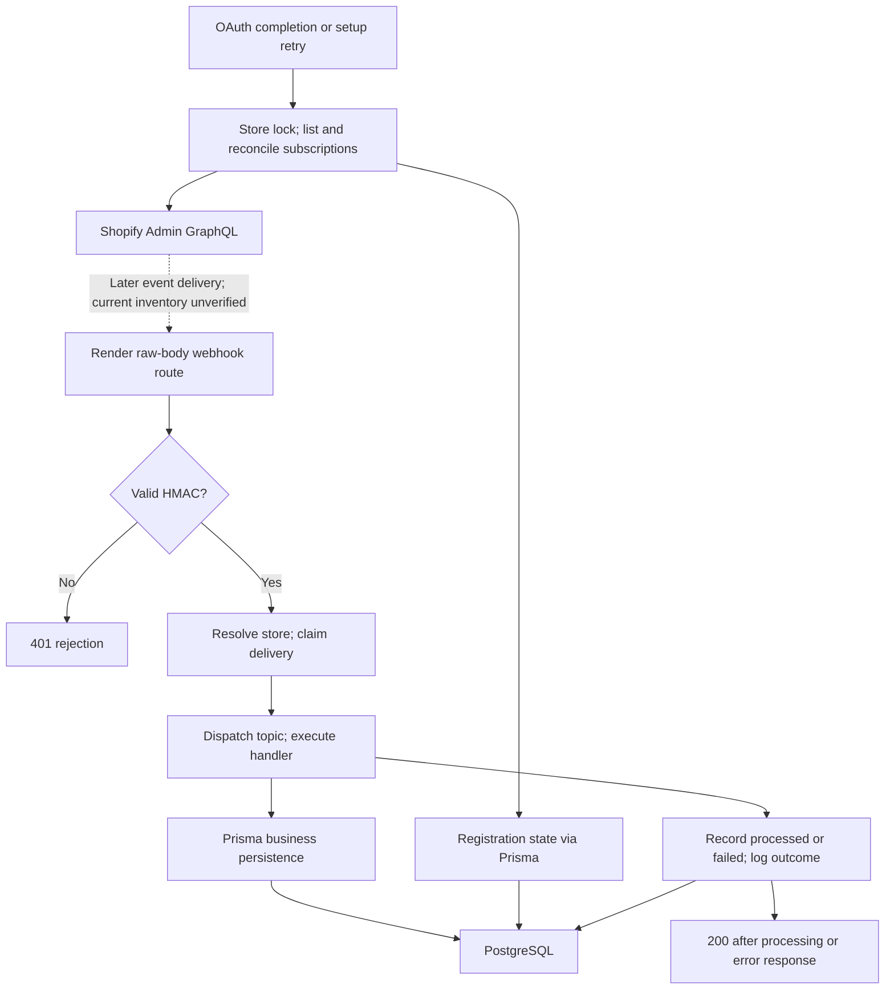

# REVLUMA — TASK 012 EXECUTION REPORT

## 1. Task identification and current execution state

- Task 012 of 406 — Record registered Shopify webhook topics; Phase 1, Reliable Data Foundation; category 1A, Baseline and Architecture.
- Inspection date: 2026-10-30 Africa/Lagos (2026-10-29 UTC).
- Repository: Revluma-Organization/Revluma; inspected main head `db1f6be1ddb0d84d7dac243de290114c698fc6cf`.
- Application source baseline: `cfb41b7b468bfecd537d841d55c450ff21673342`; local Backend diff against production is empty. Source references below use this immutable deployed revision.
- Production: Render My Workspace, Revluma-backend, `srv-db9m6pom7kps73dtk1tg`, live deploy `dep-dbhqdso8v5cc7395g6i0`; independently reconfirmed through list_deploys and signed-in dashboard.
- Production service settings verified read-only: SHOPIFY_API_VERSION=2026-10; BACKEND_URL=https://revluma-backend-vrsd.onrender.com; no linked environment groups. The configured DATABASE_URL was checked only for a boolean match to connected project `jblpgqmbgdlzitprudgt`; match=true. No connection string, username, password, encryption key or access token was emitted or persisted.
- Database: Supabase Revluma-Database, eu-west-1, PostgreSQL17; SELECT-only inspection of schema, registration metadata, store connection metadata and aggregate delivery ledger. No customer/order payloads read.
- Working branch: docs/mvp-task-012. Publication to GitHub main follows the user's standing explicit authorization.
- **COMPLETE — PASS, read-only webhook configuration/registration-evidence/handler audit.** Current all-topic subscription existence remains explicitly UNKNOWN where the available provider dashboard does not enumerate it; this report does not certify9/9 live registrations or end-to-end business correctness.

## 2. Previous documentation reviewed

Reviewed the existing README protocol, audit register, implementation decisions and relevant evidence in [002](TASK-002.md), [003](TASK-003.md), [004](TASK-004.md), [005](TASK-005.md), [006](TASK-006.md), [007](TASK-007.md), [008](TASK-008.md), [009](TASK-009.md), [010](TASK-010.md) and [011](TASK-011.md). Task001 report is still absent; production revision was rechecked directly. Original reports are preserved.

Revalidated the raw-body route, signature/controller/delivery claim, topic dispatch, registration service, setup runner and status reporting against source. Task011's production environment gap was already closed; its independent webhook-payload/served-version finding0104 remains open. Task008's possible duplicate-domain ambiguity now has direct database evidence: two store rows in two organizations share revluma-test-store.myshopify.com. This is additional evidence for REV-FIND-0014, not a duplicate finding or proof of a misrouted event.

## 3. Expected topics and configuration

The sole active Shopify registration list is `REQUIRED_SUBSCRIPTIONS`, frozen in `Backend/src/services/shopifyWebhookService.js:5–15` (S1). It is hardcoded, not environment-configurable or conditionally enabled by topic. All nine flow through `reconcileShopifyWebhooks`. Other commerce/WooCommerce string branches are legacy shared-handler support, not additional configured Shopify subscriptions or expansion of the Shopify-only MVP.

| Admin enum | Callback topic/path | Purpose | Expected configuration |
|---|---|---|---|
| APP_UNINSTALLED | app/uninstalled | Deactivate connection | S1:6 |
| ORDERS_CREATE | orders/create | Insert/update purchase | S1:7 |
| ORDERS_UPDATED | orders/updated | Update purchase | S1:8 |
| ORDERS_CANCELLED | orders/cancelled | Mark cancellation | S1:9 |
| ORDERS_DELETE | orders/delete | Mark local cancellation, preserve history | S1:10 |
| CUSTOMERS_CREATE | customers/create | Upsert customer | S1:11 |
| CUSTOMERS_UPDATE | customers/update | Upsert customer | S1:12 |
| CHECKOUTS_CREATE | checkouts/create | Persist checkout activity/context | S1:13 |
| CHECKOUTS_UPDATE | checkouts/update | Update activity/completion/context | S1:14 |

Presence here establishes expected behavior, not current Shopify registration. No additional topic was found in the queried stored registration records. The subsequent authorized provider inspection found the active app version lists webhook api_version2026-10, with no app-scoped topic subscriptions displayed. This establishes the inspected configuration view, not an exhaustive current shop-scoped subscription inventory.

## 4. Registration mechanism and architecture

S1:17–68 uses the shared Admin GraphQL client, `WebhookSubscriptions` query and `webhookSubscriptionCreate` mutation. The operation acts in the authenticated app-and-shop context; subscriptions created by this mechanism are shop-scoped. No Shopify SDK, REST webhook creator or app TOML registration configuration was found in the repository. Source absence does not establish absence of dashboard-managed app-level subscriptions.

OAuth completion and merchant retry launch `shopifyService.syncShopifyStore` → `shopifySync.syncShopifyStore`; the default runner first reconciles subscriptions. The internal sync route uses the same runner. The periodic scheduler explicitly passes `{reconcileWebhooks:false}` and therefore does not continuously recheck subscriptions. Sources: S6:321–379, S7:129,319, S8:149–161, S9:756.

The runner requires Redis and takes store-specific SET NX EX900 lock; an existing lock skips the run. Lock release checks ownership; no lease renewal is present. Direct registration function invocation is not independently locked. It lists first250 subscriptions, matches exact enum+URI, reuses a match or creates JSON subscription, then upserts its ID and topic state. It neither removes duplicates nor retires old URLs/obsolete stored IDs. The list lacks cursor/pageInfo, so completeness beyond250 is not established. S1:17–27,113–198; S6:321–346,460–465.



No queue/worker is invented here. Store-not-found404 and duplicate200 are detailed below.

## 5. Authoritative Shopify inspection and inventory boundary

The initial checkpoint23f8bfca recorded an authentication block. The user completed verification and requested completion; a fresh signed-in page confirmed Shopify developer organization224123302, app **Revluma389768118273**. Sign-in is now verified, and the earlier authentication blocker is superseded.

The app's **Current installs** page lists exactly three shops, all Installed, with pagination disabled: revluma-test-store-v1 (shop80678518973), PawStore/BYS (102537822534), and revluma-test-store (77248299165). The four Revluma DB rows map to these three domains; the duplicated A/B domain is one Shopify installation, not two provider installations. No contact addresses or credentials were copied into this report.

The active version **Revluma-v1.0 /1173036367873**, releasedOct19, explicitly shows:

- Webhooks api_version **2026-10**.
- Redirect URL `https://revluma-backend-vrsd.onrender.com/api/v1/shopify/callback`.
- Requested read_orders/read_customers and the other configured scopes, matching the inspected production scope settings.
- No app-scoped webhook topic entries in the displayed active-version configuration.

Provider webhook diagnostics for the fresh store independently expose subscription metadata on historical delivery records:

| Topic | Shopify subscription ID | URI | Method | Payload version | Observed delivery result |
|---|---|---|---|---|---|
| orders/updated | gid://shopify/WebhookSubscription/2097267835069 | N/api/v1/webhooks/shopify/orders/updated | Shop specific;http | 2026-10 | Same webhook ID: attempt1 No response from app6001ms; attempt2 200OK1989ms |
| checkouts/create | gid://shopify/WebhookSubscription/2097267998909 | N/api/v1/webhooks/shopify/checkouts/create | Shop specific;http | 2026-10 | Attempt1 200OK3657ms |

N is the current destination base defined in section6. Both IDs/URIs match D's stored provider records. The source registration mechanism and provider **Shop specific** metadata agree. Provider logs also list deliveries for orders/create, checkouts/update, customers/create and customers/update. None of the three no-event topics is declared broken merely because no delivery was observed. No payload body was opened; version/outcome/destination/ID metadata only was used.

**Current complete subscription enumeration remains UNKNOWN.** The available dashboard presents app configuration, installations and historical delivery diagnostics, not an all-topic current Admin subscription list. Installation/billing “Current subscription” is not a webhook subscription. No live Admin `webhookSubscriptions` query was executed, so neither current9/9 existence nor absence/duplicates for the undelivered topics can be certified. Historical delivery metadata establishes that the two inspected IDs existed when delivered, not that they remain active at this instant. Format/filter/includeFields/current state for every provider subscription are unobserved. This limitation is recorded under0107/0111 and future059–061, not converted into VERIFIED REGISTERED.

Read-only access paths assessed: Render connector has no application-query executor; signed-in Shell is unavailable on the free compute plan. No upgrade, job, new credential, API grant, app installation, OAuth restart, registration, retry or sync was used. A discoverable Shopify commerce plugin was not installed: its advertised features do not establish access to **Revluma-owned** app records. Admin subscription queries are app-scoped; another app's empty list would not prove absence. No WebMCP tools were available on the installation page.

The audit acceptance criteria explicitly allow current Shopify subscription state to be **marked unverified** when unavailable. The completed baseline therefore preserves the three-source comparison: all9 expected, exact stored records, provider installation/configuration/delivery evidence, and explicit unknown current enumeration. It is an audit pass with open findings, not a live registration or runtime-readiness certification.

## 6. Database registration records

Live schema matches the active Prisma `webhook_registrations` model (S5:1389–1405):

| Field | Type/nullability | Purpose |
|---|---|---|
| id | UUID required PK | Internal row identity |
| store_id | UUID required FK | Store scope; cascade on store deletion |
| external_id | varchar255 required | Shopify subscription GID **or** setup-state/topic **or** setup-failure/topic |
| topic | varchar100 required | Admin enum form |
| delivery_url | varchar1000 required | Destination recorded at reconciliation |
| status | varchar50 nullable, default active | Provider row active; synthetic state running/succeeded/failed |
| last_error | varchar2000 nullable | Latest sanitized registration error |
| attempt_count | integer required default0 | Synthetic setup-state attempt counter |
| started_at/completed_at | timestamptz nullable | Topic attempt timing |
| created_at/updated_at | timestamp nullable defaultnow | Row lifecycle; app explicitly updates updated_at |

Live unique `(store_id,external_id)` was verified. There is no unique `(store_id,topic)` or destination constraint. Multiple rows for one topic are intentional when one is a GID and the other is synthetic setup state. They are not automatically duplicate Shopify subscriptions. Provider-row attempt_count0 does not imply no attempts: the counts reside in setup-state rows.

Store aliases used throughout this report:

| Alias | Store UUID | Domain | Current stored state | Stored registration snapshot |
|---|---|---|---|---|
| A | 009e5c86-3c27-4b5e-82ed-e6fd6351e779 | revluma-test-store.myshopify.com | active; last sync Oct29 23:07:32.420UTC | 1 provider row; old-host uninstall only |
| B | 6340092e-53ef-4325-9fba-222a42ddac58 | revluma-test-store.myshopify.com | active; last sync Oct29 23:07:19.775UTC | 10 provider rows, 9 succeeded state rows; includes old-host uninstall |
| C | aa269846-51c9-483e-83c9-90780d971d49 | bys-user-store-923319-1ifggjsw.myshopify.com | active; last_synced_at null | 2 provider uninstall rows; 9 state rows; 8 failure rows |
| D | 3ed79446-cb6d-4a1c-b174-9ec1ab91fe15 | revluma-test-store-v1.myshopify.com | active; last sync Oct29 23:07:01.514UTC | 9 provider rows, 9 succeeded state rows |

57 registration rows total:22 provider,27 state,8 failure. All22 provider rows are stored as active. C has eight failed setup-state rows, each with attempt_count642 and error category `topic_rejected`; last completed Oct27 15:00:51.654–15:01:06.223UTC. The last_error values are the same generic topic rejection, not evidence isolating a missing-scope cause. D's nine setup-state attempts are34; last reconciliation Oct27 14:46:51–14:47:12UTC. None of these records was changed by this task.

Stored provider inventory below uses numeric tails of `gid://shopify/WebhookSubscription/`; destination base N=current `https://revluma-backend-vrsd.onrender.com`, O=old `https://revluma-backend.onrender.com`. Append `/api/v1/webhooks/shopify/` plus the path in section3. All are stored status active; HTTPS type inferred from URL. Current Shopify format/filter/active state/app identity/payload version remain unknown.

| Topic | A ID/base | B ID/base | C ID/base | D ID/base |
|---|---|---|---|---|
| APP_UNINSTALLED | 1735428210845/O | 1735428210845/O;1736487239837/N | 2346032333126/O;2353651777862/N | 2097267769533/N |
| ORDERS_CREATE | — | 2091926945949/N | — | 2097267802301/N |
| ORDERS_UPDATED | — | 2091926978717/N | — | 2097267835069/N |
| ORDERS_CANCELLED | — | 2091927011485/N | — | 2097267867837/N |
| ORDERS_DELETE | — | 2091927044253/N | — | 2097267900605/N |
| CUSTOMERS_CREATE | — | 2091927077021/N | — | 2097267933373/N |
| CUSTOMERS_UPDATE | — | 2091927109789/N | — | 2097267966141/N |
| CHECKOUTS_CREATE | — | 2091927142557/N | — | 2097267998909/N |
| CHECKOUTS_UPDATE | — | 2091927175325/N | — | 2097268031677/N |

A and B share one historical GID; B and C each retain two distinct uninstall IDs/destinations. These are **duplicate/stale database candidates**, not verified duplicate live subscriptions. An old host's reachability was not tested.

## 7. Expected versus stored versus Shopify comparison

All nine present in code. Numbers are provider-record counts per topic, excluding synthetic rows. Shopify column applies to **every** store. A dash is no provider GID row, not proof of provider absence.

| Expected topic | Code | A DB | B DB | C DB | D DB | Current Shopify | Classification |
|---|---|---|---|---|---|---|---|
| APP_UNINSTALLED | Yes | 1 | 2 | 2 | 1 | UNKNOWN | DATABASE ONLY — SHOPIFY UNVERIFIED; old-host/duplicate candidates A–C |
| ORDERS_CREATE | Yes | — | 1 | —;failed state | 1 | UNKNOWN | B/D DATABASE ONLY; A/C UNABLE TO DETERMINE |
| ORDERS_UPDATED | Yes | — | 1 | —;failed state | 1 | UNKNOWN | B/D DATABASE ONLY; A/C UNABLE TO DETERMINE |
| ORDERS_CANCELLED | Yes | — | 1 | —;failed state | 1 | UNKNOWN | B/D DATABASE ONLY; A/C UNABLE TO DETERMINE |
| ORDERS_DELETE | Yes | — | 1 | —;failed state | 1 | UNKNOWN | B/D DATABASE ONLY; A/C UNABLE TO DETERMINE |
| CUSTOMERS_CREATE | Yes | — | 1 | —;failed state | 1 | UNKNOWN | B/D DATABASE ONLY; A/C UNABLE TO DETERMINE |
| CUSTOMERS_UPDATE | Yes | — | 1 | —;failed state | 1 | UNKNOWN | B/D DATABASE ONLY; A/C UNABLE TO DETERMINE |
| CHECKOUTS_CREATE | Yes | — | 1 | —;failed state | 1 | UNKNOWN | B/D DATABASE ONLY; A/C UNABLE TO DETERMINE |
| CHECKOUTS_UPDATE | Yes | — | 1 | —;failed state | 1 | UNKNOWN | B/D DATABASE ONLY; A/C UNABLE TO DETERMINE |

No topic is marked VERIFIED REGISTERED without current Shopify evidence. No additional stored topic was found; additional live app-scoped or API subscriptions remain UNKNOWN.

## 8. Destinations and receiving route

All nine expected destinations are N + `/api/v1/webhooks/shopify/` + their section3 path. S1:113–124 derives N from BACKEND_URL, removing one trailing slash and requiring HTTPS. The exact current env base was verified. Stored N destinations for B/D align with source; A and legacy B/C uninstall rows use O. This drift is observable in storage; live Shopify drift remains unverified.

Receiving route: `Backend/src/app.js:82–89` mounts `/api/v1/webhooks` with express.raw(application/json,2mb) before global express.json; `src/route/commerceWebhookRoute.js:5–9` accepts POST `/:provider/*topic` and joins wildcard segments. Each expected path reaches the same controller. Earlier raw parser/rate-limiter ordering claims revalidated. App-level CORS/security middleware precedes the router; no per-route rate limiter or queue is added. Prior recorded deliveries/logs establish historical deployment reachability for six topics, not a new live probe for all nine.

## 9. Topic-to-handler coverage

Source S3=`commerceWebhookService.js`; all branches lowercase the route-supplied topic. The controller uses `req.params.topic`, not the X-Shopify-Topic header. The dispatcher uses broad substring checks rather than an exact nine-topic allowlist (existing0050/0051).

| Topic | Branch in S3 | Handler | Persistence and source assessment |
|---|---|---|---|
| app/uninstalled | 360–365 exact | processCommerceWebhook inline | stores.status=inactive; token=null; no registration cleanup |
| orders/create | 380–387 | upsertOrder117–259 then rfmSync | Store/customer/order/item transaction; optional cart match; RFM after transaction |
| orders/updated | 375–387 | cancelOrder if cancelled_at, otherwise upsertOrder | Upsert supports update-before-create; stale ordering/payment limitations retained |
| orders/cancelled | 375–378 | cancelOrder261–273 | Existing order marked cancelled; customer totals recalculated; missing order is no-op |
| orders/delete | 375–378 | cancelOrder | Local record preserved with cancelled status; not hard deletion |
| customers/create | 367–369 | upsertCustomer340–355 | Store/external-ID upsert; top-level mapping concern in section13 |
| customers/update | 367–369 | upsertCustomer | Same handler; no source timestamp guard found |
| checkouts/create | 371–373 | upsertAbandonedCart275–338 | Store/identity advisory lock; cart and nonempty item snapshot transaction |
| checkouts/update | 371–373 | upsertAbandonedCart | Same handler; completion/stale helper gates; no reverse order reconciliation |

All expected handlers exist in source. Unknown unmatched topics return ignored_topic, are marked processed, and get200. A missing cart identifier or cancellation target can also return a success-shaped result without a business row mutation.

## 10. Authentication and tenant isolation

S2=`commerceWebhookController.js:31–48`: raw Buffer/provider validation400 → verifyShopifySignature → reject invalid401 → findStore → unknown404 → claimDelivery. Signature validation precedes all business processing. S3:7–20 computes HMAC-SHA256 over exact bytes with SHOPIFY_API_SECRET, compares equal-length hex-encoded base64 values with timingSafeEqual. Application JSON parsing follows this route; malformed JSON after a valid signature is marked failed and goes to the error handler. Wrong content type may fail raw-body requirement. Invalid signatures have no dedicated log in this controller.

Store resolution S3:26–34 is findFirst(platform,shop_domain,status!=deleted). It does not bind organization/app installation, reject ambiguous matches, or exclude inactive. Incoming domain and route topic are outside the HMAC-covered body. Signature validity by itself is not a proof of correct tenant selection. DB evidence now confirms A/B share one domain under **two organizations**. No cross-tenant replay, payload swap, impersonation or live security test was performed. Existing0014/0042 cover ownership ambiguity and missing behavioral isolation tests.

Business order/customer/cart queries generally include store.id; this helps scope writes only after correct store resolution. Delivery uniqueness is provider+delivery_id, not store+delivery_id, and hash fallback covers body only. A valid delayed event for an inactive, nondeleted store can still reach business processing by source logic (new0108). An uninstall clears only the chosen store's token/status, not every duplicate-domain row. All4 inspected stores are presently active; no uninstall delivery was found.

## 11. Delivery and processing evidence

Read-only `webhook_deliveries` aggregate over **all retained Shopify rows** found122 processed rows, all for D; no failed/received rows in this snapshot and no rows for A/B/C. No payloads, customer data or delivery IDs were selected. First observed events Oct27, latest below. Historical events predate the current deployed commit, so they establish past operation, not current-release end-to-end verification.

| Topic | Expected | Current Shopify registered | Handler exists | D delivery/processed ledger count | Latest received / processed UTC Oct29 | Authentication/processing evidence | Final persistence/E2E |
|---|---|---|---|---|---|---|---|
| APP_UNINSTALLED | Yes | UNKNOWN | Yes | 0 | — | No event observed | UNKNOWN |
| ORDERS_CREATE | Yes | UNKNOWN | Yes | 2 | 10:24:25.174 /10:24:47.519 | Handler action in Render log10:24:48.233; signature gate supported by source | UNKNOWN |
| ORDERS_UPDATED | Yes | UNKNOWN | Yes | 5 | 15:30:41.470 /15:30:56.545 | Handler action in Render log15:30:57.143; signature gate supported by source | UNKNOWN |
| ORDERS_CANCELLED | Yes | UNKNOWN | Yes | 0 | — | No event observed | UNKNOWN |
| ORDERS_DELETE | Yes | UNKNOWN | Yes | 0 | — | No event observed | UNKNOWN |
| CUSTOMERS_CREATE | Yes | UNKNOWN | Yes | 6 | 10:11:36.034 /10:11:37.247 | Processed ledger; gate/handler inferred from inspected path | UNKNOWN |
| CUSTOMERS_UPDATE | Yes | UNKNOWN | Yes | 4 | 10:24:23.456 /10:24:24.654 | Render customer_upserted10:24:25.294 | UNKNOWN |
| CHECKOUTS_CREATE | Yes | UNKNOWN | Yes | 13 | 09:59:32.894 /09:59:35.085 | Processed ledger; gate/handler inferred from inspected path | UNKNOWN |
| CHECKOUTS_UPDATE | Yes | UNKNOWN | Yes | 92 | 10:24:25.773 /10:24:30.266 | Render cart_upserted10:24:30.870 | UNKNOWN |

The initial broad Render query failed503; a narrower Oct29 commerce_webhook_processed query succeeded (limit6, hasMore=true). It corroborates four topic types, not exhaustive log history. No dedicated per-delivery authenticated flag or linked business-row result is stored; authentication is source-path inference, not separately recorded proof. A processed ledger row is status persistence, not verification of business data correctness or HTTP acknowledgment received by Shopify. No-event topics are not declared broken. The completion follow-up obtained provider delivery diagnostics and response outcomes; details below supersede that initial access limitation.

## 12. Reliability, acknowledgments, retries and status reporting

S2:45–68 claims first, JSON-parses and awaits handler, marks processed, logs, then sends200. Invalid signature401; unknown store404; duplicate/in-flight claim200; unknown topic200. Handler/parse/mark-processed failure attempts mark-failed with error category and calls next(error); S11 globalHandler.js:49 defaults500. Store lookup/claim failures occur before the try and depend on Express async error handling; no local failure record is guaranteed there.

There is no durable internal replay queue, payload retention, lease expiry for received rows, delivery attempt counter or per-attempt audit trail. Failed→received updateMany permits one reclaim when Shopify redelivers the same ID; successfully processed/in-flight received duplicates return200. If a process dies after claim, its received row is never reclaimed by this function and a retry can be acknowledged without processing (0109). If business writes commit but markDelivery fails, retry can rerun effects; business-level idempotency is not proven by delivery dedup (existing0040). There were no stranded rows observed in the current snapshot.

Latency from DB receipt to processed status is a proxy, not HTTP tracing:

| Topic | Mean seconds | Maximum seconds | Entries over5seconds |
|---|---|---|---|
| checkouts/create | 1.901 | 2.294 | 0/13 |
| checkouts/update | 1.985 | 4.493 | 0/92 |
| customers/create | 1.220 | 1.232 | 0/6 |
| customers/update | 1.221 | 1.282 | 0/4 |
| orders/create | 19.299 | 22.345 | 2/2 |
| orders/updated | 13.194 | 15.075 | 5/5 |

Since acknowledgment follows mark-processed, these order intervals strengthen existing latency finding0048. At the initial checkpoint, HTTP outcomes were unobserved. The completion follow-up below confirms a provider-recorded no-response failure and successful retry; subscription deletion is still not established. Shopify documents a5second entire-request budget, retries on failure and possible automatic removal of API-managed subscriptions after repeated failures. This is why a stored active row cannot establish continuing registration.

Registration failures are distinct from delivery failures: S1 persists topic status/error/count/start/completion; global list failure logs and propagates before per-topic attempts, potentially leaving older per-topic rows unchanged. Independent topic failure continues all remaining topics. D last-state succeeded; C eight latest states failed642times. No retry was triggered.

`storeController.getStores` S4:38–118 derives readiness entirely from stored active enum rows; statusPriority active>succeeded>running>failed. It counts distinct topics, not rows, which prevents synthetic rows inflating9/9. It ignores delivery_url, live provider existence and confirmation age; provider-row attempt_count0 can mask the state-row counter. Stored active rows can remain authoritative over a later failed setup attempt. Scheduler skips re-reconciliation, so old status may persist (0107). The actual API/merchant screen was not exercised here.

## 13. Topic-specific findings and completion precedence

- **Uninstall:** S3:360–365 sets chosen store inactive and token=null; preserves business/registration/delivery history. findStore still admits inactive stores; duplicate-domain stores need ownership resolution. Old registration rows are not inactivated. No uninstall was triggered; behavior is source-assessed, not live verified. Future057/058/081.
- **Orders:** four branches exist. Cancellation/deletion preserves local orders, ignores missing orders, and recalculates totals. Upserts share matching logic; cancellation status/stale updates, missing IDs, unpaid-order completion and attribution issues remain earlier findings0053–0063. No new purchase event was generated. Future014/017–049/077.
- **Customers:** upsertCustomer passes the raw payload to customerData, which reads `payload.customer || {}`. For a top-level customer payload with id/email but no nested customer, external ID becomes `order:{id}`, name/phone are null and contact/consent fields may be lost. This exact source path is a potential mapper defect0110, not a claim that inspected real customer rows are corrupted. No customer payload/PII was fetched. Future080; dedicated mapper change BACKLOG MAPPING REQUIRED.
- **Checkouts:** ID priority checkout_id→id→cart_token→checkout_token; missing identity returnsnull; customer optional; per-store identity advisory lock and item transaction. nextCheckoutStatus preserves completed/recovered; stale incomplete event returns existing. Order handler attempts matching when an order arrives, but checkout handler does not search already received orders. The scheduler lacks independent completed-order exclusion. Existing0019/0039/0040/0056/0069–0101 remain relevant. Required event paths exist; universal completed-purchase precedence is **not** established. Future013/017–045/049/075–076.

No automatic campaign action or new product scope is authorized by this audit.

## 14. API version, scopes and configuration compatibility

Registration uses shared `getShopifyApiVersion`/Axios Admin GraphQL request target2026-10, verified in Task011 and rechecked in Render. Shopify's2026-10 enum documentation lists all nine configured topics. Relevant resource permissions: orders and checkouts use read_orders; customer topics read_customers; uninstall documents no extra resource scope in its enum entry. Those names are in current production SHOPIFY_SCOPES and D's stored OAuth granted_scopes. A/B/C stored granted_scopes are null, which is absence of stored evidence, not proof of no permission. Requested scope settings do not prove actual current grants. S10:146–166 unions configured scopes with read_orders/read_customers/write_discounts. No scopes were changed.

C's generic rejection does not identify its cause; app eligibility/protected customer access/scopes/version/installation state remain investigation candidates. Do not label it a confirmed missing-scope or unsupported-topic defect without provider evidence.

Shopify distinguishes shop-scoped Admin subscriptions from app-configured ones. The webhook payload apiVersion is inherited from the app and exposed by subscription metadata; it is not established by using2026-10 for registration. Source listing selects onlyid/topic/uri, while receiver ignores X-Shopify-API-Version (existing0104). The completion follow-up verifies active app webhook payload version2026-10 and observed delivery headers2026-10. Actual current format/filter/includeFields across all subscriptions remain UNKNOWN. The current served Admin response header is still unobserved. Production callback source requests JSON without filters, but the current provider metadata could differ. No local/staging deployment parity was verified.

## 15. Existing test inventory and observed execution

No tests or fixtures created/modified. Existing selected tests were reviewed for isolation before running. Database, Redis, Shopify GraphQL/token exchange and ML calls in the callback/registration assertion scripts are injected mocks; contract script only reads files; inactivity tests are pure helpers. A fresh Python subprocess inherited only PATH/HOME/TMPDIR/LANG, NODE_ENV=test and dummy JWT/cookie/encryption values. No DB/Redis/provider/Python production credentials or local .env were loaded. Local Node24.22.1, existing dependencies/generated client reused.

Exact command from Backend:

```bash
node --test src/services/__tests__/shopifyWebhookService.test.js src/controller/__tests__/integration.contract.test.js src/controller/__tests__/shopify.callback.test.js src/services/__tests__/checkoutInactivity.test.js
```

**Observed exit0;11 runner entries pass,0fail,0skipped,0cancelled;179.155ms.** Eight named helper tests plus three self-running assertion scripts; not eleven end-to-end scenarios. No full-suite claim.

| Test | Behavior | Coverage boundary |
|---|---|---|
| shopifyWebhookService.test.js / verifyTopicRejectionDoesNotStopOtherTopics | All9 attempted despite one rejected; failure saved | Mock GraphQL/DB |
| Same / verifyInitialSubscriptionListFailureIsLoggedAndPreserved | Listing403 aborts creates and preserves cause/stage/log | Mock only |
| Same / verifyRetryCanRecoverAfterShopifyRejection | Second run succeeds, failure synthetic row removed | Mock list always empty; **does not test existing-subscription reuse** |
| Same / verifyPersistenceFailureDoesNotBlockRemainingTopics | Status-write failure doesn't skip other topics | Mock only |
| integration.contract.test.js | Raw-before-JSON and verifier/claim references | Static strings; not HTTP/HMAC authenticity |
| shopify.callback.test.js | Deferred setup failure, status reporting with9active topics/old failure rows, failed delivery reclaim then duplicate | Mock Prisma/Redis/ML/token exchange; OAuth HMAC is not commerce HMAC |
| checkoutInactivity.test.js / eight named tests | Threshold, timestamp, pending/completion/stale helper behavior | No DB persistence or full purchase sequence |

No dedicated test found proving actual signature+raw-body HTTP flow, all9 dispatch/persistence paths, cross-tenant store selection, uninstall gating, received-claim crash recovery, concurrent setup after lock expiry, full provider pagination, existing-subscription reuse, or real final database state. Earlier010 coverage findings are reused; new code/tests are out of scope.

## 16. Findings register and future tasks

All source findings below refer to deployed cfb41b7. OPEN denotes unresolved evidence-supported risk; none is marked fixed. New IDs follow0106.

| ID | Severity/classification | Evidence | Impact and approved future task | Status |
|---|---|---|---|---|
| REV-FIND-0107 | Medium / VERIFIED stored drift + POTENTIAL status defect | S1:142–168 no old-row retirement; S4:48–81 trusts stored active and ignores URL/age; DB22provider rows include3old-host entries | Stale active records can mask removed/wrong-destination subscriptions or latest failed setup. 059–061; drift cleanup implementation requires scoped assignment | OPEN |
| REV-FIND-0108 | High / POTENTIAL DEFECT | S3:26–34 excludes onlydeleted;360–365 setsinactive; DB stores permit these statuses | Valid delayed webhooks can write after uninstall; records remain active. 057/058/081 | OPEN |
| REV-FIND-0109 | High / POTENTIAL DEFECT | S3:37–54 reclaims onlyfailed; schema1407–1421 has no lease/attempt metadata; S2:45–46 returns200 on no claim | Crash leaves received delivery permanently skipped on retry; no stranded row currently observed. 063–064; new mechanism BACKLOG MAPPING REQUIRED | OPEN |
| REV-FIND-0110 | Medium / POTENTIAL customer mapper defect | S3:57–70 expects nestedcustomer;340–355 passes raw customer payload | Top-level customer events can use order-prefixed identity and lose fields; actual customer rows not inspected. 080 validation; mapper implementation BACKLOG MAPPING REQUIRED | OPEN |
| REV-FIND-0111 | Medium / VERIFIED registration reconciliation bound | S1:17–27 first250 no pageInfo/cursor;142 exactmatch; no duplicate deletion | Beyond250, a match can be missed; mismatched/obsolete subscriptions not cleaned. No live duplicate confirmed. 061; pagination implementation BACKLOG MAPPING REQUIRED | OPEN |
| REV-FIND-0112 | Medium / VERIFIED historical registration failures | DB C8topics failed,642attempts each, lastOct27; null storedgrants; S1error persistence | C lacks successful stored registration for8topics; root cause/currentShopify state unverified. 059–060/097 | OPEN |

Additional evidence for existing findings (no duplicate IDs):

- **0014:** SELECT groups one shop domain into2stores/2organizations; first-match lookup remains. Ownership resolution055/082–086/093–094. No misroute established.
- **0048:** all7retained order processed intervals exceed5seconds, maximum22.345; synchronous source path awaits RFM. Future065. Historical latency risk strengthened; HTTP/Shopify timeout outcome unknown.
- **0040/0042/0039:** mocked delivery reclaim does not prove business idempotency, tenant isolation or full completion sequence.
- **0049/0050/0051:** body-only hash fallback, broad route-topic matching and ignored-topic200 remain.
- **0017/0104:** no payload/version/business-result correlation in ledger; current webhook payload version still unobserved.

No new architectural decision was made, and no historical rationale was invented. Decisions register unchanged.

## 17. Engineering documentation and evidence methods

Created this report and updated audit-register only. No original report overwritten. Query methods: information_schema columns; pg_indexes; stores safe selected fields; provider registration metadata; synthetic state/error metadata; aggregate delivery counts/times/status/errors; duplicate-domain organization counts; receipt→processed aggregate intervals. Every SQL statement was SELECT-only, with no payload/token/credential selection. Queries reflect a bounded inspection snapshot and separate calls, not an atomic cross-system snapshot.

Render list_deploys identifies production baseline; narrow filtered logs corroborate four topic actions. Signed-in environment inspection confirms destination/version/scope names and boolean DB project binding. Developer sign-in subsequently succeeded; provider configuration/installations and delivery metadata were inspected as recorded in sections5 and20. Official source register below distinguishes provider semantics from observed runtime behavior.

## 18. Version control and delivery

Initial checkpoint `23f8bfca49b819b5263a51258274c7d3b9f9c177` was published to GitHub main pending authentication. This completion follow-up is a separate documentation-only commit under the same standing authorization; its immutable SHA is in Git history and the final response. No implementation PR or deployment API invoked. Connected Git integrations may react automatically to repository publication; no manual deploy/restart/upgrade action occurred.

## 19. Safety confirmation

No Backend/Frontend application changes, Prisma changes, migrations, new tests/fixtures/packages, Shopify subscription/scopes/API-version changes, production DB writes, setup/sync/retry/delivery-test calls, uninstall, infrastructure changes, restart, upgrade or deployment command. Credential entry occurred only through secure browserAuth. No credential/OTP/token/customer payload is included in this report. Temporary test log is outside the repository. Task013 is not started.

## 20. Completion follow-up, evidence assessment and final status

**PASS — Shopify webhook topic configuration, registration state, and handler coverage mapped with sufficient evidence.**

This is an inspection/documentation pass under Task012 section38: all9 expected topics and their handlers are mapped; exact stored subscription IDs/states and live database constraints are recorded; production destination/version/project binding verified; provider installation/app-version metadata and historical delivery outcomes inspected; all current-enumeration limits explicitly classified UNKNOWN. Existing selected tests pass11/11. No assertion of9/9 currently live subscriptions or correct final business records is made. Those are distinct claims requiring evidence this audit does not possess.

The earlier authentication block was closed by the user's manual sign-in. The inspected UI does not expose an exhaustive current Revluma-owned subscription list, and the permitted connector/runtime paths do not provide a read-only Admin-query execution surface. This is a recorded audit limitation, not a remaining sign-in action. The task prompt allows current subscription state to be marked unverified and requires unresolved implementation findings to remain open. No additional credentials or app/config changes were justified to force a stronger claim.

### Provider delivery failure now confirmed — existing REV-FIND-0048

For fresh-store orders/updated webhook ID `2e35a60b-fda7-5d85-8037-f1ebb2f4d624`, Shopify shows:

| Evidence | Observed value | Meaning |
|---|---|---|
| Attempt1 | No response from app;6001ms | Provider-recorded delivery failure, beyond intended acknowledgment budget |
| Attempt2, same ID | 200OK;1989ms | Provider received successful acknowledgment on retry |
| Subscription metadata | 2097267835069;current-host orders/updated;Shop specific | Matches D's stored registration |
| Version metadata/header | 2026-10 | Confirms payload version for this recorded event |
| Trigger header | 2026-10-29T15:30:38.742906868Z | UTC event time; dashboard labels11:30local-display time |
| Exact-ID DB lookup | received15:30:41.470UTC;processed15:30:56.545UTC;no last_error | The receipt's ledger eventually became processed |

The second200 cannot by itself prove that a second handler ran or that the final order/cart data is correct: source acknowledges in-flight duplicates200. The ledger lacks an HTTP acknowledgment/per-attempt history and linked final business result. No payload or commerce row was inspected to make those stronger claims.

Shopify overview displayed webhook failure rate6.2% for the selected last7days, Oct29 failure rate11.5%, response-time P90 overall4431ms and Oct29P905904ms. These are provider dashboard aggregates for the Revluma app, distinct from DB receipt→processed intervals. Existing0048 is raised fromMedium to**High** based on a confirmed provider no-response/retry sequence plus the synchronous handler path. Its status remains UNDER INVESTIGATION; no fix or deployment occurred.

Existing0104 gains verified app-configured and recorded-event payload-version evidence2026-10; current served Admin version/full current inventory remain unobserved, so it is not marked resolved. All new0107–0112 findings remain OPEN. Old IDs and checkpoint history are preserved.

### Acceptance review

- [x] Baseline/prior reports, expected9topics, additional stored topics, registration mechanism and naming assessed.
- [x] Live DB registration records/constraints inspected; expected/stored/provider evidence compared; unavailable current subscription enumeration marked unverified.
- [x] Destinations, all handlers, raw-body HMAC, tenant resolution, acknowledgment, deduplication, retries/failure tracking and idempotency mapped.
- [x] Uninstall/order/customer/checkout behavior, purchase-completion precedence dependencies, version/scope compatibility and drift assessed.
- [x] Existing test inventory and observed11pass results recorded; no new tests or fixtures.
- [x] Required architecture diagram, stable findings, related diagnoses and approved future task dependencies recorded.
- [x] Task report/register updated; decisions reviewed and unchanged; documentation-only diff and credential/link/ID checks completed before publication.
- [x] No app/Shopify/database/infrastructure mutations or manual deployment/restart/setup/sync/retry actions.

## 21. Next task boundary

TASK013 — Identify checkout fields actually received in test payloads. **Not started.** Task012 audit is complete; do not start Task013 without the next task instruction.

## Immutable source and official evidence register

- [S1 shopifyWebhookService.js](https://github.com/Revluma-Organization/Revluma/blob/cfb41b7b468bfecd537d841d55c450ff21673342/Backend/src/services/shopifyWebhookService.js)
- [S2 commerceWebhookController.js](https://github.com/Revluma-Organization/Revluma/blob/cfb41b7b468bfecd537d841d55c450ff21673342/Backend/src/controller/commerceWebhookController.js)
- [S3 commerceWebhookService.js](https://github.com/Revluma-Organization/Revluma/blob/cfb41b7b468bfecd537d841d55c450ff21673342/Backend/src/services/commerceWebhookService.js)
- [S4 storeController.js](https://github.com/Revluma-Organization/Revluma/blob/cfb41b7b468bfecd537d841d55c450ff21673342/Backend/src/controller/storeController.js)
- [S5 active Prisma schema](https://github.com/Revluma-Organization/Revluma/blob/cfb41b7b468bfecd537d841d55c450ff21673342/Backend/prisma/schema.prisma)
- [S6 shopifySync.js](https://github.com/Revluma-Organization/Revluma/blob/cfb41b7b468bfecd537d841d55c450ff21673342/Backend/src/services/shopifySync.js)
- [S7 shopifyController.js](https://github.com/Revluma-Organization/Revluma/blob/cfb41b7b468bfecd537d841d55c450ff21673342/Backend/src/controller/shopifyController.js)
- [S8 shopifyService.js](https://github.com/Revluma-Organization/Revluma/blob/cfb41b7b468bfecd537d841d55c450ff21673342/Backend/src/services/shopifyService.js)
- [S9 schedulerService.js](https://github.com/Revluma-Organization/Revluma/blob/cfb41b7b468bfecd537d841d55c450ff21673342/Backend/src/services/schedulerService.js)
- [S10 Shopify config](https://github.com/Revluma-Organization/Revluma/blob/cfb41b7b468bfecd537d841d55c450ff21673342/Backend/src/utils/shopify.js)
- [S11 global error handler](https://github.com/Revluma-Organization/Revluma/blob/cfb41b7b468bfecd537d841d55c450ff21673342/Backend/src/middlewares/globalHandler.js)
- [Raw-body mount](https://github.com/Revluma-Organization/Revluma/blob/cfb41b7b468bfecd537d841d55c450ff21673342/Backend/src/app.js), [wildcard route](https://github.com/Revluma-Organization/Revluma/blob/cfb41b7b468bfecd537d841d55c450ff21673342/Backend/src/route/commerceWebhookRoute.js)
- [Registration tests](https://github.com/Revluma-Organization/Revluma/blob/cfb41b7b468bfecd537d841d55c450ff21673342/Backend/src/services/__tests__/shopifyWebhookService.test.js), [callback/status/reclaim tests](https://github.com/Revluma-Organization/Revluma/blob/cfb41b7b468bfecd537d841d55c450ff21673342/Backend/src/controller/__tests__/shopify.callback.test.js), [static contract](https://github.com/Revluma-Organization/Revluma/blob/cfb41b7b468bfecd537d841d55c450ff21673342/Backend/src/controller/__tests__/integration.contract.test.js), [lifecycle helpers](https://github.com/Revluma-Organization/Revluma/blob/cfb41b7b468bfecd537d841d55c450ff21673342/Backend/src/services/__tests__/checkoutInactivity.test.js)
- [Shopify current-app/shop subscription query and app-scoped exclusion](https://shopify.dev/docs/api/admin-graphql/latest/queries/webhookSubscriptions) — page labeled2026-10 at inspection.
- [Subscription metadata including inherited apiVersion](https://shopify.dev/docs/api/admin-graphql/latest/objects/WebhookSubscription).
- [Create mutation and app payload-version distinction](https://shopify.dev/docs/api/admin-graphql/latest/mutations/webhookSubscriptionCreate).
- [Supported enums/resource scopes](https://shopify.dev/docs/api/admin-graphql/latest/enums/WebhookSubscriptionTopic) — all9 present at inspection2026-10.
- [Delivery HMAC, acknowledgment deadlines and retry behavior](https://shopify.dev/docs/apps/build/webhooks/verify-deliveries).
- [API version lifecycle](https://shopify.dev/docs/api/usage/versioning), cross-referenced in Task011.


### Provider UI evidence inspected on completion

- [Revluma developer overview](https://dev.shopify.com/dashboard/224123302/apps/389768118273) — app identity and provider failure/latency aggregates.
- [Current installations](https://dev.shopify.com/dashboard/224123302/apps/389768118273/installs) —3installed domains; pagination disabled.
- [Active Revluma-v1.0 configuration](https://dev.shopify.com/dashboard/224123302/apps/389768118273/versions/1173036367873) — Webhooks api_version2026-10, redirect/scopes; no topic entries displayed.
- [Fresh-store webhook diagnostics](https://dev.shopify.com/dashboard/224123302/apps/389768118273/logs?shop%5B%5D=revluma-test-store-v1.myshopify.com&time=now-7d..now&type=webhook) — select the Oct29orders/updated entries for the same ID, or checkouts/create, then More details for URI/subscription/method metadata. Drawer state is not encoded in the URL; do not trigger retry/testing.
