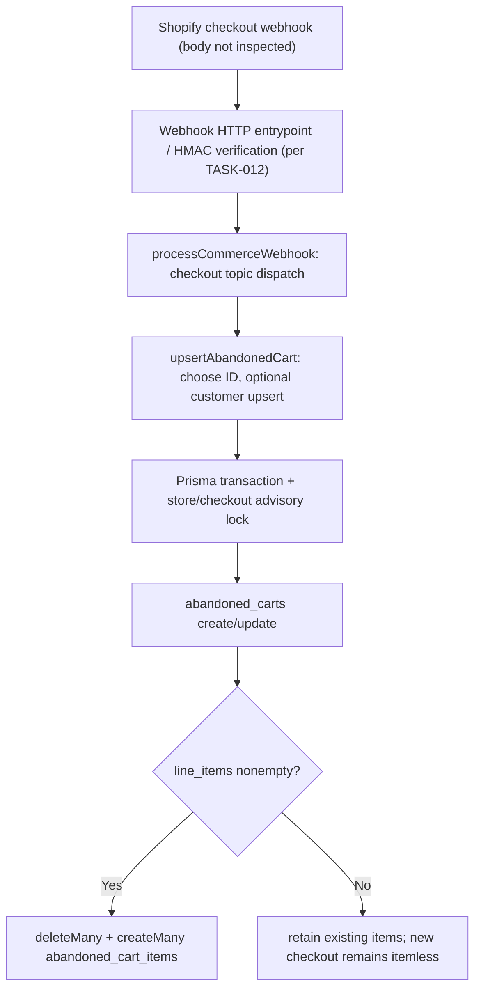

# REVLUMA — TASK 013 EXECUTION REPORT

## Identification and verdict
Task 013 of 406 — Identify checkout fields actually received in test payloads. Phase 1 / 1A. Inspection 2026-10-30 Africa/Lagos. Inspected GitHub main at `b36cebd82dc1c1ed71b570fc542659f990ca3991`. Production backend revision previously reported as `cfb41b7b468bfecd537d841d55c450ff21673342` by TASK-012; production alignment was **not independently rechecked in this task**.

**Verdict: PARTIAL.** Backend field expectations and mapping can be established from inspected source; no Level A/B *body* of a verified Shopify checkout delivery was retrieved, so this report cannot truthfully claim fields actually received. Historical delivery metadata in TASK-012 proves checkouts/create and checkouts/update deliveries existed, not their JSON bodies. Do not promote synthetic fixtures or source-code reads to observed Shopify field availability.

## Prior evidence
Read docs/mvp-execution/README.md, audit-register.md, implementation-decisions.md and historical TASK-005, TASK-006, TASK-012. TASK-001 report unavailable per register. TASK-002–011 are indexed by the register; their full content was not all independently reread in this inspection. TASK-005/006 originally inspected `cfb41b7`; current handler source was rechecked.

## Payload evidence inventory
| Reference | Topic | Origin | Level | Date | Reliability |
|---|---|---|---|---|---|
| TASK-012 provider delivery metadata | checkouts/create | Shopify dashboard delivery diagnostics; body not opened | A for *delivery existence only*, NOT payload fields | Historical, exact event date in TASK-012 | Verified topic/delivery, no body |
| TASK-012 provider delivery metadata | checkouts/update | Shopify dashboard historical diagnostics; body not opened | A for *delivery existence only*, NOT payload fields | Historical | Verified topic/delivery, no body |
| Backend/src/services/commerceWebhookService.js | both topics | Handler source, not payload | Not a payload | Inspected 2026-10-30 | Authoritative for mapping only |
| Existing test fixtures | both topics | Not fully inventoried | Unknown | Unknown | Unverified |

No captured checkout JSON body has been authenticated as Level A or B. No creation/update field-presence comparison is possible. For every field listed below, **observed presence, observed JSON type and observed nullability are UNKNOWN**.

## Handler field inventory and coverage (NOT observed payload inventory)
The same `upsertAbandonedCart` function processes both `checkouts/create` and `checkouts/update`, through `processCommerceWebhook`. Source: Backend/src/services/commerceWebhookService.js, functions `processCommerceWebhook`, `upsertAbandonedCart`, `customerData`.

| Input JSON path | Backend extraction / fallback | Database destination | Observed in real payload |
|---|---|---|---|
| checkout_id, id, cart_token, checkout_token | first truthy in that order; String | abandoned_carts.external_cart_id | Unknown |
| customer.id, customer_id, customer.email, email, customer.first_name, customer.last_name, customer.phone | customerData only if customer object exists; placeholder email possible | customers and abandoned_carts.customer_id | Unknown |
| customer.email_marketing_consent.state, customer.sms_marketing_consent.state | conditional boolean mapping | customers consent fields | Unknown |
| created_at | Date or now; existing abandoned_at preserved | abandoned_carts.abandoned_at | Unknown |
| updated_at, updatedAt, created_at, createdAt | via lastCheckoutActivity | abandoned_carts.updated_at | Unknown |
| completed_at | completion state/date | abandoned_carts.status, recovered_at | Unknown |
| total_price, total | Number, defaults 0 | abandoned_carts.cart_value | Unknown |
| currency | defaults USD | abandoned_carts.currency | Unknown |
| abandoned_checkout_url, recovery_url | first truthy or null | abandoned_carts.recovery_url | Unknown |
| line_items[] | only nonempty arrays replace items | abandoned_cart_items | Unknown |
| line_items[].product_id | String or 'unknown' | external_product_id | Unknown |
| line_items[].variant_id | String or null | external_variant_id | Unknown |
| line_items[].title, line_items[].name | String or 'Unknown product' | product_name | Unknown |
| line_items[].price | Number or 0 | price | Unknown |
| line_items[].quantity | Number or 1, min 1 | quantity | Unknown |
| line_items[].sku, image, properties, discounts | no direct mapping in checkout handler | not stored by this handler | Unknown |
| subtotal_price, total_tax, shipping_lines, discount_codes, discount_applications | no checkout-specific extraction | not stored by this handler | Unknown |
| order_id, checkout status | no direct checkout mapping | not stored by this handler | Unknown |

This table is a **handler-expectation inventory**, not proof Shopify sent any field. No real-body JSON type, nullable rate, top-level key count, or creation/update differences were established.

## Identifiers and reconciliation
The checkout handler stores only one chosen identifier, scoped by store ID. The order handler separately matches any of `checkout_id`, `cart_token`, `checkout_token` against that single stored value. Distinct identifiers for the same checkout can therefore fail to reconcile; this is a code-supported risk, not a confirmed payload mismatch. Numeric IDs converted to String after JavaScript JSON parsing may already have lost precision if represented as unsafe JSON numbers; no observed identifier type or unsafe-ID example was captured.

## Products and missing-product investigation
A nonempty `line_items` array triggers deleteMany then createMany in the checkout-items table. Missing or empty arrays skip writes, preserving any existing items but leaving newly created checkout records itemless. Explicit empty and absent collections are indistinguishable in this handler. A later nonempty update replaces items. Potential causes of previously missing product display remain: absent payload items, absent historical sync items, mapping/persistence problems, or API presentation. None is confirmed for the reported incident without its original body and corresponding DB/API records. This handler does extract and persist the listed product fields when supplied.

## Customer, money, timestamps, completion
Guest checkout (no customer object) persists with null customer_id; later no-customer updates can clear an earlier association. Missing totals become zero; missing currency becomes USD, potentially overwriting known values. Numeric conversion uses JS Number, so decimal precision should be separately validated. Shopify timestamps versus receipt timestamps require delivery-body and runtime comparison. The 15-minute inactivity policy is described by previous reports; source `checkoutInactivity.js` and live transitions were not independently executed here. `completed_at` is a completion signal used by the handler, while order reconciliation remains separately dependent on identifier matching. Completion is labeled 'recovered' in current checkout state; this does not prove campaign attribution.

## Shipping, discounts, other data
No checkout-specific persistence is implemented here for shipping lines/costs, discount breakdowns, landing/referral fields, device/session data or marketing attribution. Their *presence in Shopify deliveries is unknown*. No invented behavior signals.

## Verified source-flow diagram

## Findings and dependencies
| Finding | Severity | Classification | Evidence | Follow-up |
|---|---|---|---|---|
| TASK013-EVIDENCE-01 | Critical | Missing verification: no A/B checkout body inspected | TASK-012 metadata; this inspection | Obtain authorized redacted checkout delivery-body evidence in subsequent validation |
| TASK013-MAP-01 | High | Potential mismatch across alternate identifiers | commerceWebhookService.js upsertAbandonedCart/upsertOrder | Tasks 017–019, 028 |
| TASK013-MAP-02 | High | Potential product-state mismatch: absent vs empty line_items | commerceWebhookService.js item guard | Task 076; additional backlog mapping pending |
| TASK013-MAP-03 | High | Potential customer association loss | checkout data.customer_id assignment | Future scoped implementation, task mapping pending |
| TASK013-MAP-04 | High | Potential false zero/default currency | checkout data.cart_value/currency assignment | Tasks 079–080 |
| TASK013-MAP-05 | High | Missing real-payload completion/order correlation proof | completion field and order identifier code paths | Tasks 016–050 |

These are task-local identifiers, **not new REV-FIND IDs**: reconcile against the existing central register before assigning any new stable global ID; do not duplicate earlier findings.

## Tests and limitations
No tests executed: no isolated safe test environment was established. No test results claimed. Fixture provenance and realism not established. No live production payload/body, Prisma row or API response was inspected. No safe assertion that Shopify did or did not include line_items. Production alignment not independently verified.

## Changes and safety
Documentation-only Task 013 report and audit-register row update on a dedicated branch. No application source, Prisma, Shopify configuration, database, infrastructure, deployment or raw customer payload changed. No real customer PII, credentials or tokens included.

**Final status: PARTIAL — source mapping established; actual received field inventory unverified.** Next Task 014: Identify order fields actually received in test payloads. Not started.

## 2026-10-30 follow-up — connected production evidence
Authorized read-only inspection of Supabase project `Revluma-Database` (`jblpgqmbgdlzitprudgt`) confirmed actual live table metadata: `webhook_deliveries` stores topic/status/timestamps but **no payload body**. A grouped, PII-free query returned **13 processed checkouts/create** deliveries (2026-10-27 07:12:29.417 UTC through 2026-10-29 09:59:32.894 UTC) and **92 processed checkouts/update** deliveries (2026-10-27 07:12:29.417 UTC through 2026-10-29 10:24:25.773 UTC). These are database processing records, not proof of specific JSON fields.

A read-only join of `abandoned_carts`, `abandoned_cart_items` and `stores` showed **19 checkout rows** for `revluma-test-store-v1.myshopify.com`: **7 with at least one persisted product item, 12 without**. This confirms that missing item associations occur in stored test-store data; it does not establish whether Shopify omitted `line_items` or whether the ingestion/sync pipeline lost them. No PII, customer rows, access tokens, or raw payloads were read.

Render workspace `My Workspace` and live service `Revluma-backend` were identified. An attempted read-only checkout-log query for 2026-10-27 through 2026-10-30 returned **503: log retrieval is currently unavailable**. No logs or payload bodies were obtained. No production configuration changes, webhook replays, or new test checkouts were performed.

**Verdict remains PARTIAL**: concrete production delivery and persistence evidence is now verified, but Task 013 specifically requires *actual field-level payload evidence*. Neither webhook-delivery metadata nor persisted DB rows can substitute for the original Shopify JSON body. Next required evidence: safely access an authenticated historical Shopify checkout delivery body, or capture a controlled checkout-create/update test payload through an approved redacted test-only mechanism, then compare observed keys/types and source-to-DB outcomes. Do not call this COMPLETED — VERIFIED until that happens.
