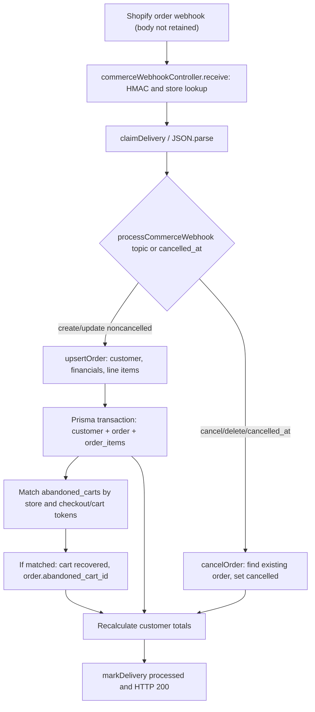

# REVLUMA — TASK 014 EXECUTION REPORT

## A. Identification and status
- **Task:** 014 of 406 — Identify order fields actually received in test payloads.
- **Phase/category:** 1 / 1A, Reliable Data Foundation / Baseline and Architecture.
- **Date:** 2026-10-30 UTC.
- **Inspected GitHub branch:** main at `fbf133d161e2f5054653d26ad68e25b3ae87bbab`; documentation branch `docs/task-014-order-payload-audit`.
- **Observed Render deployed code revision:** `4ac02b7c413cc6dfabd9f6ce404fc0618a2ab7c7` at the previous Task 013 inspection; latest production alignment was not rechecked in this task. Differences include Task 013 documentation; do not assert full revision parity.
- **Shopify webhook API version:** 2026-10, per TASK-012 verified active app configuration.
- **Final verdict:** **PARTIAL — actual order delivery processing observed, but original order webhook JSON field names/types are unavailable.** No fabricated Level A/B order field evidence.

## B. Earlier evidence and provenance
Reviewed repository README, implementation decisions, Task 003 (creation), Task 004 (updates), Task 009 (Prisma), Task 010 (tests), Task 013 (verified checkout field-presence captures); referenced Task 012 webhook audit and existing central findings. Earlier Task 001–013 reports are indexed by the repository audit register; no claim that every report was independently re-executed. TASK-013 verified **checkout** webhook fields only; those captures cannot be relabeled as **order** fields. The currently deployed diagnostic in `Backend/src/controller/commerceWebhookController.js` was explicitly scoped to `checkouts/create` and `checkouts/update`, not orders.

## C. Actual delivery evidence and classification
Authorized read-only Render log queries for 2026-10-26 onward on `Revluma-backend` (`srv-db9m6pom7kps73dtk1tg`) returned:
| Reference | Topic | Result | Origin | Evidence class | Field inventory |
|---|---|---|---|---|---|
| Render 2026-10-27T14:30:51Z, 2026-10-29T10:24:48Z | `orders/create` | 2 `commerce_webhook_processed` / `order_upserted` | Real authenticated Shopify delivery metadata | A — delivery metadata only | **Not available** |
| Render 2026-10-27 onward | `orders/updated` | 6 matching log entries, including at least one `P2028` failure and successful `order_upserted` outcomes | Real authenticated Shopify delivery metadata | A — delivery metadata only | **Not available** |
| Render query | `orders/cancelled` | 0 matching logs in queried range | No example retrieved | Unknown | **Not available** |
| Render query | `orders/delete` | 0 matching logs in queried range | No example retrieved | Unknown | **Not available** |
| `Backend/src/tests/shopifyRefundTotals.test.js` | synthetic order-like refund data | Five node:test cases | Manually constructed | D — synthetic mock | Only fixture fields, **not Shopify delivery proof** |
| `Backend/src/services/__tests__/shopifyWebhookService.test.js` | registration topics | Mock registration and failure outcomes | Manually constructed | D — synthetic mock | No order payload bodies |

The current `webhook_deliveries` model retains delivery ID/topic/status/timestamps/errors, **not original JSON body** (TASK-013 direct DB inspection). No authentic order body, redacted order field-presence capture, saved order delivery-body export, or authoritative order-to-checkout identifier pair was available. This prevents PASS under the task's Level A/B field-evidence rule.

## D–H. Topic-specific field inventories and comparison
**Observed actual JSON paths/types for all four order topics: UNKNOWN.** This is not a claim that fields were absent. Render records processing outcomes but omit payload field names, types and values.

| Candidate field/category | Create | Update | Cancel | Delete | Backend dependency |
|---|---|---|---|---|---|
| `id` / `order_id` | Unverified | Unverified | Unverified | Unverified | Upsert/cancel external ID |
| `checkout_id` | Unverified | Unverified | Unverified | Unverified | Checkout reconciliation |
| `checkout_token` | Unverified | Unverified | Unverified | Unverified | Checkout reconciliation |
| `cart_token` | Unverified | Unverified | Unverified | Unverified | Checkout reconciliation |
| `line_items[]` | Unverified | Unverified | Unverified | Unverified | Order item upserts |
| `customer` / `customer_id` / `email` | Unverified | Unverified | Unverified | Unverified | Customer association |
| `total_price` / `subtotal_price` / `total_discounts` / `currency` | Unverified | Unverified | Unverified | Unverified | Financial persistence |
| `financial_status` / `fulfillment_status` | Unverified | Unverified | Unverified | Unverified | Not mapped by current upsert |
| `cancelled_at` / `cancel_reason` | Unverified | Unverified | Unverified | Unverified | Cancel route tests `cancelled_at` |
| `refunds[]` | Unverified | Unverified | Unverified | Unverified | Net order total |
| `created_at` / `updated_at` / `processed_at` | Unverified | Unverified | Unverified | Unverified | `created_at` mapped to ordered_at |

No observed absence/nullability can be claimed. Shopify order deletion must not be assumed to carry full order fields.

## I–K. Identifiers and comparison to Task 013
| Identifier | TASK-013 authentic checkout capture | Authentic order webhook | Handler extraction | Reliability |
|---|---|---|---|---|
| Checkout ID | `checkout_id` **not present** in observed top-level checkout field union; `id` also not present | Unknown | `payload.checkout_id` | Unknown |
| Checkout token | Checkout `token` observed as string | Unknown | Order `payload.checkout_token`; checkout stores `payload.checkout_token` only after `checkout_id/id/cart_token` priority | **Potential naming/storage mismatch** |
| Cart token | Checkout `cart_token` observed as string | Unknown | Order `payload.cart_token`; checkout prefers `cart_token` over `checkout_token` | Potentially compatible, actual match unverified |
| Shopify order ID | Not applicable to observed checkout fields | Unknown | `String(payload.id || payload.order_id)` | Store-scoped uniqueness; unsafe missing-ID fallback |

Task 013 capture logged **field names and types**, not actual token values. It cannot establish that an order's token equals a checkout's token. JavaScript `String` avoids additional numeric parsing in the handler, but Shopify numeric IDs already decoded as JSON numbers may have lost integer precision before stringification; no actual large-ID case was captured. `String(undefined)` may become `"undefined"` on order upsert; cancellation guards against missing ID via `String(... || '')`.

## L. Product and line items
`upsertOrder` takes `payload.line_items || payload.products || []`; for each item it uses `id || line_item_id || orderId:productId/name` as string line-item key, `product_id`, `variant_id`, `title || name`, `quantity || 1`, `price || unit_price || 0`. It upserts `order_items` by `(store_id,external_line_item_id)`, stores `order_id,store_id,external_product_id,external_variant_id,product_name,quantity,unit_price,line_total,ordered_at`. Existing item update changes quantity/price/timestamp but **does not update product name/product/variant IDs**. No deletion of old line items on later reduced/empty arrays is shown. Checkout item processing instead replaces checkout items on nonempty `line_items`. Task 013 established authentic checkout item presence; authentic **order** line-item fields remain unverified. Product similarity alone cannot establish purchase reconciliation.

## M. Customer mapping and privacy
`customerData` reads `customer.id || customer_id || order:<payload.id>`, `customer.email || email`, first/last name, phone and marketing consent. Missing email produces an internal `@redacted.invalid` placeholder. `customers.upsert` is store-scoped by external ID; order requires customer foreign key. Anonymous orders can be persisted using the synthetic customer identity. A later update can overwrite known customer fields with placeholders/nulls; this is a source-grounded risk, not a confirmed observed production loss. No customer values are included in this report.

## N. Financial mapping
`shopifyNetOrderTotal` parses `total_price` using `Number`; iterates `refunds[].transactions[]`, subtracts only successful `kind=refund` amounts and rounds net to two decimal places. Missing/malformed total or malformed refund transactions return null and throw `ORDER_FINANCIAL_TOTAL_UNVERIFIED` in `upsertOrder`. Subtotal, discounts and item prices also use JavaScript Number, then Prisma Decimal(10,2) / Decimal(12,2) storage. `currency || 'USD'` defaults without verifying shop currency. `discount_codes[0].code` populates coupon. Financial/presentment currency and financial status are not stored by this upsert; a newly created order is marked `recovery_status='completed'` regardless of payment capture state. The synthetic `shopifyRefundTotals.test.js` asserts full, partial, pending/failed and malformed refund handling; not a real webhook fixture.

## O–P. Lifecycle, timestamps and event ordering
`processCommerceWebhook` routes `orders/cancelled`, `orders/delete`, `order.deleted`, or **any payload with truthy `cancelled_at`** to `cancelOrder`. Cancellation finds an existing store-scoped order and sets `recovery_status='cancelled'`, recalculates customer totals; if no order exists it returns null. No cancellation timestamp/reason is persisted in `orders`. Deletion follows the same cancellation route; no delete occurs. A cancelled purchase is not equivalent to an abandoned checkout. Normal order create/update uses shared `upsertOrder` and marks order completed/recovered; the handler does not enforce source `updated_at` ordering. `ordered_at` uses `created_at || date_created || Date.now()`, a UTC-compatible Date object; `updated_at` from Shopify is not persisted on orders. Delayed create/update can overwrite newer state; a subsequent non-cancelled event can reset cancelled order to completed. These are **possible code-path risks**, not observed lifecycle regressions.

## Q. Checkout reconciliation
Inside the order transaction, the handler creates/updates the order and items, then searches `abandoned_carts` by `store_id` and `external_cart_id IN [checkout_id,cart_token,checkout_token]`, using latest `updated_at` if multiple. If none found and a coupon exists, it searches `sequence_sends` metadata for a linked abandoned cart. On a match, marks cart `recovered`, assigns `orders.abandoned_cart_id`, `session_id` and `recovery_status='recovered'`. If none matches, the order remains `completed` without a cart relationship. The order schema has no separate checkout_id/checkout_token/cart_token fields; the relation is via `abandoned_cart_id`. **No authentic matched order/checkout identifier pair or persisted matched-purchase test was obtained.**

## R–T. Handler and Prisma mapping / coverage
| Shopify candidate | Handler behavior | Prisma destination | Actual Shopify field observed? |
|---|---|---|---|
| `id` / `order_id` | `String(...)` | `orders.external_order_id` | Unknown |
| `checkout_id`, `checkout_token`, `cart_token` | Distinct string lookup | `orders.abandoned_cart_id` only after match | Unknown |
| `line_items[].id/product_id/variant_id/title/quantity/price` | Numeric/string fallbacks, per-item upsert | `order_items` fields | Unknown |
| `customer.id/email` | Store-scoped upsert, placeholder fallback | `customers`, `orders.customer_id` | Unknown |
| `total_price`, `refunds` | Net calculation via Number | `orders.total` Decimal(10,2) | Unknown |
| `subtotal_price`, `total_discounts`, `discount_codes` | Number/first code | `subtotal`, `discount_amount`, `discount_pct`, coupon | Unknown |
| `currency` | USD fallback | `orders.currency` | Unknown |
| `created_at` | Date | `orders.ordered_at` | Unknown |
| `cancelled_at` | Routes to cancel | `orders.recovery_status` | Unknown |
| `financial_status`, `fulfillment_status`, `cancel_reason`, `updated_at` | Not mapped | No corresponding order column | Unknown |

Potential loss includes payment/fulfillment lifecycle, cancellation reason/time, checkout identifiers after unmatched order, precision in Number conversions, older updates overwriting newer data, stale line-item metadata and missing purchase-to-cart linkage. **No data-loss defect is confirmed by comparing actual incoming order field values to persisted rows**; the code paths are documented for later tasks.

## U. Existing test inventory and execution
| File | Verified existing assertion | Fixture origin | Quality / limitation |
|---|---|---|---|
| `Backend/src/tests/shopifyRefundTotals.test.js` | 5 tests: full, partial, pending/failed, malformed, no refund | D synthetic | Strong pure-helper assertions; no webhook/DB integration |
| `Backend/src/services/__tests__/shopifyWebhookService.test.js` | Nine-topic registration and failure handling | D synthetic | Webhook setup mocks, not order payload field validation |
| `docs/mvp-execution/diagnostics/TASK-010.md` | Earlier selected tests and missing reconciliation coverage | Historical | No direct persisted checkout-to-order matching test |

No tests were executed in this Task 014 session. A safe isolated executable backend/test dependency environment was not established; existing test assertions were inspected read-only. Do not report green tests for this task.

## V. Verified source-flow diagram

RFM sync also runs after the upsert transaction and before delivery completion; it is omitted from the diagram only for legibility.

## W–X. Findings and future approved task dependencies
Use existing stable findings; **do not allocate duplicate global IDs** without a distinct verified defect:
| Existing finding / local note | Severity | Evidence | Status | Future tasks |
|---|---|---|---|---|
| REV-FIND-0038 | Critical | No direct persisted checkout/order matching tests; order field bodies unavailable | OPEN | 017–028,049 |
| REV-FIND-0040 | High | Dedup not equivalent to business-state idempotency | OPEN | 034–035,063–064,074–075 |
| REV-FIND-0042 | High | Store-scoped query filters not behavioral cross-store rejection tests | OPEN | 082–086,093–094 |
| REV-FIND-0043 | High | Historical import and live event overlap unverified | OPEN | 044–045,066–067,074–076 |
| REV-FIND-0048 | High | Prior Shopify timeout + current Render P2028 failure | UNDER INVESTIGATION | 065 |
| TASK014-OBS-01 | High | Actual order field-level deliveries unavailable; no proof of checkout_id/cart_token | Missing verification | 014 follow-up, 017–019 |
| TASK014-OBS-02 | High | `String(undefined)` possible for missing order ID | Potential defect | 016, 028 |
| TASK014-OBS-03 | High | Cancelled state can be overwritten by subsequent upsert; no ordering guard | Potential defect | 029–033 |
| TASK014-OBS-04 | High | `financial_status` not persisted; order creation not equivalent to captured payment | Potential defect / product semantics | 015, 036–040 |
| TASK014-OBS-05 | Medium | Order line-item update preserves stale product/variant/name | Potential defect | 076 |
| TASK014-OBS-06 | Medium | Number conversion before Decimal storage and currency fallback | Potential defect | 079–080 |

Local `TASK014-OBS` references are task-local, not new global REV-FIND identifiers. Prior findings remain unresolved. Later implementation must reread Task 013/014 and revalidate against then-current source.

## Y. Limitations and completion gate
No authentic order JSON bodies, field-name/type logs, cancellation/deletion payload examples, verified checkout-to-order identifier equality, post-delivery DB row correlation, or safely executable backend integration suite were available. To reach PASS **without violating Task 014's read-only restriction**, retrieve already existing redacted order webhook delivery bodies from authorized Shopify developer delivery diagnostics or previously captured secure logs, then append field/type inventories and topic comparison. Do not create orders, add diagnostic code, enable environment flags, or deploy under Task 014.

## Z–AA. Verdict, changes and safety
**PARTIAL — order handler/schema/identifier/lifecycle mapping completed; actual Shopify order field availability remains unverified.** Created `docs/mvp-execution/diagnostics/TASK-014.md` and updated `docs/mvp-execution/audit-register.md` on a documentation-only branch. No backend/frontend/Prisma/Shopify/Render/Supabase changes, no production database writes, no new orders or mutations, no raw customer payloads or secrets, no deployment. Next task when Task 014 evidence gate is resolved: **015 — Document checkout/order state definitions**; not started.

## Follow-up 2026-10-30 — explicit authorization and diagnostic deployment

The user explicitly authorized a narrow exception to the Task 014 read-only restriction, for this and later necessary verification work. This **supersedes only the earlier prohibition on temporary diagnostics**, not the requirement for authentic webhook field-level evidence. Added privacy-safe field-name/type instrumentation to `Backend/src/controller/commerceWebhookController.js`, scoped to test shop `revluma-test-store-v1.myshopify.com`, topics `orders/create`, `orders/updated`, `orders/cancelled`, `orders/delete`, and opt-in `TASK014_ORDER_FIELD_CAPTURE=true`. It emits `task014_order_field_presence`, top-level keys/types, line-item keys/count, customer keys/types, refund keys, discount-code keys. **No field values or raw payloads logged.** Merged [PR #208](https://github.com/Revluma-Organization/Revluma/pull/208), commit `8349de91cdaeff8b786ccc5f3ba0286c5b9f5a0b`. Enabled flag on Render service `srv-db9m6pom7kps73dtk1tg` in workspace `tea-dat7lbqd0e5s73afif20`; triggered deploy `dep-dbhu929srm7s73e010d0`. Last observed status: **build_in_progress**. No authentic new order field capture yet; original Task 014 verdict remains **PARTIALLY VERIFIED**. Before completion: confirm deploy LIVE, observe real test-order events, inventory actual fields/types per topic, compare to code, disable diagnostic, confirm shutdown deployment, and update register. Cancellation/deletion require authentic examples or explicitly bounded unverified coverage; do not invent them.

## Authentic Shopify order captures — 2026-10-30

**Evidence class A: production webhook deliveries**, captured with the explicitly authorized, test-store-only, privacy-safe field-name/type logger after Render deploy `dep-dbhu929srm7s73e010d0` reached LIVE at 00:29:10 UTC.

- `orders/updated`: 2026-10-30 00:32:44.032 UTC, one line item.
- `orders/create`: 2026-10-30 00:32:44.657 UTC, one line item.
- Same Revluma store UUID `3ed79446-cb6d-4a1c-b174-9ec1ab91fe15`; both events include actual Shopify top-level `id:number`, `cart_token:string`, `checkout_token:string`, `token:string`, `admin_graphql_api_id:string`. **Top-level `checkout_id` absent from both captures** (not a claim about all Shopify orders).
- Actual order commerce fields: `created_at:string`, `updated_at:string`, `processed_at:string`, `currency:string`, `presentment_currency:string`, `financial_status:string`, `fulfillment_status:null`, `total_price:string`, `subtotal_price:string`, `current_total_price:string`, `total_discounts:string`, `total_tax:string`, `discount_codes:array`, `refunds:array`, `line_items:array`, `customer:object`, `cancelled_at:null`, `cancel_reason:null`, `test:boolean`.
- Actual customer object includes `id:number`, `email:string`, `created_at:string`, `updated_at:string`, `verified_email:boolean`, `default_address:object`. Actual single line item includes `id`, `product_id`, `variant_id`, `title`, `price`, `quantity`, `sku`, `fulfillment_status`, `discount_allocations`, `tax_lines`, `total_discount`, `admin_graphql_api_id` and other metadata; field names were captured without values. Refunds and discount_codes arrays were empty, so their nested object fields are **not verified**.
- Neither `orders/cancelled` nor `orders/delete` was captured. Their actual field inventories remain **unverified**; do not label as absent or synthetic.
- Render processed checkout/create and multiple checkout/update events for same store immediately before order capture. Read-only Supabase SQL verified the new order row created 2026-10-30 00:32:44.512 UTC has `abandoned_cart_id IS NOT NULL`, `recovery_status='recovered'`, linked cart `status='recovered'`, and nonnull `recovered_at`. This proves successful persisted checkout-to-order reconciliation for **this one order**, not universal matching. Historical 2026-10-27 order remained unlinked.
- The temporary capture flag `TASK014_ORDER_FIELD_CAPTURE=false` was set on Render, triggering rollback deployment `dep-dbhubruc6qcc73f08eb0` at 00:33:51 UTC; **verify rollback LIVE** before declaring shutdown complete.

**Revised verdict: PARTIALLY VERIFIED**. Authentic creation/update field inventories and one real checkout/order reconciliation are verified. Actual cancellation/deletion topic field inventories and empty refund/discount nested structures are not. This is a bounded evidence limitation, not a reason to fabricate coverage or expand the Shopify-only MVP. No additional orders or cancellations were generated by the assistant.

## Authentic deletion capture and cancellation processing — 2026-10-30

- 00:36:46.173 UTC: real `orders/cancelled` delivery processed as `order_cancelled`; capture was disabled at the time, so **the cancellation payload's actual field inventory remains unverified**.
- Read-only Supabase query after cancellation: new test order `recovery_status='cancelled'`, checkout association preserved, associated cart still `status='recovered'`.
- Capture re-enabled only for the test store, Render deployment `dep-dbhudbo473hc73955d80` LIVE 00:38:17 UTC.
- **Evidence class A**, 00:40:02.999 UTC: real `orders/delete` payload fields **only** `id:number`; `line_items`, `customer`, `refunds`, `discount_codes` all undefined. The handler logged `commerce_webhook_processed` action `order_cancelled` at 00:40:04.933 UTC.
- **Evidence class A**, 00:40:03.133 UTC: concurrent `orders/updated` captured `cancelled_at:string`, `cancel_reason:string`, `closed_at:string`, `refunds:array`, with refund child keys `admin_graphql_api_id`, `created_at`, `duties`, `id`, `note`, `order_adjustments`, `order_id`, `processed_at`, `refund_line_items`, `restock`, `total_duties_set`, `transactions`, `user_id`. Refund grandchildren/values not captured. The event's arrival after delete does not by itself prove ordering or final-state correctness.
- Read-only Supabase query after deletion: test order still persisted with `recovery_status='cancelled'`, checkout FK intact, associated cart `status='recovered'`. Thus deletion does **not** remove the internal order record in this observed path.
- No authentic `orders/cancelled` field shape was captured; this one remaining mandatory field-inventory gap keeps **Task 014 PARTIALLY VERIFIED** until a fresh controlled cancellation after capture is LIVE. Do not conflate observed cancellation handling with field inventory.
