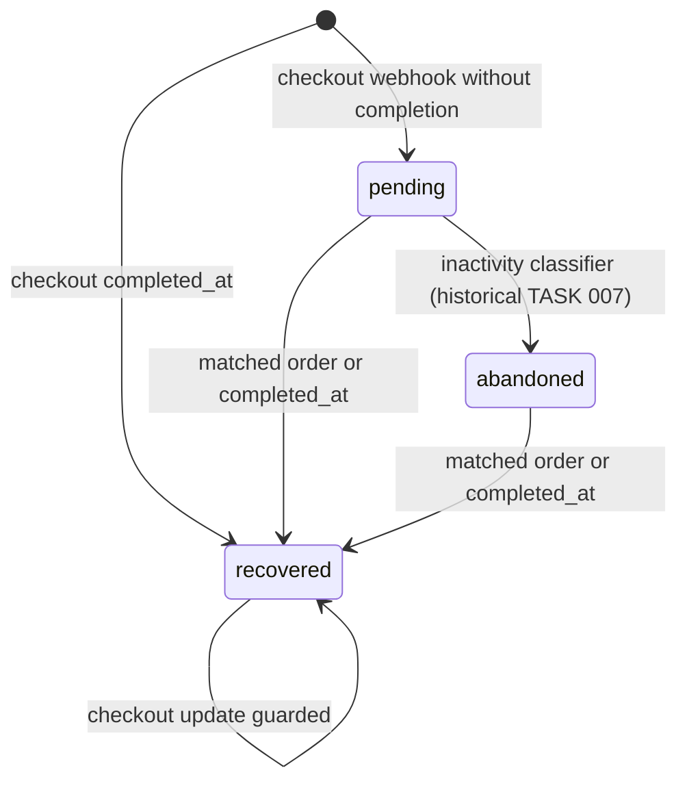
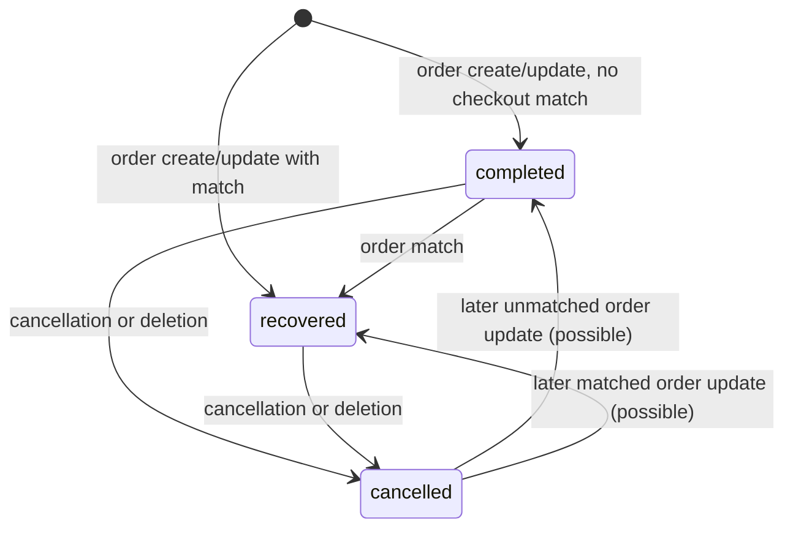
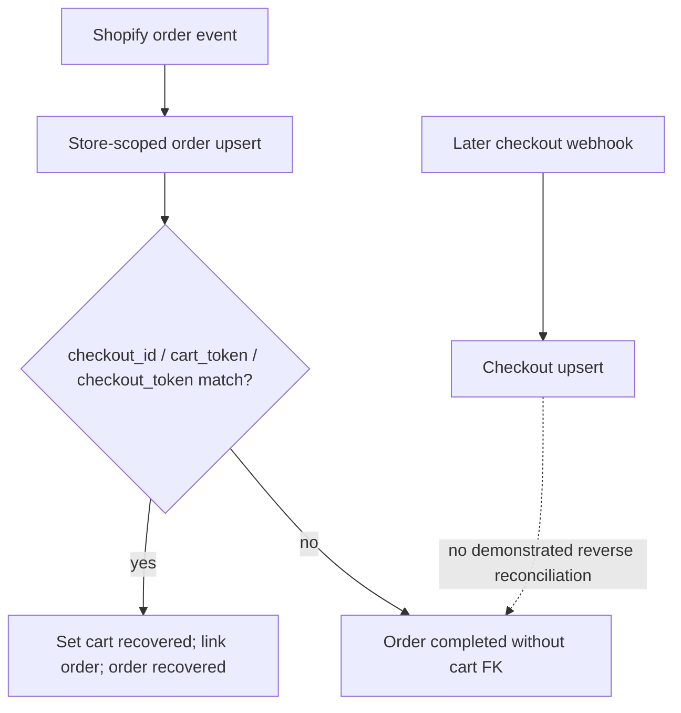

# REVLUMA — TASK 015: CHECKOUT / ORDER LIFECYCLE ARCHITECTURE AUDIT

**Task:** 015 / 406 · Phase 1, baseline architecture · **Execution:** 2026-10-30 · **Verdict:** PARTIAL (architecture mapped; transition guarantees not universally verified) · **Readiness for 016:** READY WITH LIMITATIONS.

## A. Inspection baseline and evidence
Repository: Revluma-Organization/Revluma; inspected `main` at the time the documentation branch was created, with file blob references: `Backend/src/services/commerceWebhookService.js` 0a042e3f61aee62cbca84e05938e606036394f50; `Backend/src/services/checkoutInactivity.js` inspected; `Backend/prisma/schema.prisma` 61b1754fa05dde437a262a6d9fc9cbbe7b8bbbd7. Production backend deployment was independently confirmed LIVE on commit `8349de91cdaeff8b786ccc5f3ba0286c5b9f5a0b` in Task 014; full main-versus-production source equivalence was not proven here. The documentation branch was based on `main`, not the still-unmerged Task 014 report branch. Source locations below refer to current inspected files, not to historical report line numbers.

Prior evidence: audit register on main records TASK 001 report unavailable; TASK 002–007 historical PASS audits; TASK 008–009 PARTIAL; TASK 010 test-architecture verified but product coverage partial; TASK 011–013 complete; TASK 014 on main incorrectly says NOT STARTED because its verified report and audit update are on the unmerged `docs/task-014-order-payload-audit` PR #207. Actual Task 014 production evidence: all four order webhook field shapes captured on 2026-10-30, and one real checkout/order reconciliation verified. Do not infer that a missing merged report invalidates production evidence. Existing implementation-decisions register inspected; no new architectural decision adopted.

## B. Checkout state definitions
| Persisted state | Actual entry | Exit / meaning | Evidence |
|---|---|---|---|
| `pending` | `upsertAbandonedCart` for a checkout lacking `completed_at`, unless previously recovered | Intended pre-abandonment activity; may later become abandoned or recovered | `commerceWebhookService.js:275–319`; `checkoutInactivity.js:17–21` |
| `recovered` | Checkout `completed_at`, pre-existing recovered state, or matched Shopify order | Preserves purchase evidence in checkout row; `recovered_at` set from completion/order timestamp | `commerceWebhookService.js:242–254,312–315` |
| `abandoned` | Periodic classifier (historical TASK 007); schema default also `abandoned` | Eligible after inactivity; exact current job predicate requires separate source revalidation | `schema.prisma` model `abandoned_carts`; TASK 007 |
Other strings may exist in legacy records; no authoritative enum restricts `abandoned_carts.status`. **`active` and `completed` are conceptual MVP states, not proven persisted string values**. `abandoned_at` is assigned at checkout upsert from `created_at` even while `status=pending`; it is not reliable proof the abandonment transition has occurred. `updated_at` is overloaded as Shopify activity timestamp and database mutation timestamp; comparing webhook source activity against this field can reject valid updates or accept stale ones after recovery.

The helper `checkoutInactivity.js` defines `ABANDONMENT_INACTIVITY_MS = 15 * 60 * 1000`; `lastCheckoutActivity` prioritizes Shopify `updated_at`, then `created_at`, falling back to receipt time; `isCheckoutInactive` compares elapsed time >=15 minutes. Exact invocation, schedule, conditional update predicate, and race protection of the periodic classifier are **not reverified against its current job source**. Checkout upsert never directly assigns abandoned: it assigns pending or recovered.

## C. Completion signals, precedence, and reconciliation
| Signal | Usage | Authority and limits |
|---|---|---|
| Checkout `completed_at` | `nextCheckoutStatus` sets recovered, `recovered_at` set | Explicit Shopify completion signal; no order FK required |
| Shopify order create/update | `upsertOrder` creates/updates `orders` then matches `checkout_id`, `cart_token`, `checkout_token` to `abandoned_carts.external_cart_id` in same store | Authoritative order existence, **not** proof of captured payment; actual Task 014 captures have tokens but no top-level `checkout_id` |
| Recovery coupon attribution | Optional fallback to `sequence_sends.metadata.discount_code` and `abandoned_cart_id` | Attribution-assisted association, not intrinsic Shopify checkout identity |

`upsertOrder` uses one Prisma transaction for customer, order, items, matching cart and customer totals. Match uses store-scoped identifiers, latest updated cart if multiple candidates; linked cart becomes `recovered`, and order `recovery_status='recovered'`. Without match, order `recovery_status='completed'` and `abandoned_cart_id=NULL`. This status conflates purchase existence and recovery attribution; it does not store Shopify financial/fulfillment state.

`upsertAbandonedCart` uses a per-store/checkout PostgreSQL advisory transaction lock and returns existing row for stale noncompleted events. `nextCheckoutStatus` preserves already recovered state. **Potential regression:** `upsertOrder` writes `recovery_status='completed'` on *every* order update before attempting matching; a previously cancelled order may be reopened by a later order update. Actual Task 014 cancellation/deletion tests observed cancellation processing, but no universal ordering guarantee. No demonstrated reverse order-first-then-checkout reconciliation pass when checkout arrives later.

## D. Order state dimensions and lifecycle
| Dimension | Persisted implementation | Trigger / limitation |
|---|---|---|
| Existence | `orders` unique (`store_id`, `external_order_id`) | `orders/create` and `orders/updated` upsert; order creation does not verify payment captured |
| Recovery/processing | `orders.recovery_status`: `completed`, `recovered`, `cancelled` | `upsertOrder` and `cancelOrder`; free-form string, not financial-status enum |
| Financial | `total`, `subtotal`, `discount_amount`, `discount_pct`, `coupon_used` | Net Shopify total computed from refund data; `financial_status` not separately persisted |
| Fulfillment | No `fulfillment_status` in inspected `orders` model | Actual Shopify payload contains fulfillment status, but this model does not persist it |
| Cancellation | `cancelOrder` sets `recovery_status='cancelled'` | `orders/cancelled` and `orders/delete` routed to same handler; preserves order row |
| Refund | Financial totals recalculated by `shopifyNetOrderTotal` on update | No independent refund lifecycle field; checkout not deliberately reopened by refund handler |

Deletion payload actually contains only `id:number` (Task 014). Handler marks matching order cancelled rather than physically deleting it. In the observed first test, associated checkout stayed `recovered` after cancellation and deletion, preserving original completion history. Cancellation does not update checkout state in `cancelOrder`. Financial, fulfillment, cancellation and checkout completion are **not** independently fully represented in persisted order model.

## E. State transitions and invariants
| From | Event | Actual effect | Safeguard / coverage |
|---|---|---|---|
| absent | checkout create/update | pending, or recovered if `completed_at` | Source verified; runtime field captures TASK 013 |
| pending | 15-minute inactivity job | intended abandoned | Threshold helper verified; classifier transaction/eligibility not reverified |
| pending/abandoned | matched order | recovered + `recovered_at` | Source + one real Task 014 DB reconciliation verified |
| pending/abandoned | checkout `completed_at` | recovered | Source verified; end-to-end variant unverified |
| recovered | later checkout update | remains recovered | Explicit `nextCheckoutStatus` guard; some concurrency risks remain |
| recovered | classifier | should remain recovered | **Not established** from inspected job source |
| recovered | cancelled/refunded order | checkout unchanged | Cancel handler source + one observed cancellation; refund variants unverified |
| order completed/recovered | cancellation/deletion | cancelled | Source + actual Task 014 processing |
| order cancelled | later order update | completed or recovered possible | **Potential defect:** unconditional `upsertOrder` update |
| unmatched order | checkout arrives later | automatic linkage not shown | Missing verification |

**Critical invariants:** completion beats abandonment: partially enforced by checkout upsert, not universally proven against classifier/concurrency; tenant matching: explicitly store-scoped; idempotent orders: unique store/external ID and upsert; stale checkout updates: partially guarded; stale order updates: no source timestamp compare observed; financial capture distinct from order creation: **not represented**; cancelled/refunded purchase does not mean checkout abandoned: observed for cancellation, refund unverified. No database CHECK constraint/enumerated checkout lifecycle or full transition audit history shown.

## F. Database consistency, mutation sites, and operational consumers
`abandoned_carts`: nullable `status` default `abandoned`, `abandoned_at` nonnull, `recovered_at` nullable, `updated_at` nullable, nullable `external_cart_id`, store/external ID **nonunique index**. `orders`: `recovery_status` nullable string, nullable `abandoned_cart_id`, unique store/external order ID, optional `session_id`; no persisted payment, fulfillment or refund status. Many orders may reference one cart; an order references at most one cart. Contradictory combinations are representable (e.g. recovered_at nonnull with status pending, recovered cart with cancelled order, multiple carts sharing external ID). Actual observed recovered cart with cancelled order is historically coherent, not by itself a defect.

Mutation paths: `upsertAbandonedCart` (checkout webhooks), `upsertOrder` (order create/update), `cancelOrder` (cancel/delete), and periodic abandonment classifier (TASK 007); historical synchronization paths TASK 008 need fresh current-source inspection. Other consumers include customer LTV recalc filtering cancelled orders and any Command Center/recovery analytics querying these tables; exhaustive consumer inventory not established. `upsertAbandonedCart` customer upsert occurs outside cart transaction; partial failures can leave customer changes without cart update. Advisory lock serializes checkout webhook writes but does not obviously serialize concurrent order reconciliation and classification on same key.

## G. State machine diagrams (implemented transitions only)

## H. Test coverage and execution
TASK 010 maps existing checkout reconciliation tests and identifies partial realistic fixture coverage, cross-order timing and concurrency gaps. The current test directory and complete named tests were not re-enumerated in this inspection. **No tests executed**: remote GitHub/Render tools provide no established isolated test runner, and Task 015 forbids production mutations. A mock assertion cannot substitute for a persisted-state test. Actual Task 014 production lifecycle test independently confirmed one checkout/order FK, recovered checkout, cancellation state, and deletion handling; it does not prove all race or refund variants.

## I. Findings / future implementation dependencies
- **REV-FIND-0040 / 0042 and related existing reconciliation findings:** preserve existing IDs and original source evidence from audit register; exact future task mapping per approved backlog, otherwise BACKLOG MAPPING REQUIRED.
- **TASK015-FIND-01 (HIGH, potential defect):** unconditional order upsert may overwrite `cancelled` with `completed` or `recovered` after delayed order update (`commerceWebhookService.js:158–185,261–270`). BACKLOG MAPPING REQUIRED.
- **TASK015-FIND-02 (HIGH, verification gap):** checkout-first matching verified once, reverse order-first reconciliation not demonstrated (`commerceWebhookService.js:210–255,275–319`). BACKLOG MAPPING REQUIRED.
- **TASK015-FIND-03 (HIGH, architectural inconsistency):** `abandoned_at` populated before abandonment and default `status='abandoned'` conflict with pending-first semantics (Prisma model; service lines 300–315). BACKLOG MAPPING REQUIRED.
- **TASK015-FIND-04 (HIGH, verification gap):** classifier vs completion race and source timestamp ordering not proven; checkout advisory lock is not a global transition lock. BACKLOG MAPPING REQUIRED.
- **TASK015-FIND-05 (MEDIUM, architectural gap):** Shopify financial/fulfillment status not persisted separately; recovery_status mixes lifecycle and attribution (`orders` Prisma model; service 158–185). BACKLOG MAPPING REQUIRED.
No application fixes are authorized in Task 015.

## J. Consolidated TASK 001–015 baseline
| Tasks | Current recorded baseline | Limitations |
|---|---|---|
| 001 | Report unavailable on main | Earlier completion not independently recovered |
| 002–007 | Historical architecture audits PASS | Historical revision; production behavior not universally certified |
| 008–009 | PARTIAL historical reports | Historical sync and Prisma consistency gaps |
| 010 | Test architecture mapped | Realistic fixtures and race cases incomplete |
| 011–012 | API version and webhook inventory audited | Live-version/subscription evidence limitations per original reports |
| 013 | Authentic checkout field captures VERIFIED | Does not prove all ingestion paths |
| 014 | Authentic four order-topic field captures VERIFIED in unmerged PR #207 | Main audit register stale; one real reconciliation verified |
| 015 | Lifecycle states and major mutations mapped in this report | Unverified classifier, historical sync, tests, concurrency and refund variants |

**Readiness for Task 016: READY WITH LIMITATIONS.** There is enough lifecycle mapping to start the next approved atomic validation task, but do not treat completion precedence, all reconciliation orders, refunds or race safety as fully proven. Read exact Task 016 backlog requirements before execution.

## K. Change and safety record
Documentation-only branch; files under `docs/mvp-execution/` only. No backend/frontend/Prisma changes, production SQL writes, Shopify changes, infrastructure changes, diagnostic toggles, deployments, or live test triggers. Task 015 is **PARTIAL** because important transition safeguards and full test coverage remain unverified; this is not a claim that the implementation is production-ready.
