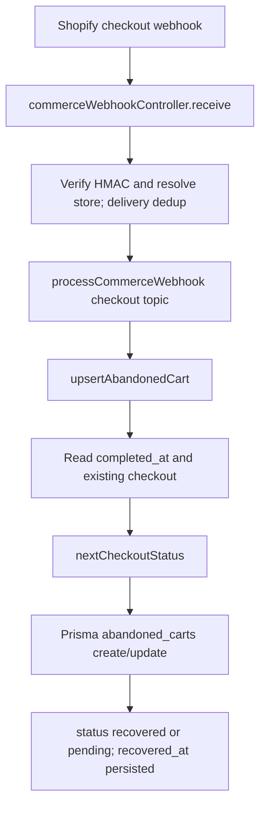

# REVLUMA — TASK 016 COMPLETED CHECKOUT PAYLOAD HANDLING VALIDATION

**Date:** 2026-10-30 · **Phase:** 1 / 1B Checkout–Order Integrity · **Verdict: PARTIAL** (isolated completion helper verified, full persisted webhook behavior not yet verified).

## 1. Baseline
Repository `Revluma-Organization/Revluma`; inspected GitHub `main` at creation of this documentation branch, base revision `8349de91cdaeff8b786ccc5f3ba0286c5b9f5a0b` (PR #209 creation recorded same base). Inspected file blobs: `Backend/src/services/checkoutInactivity.js` `e4a75aa5f1b76423b140680cfcbd46f16b74c81e`, `Backend/src/services/commerceWebhookService.js` `0a042e3f61aee62cbca84e05938e606036394f50`, `Backend/package.json` `c3534d7ce621bd61a6c9198e55bc244cea0f546c`. Prior Render production revision recorded as `8349de91cdaeff8b786ccc5f3ba0286c5b9f5a0b` after Task 014; exact current deployment equivalence not independently rechecked. Backend dependencies include Prisma `^6.19.3`; backend test script `npm test` invokes `node scripts/run-tests.js`; Node runtime version not established in this execution.

Previous documentation: TASK 001 unavailable in main register; TASK 002–013 indexed there; TASK 014 authentic order field audit in open PR #207, not yet merged to main; TASK 015 lifecycle architecture in open PR #209, reviewed. TASK 010 reports eight helper tests but no database-backed `upsertAbandonedCart` test; those historical test results are not counted as a new execution here.

## 2. Completion evidence and verified code path
`completed_at` is the backend's explicit completion signal; its truthiness determines `nextCheckoutStatus` and the `recovered_at` assignment. Shopify `updated_at` is an activity timestamp, not completion proof. TASK 013 captured actual Shopify checkout field shapes, but a field's presence/type alone is not evidence that a non-null completion event was captured.

`commerceWebhookService.js:275–319`: `external_cart_id` selected from `checkout_id || id || cart_token || checkout_token`; per-store/checkout advisory transaction lock; `nextCheckoutStatus({completedAt: payload.completed_at,existingStatus:existing?.status,isStale:isStaleEvent})`; `recovered_at` assigned `new Date(payload.completed_at)` when truthy, otherwise existing value. On a stale non-completion event, function returns existing record early. Completed creation/update path uses the same upsert. Completion status is persisted as **`recovered`**, not literal `completed`.

## 3. Safe execution and actual results
No disposable isolated PostgreSQL database or complete runnable backend checkout handler harness was established. Production DB and Shopify mutation are prohibited. To obtain limited genuine execution evidence, fetched the exact current `checkoutInactivity.js` source blob through GitHub and executed it in an isolated JavaScript V8 runtime using `new Function('module','exports', source)`, no database, environment secrets, Shopify calls or production side effects. This is **actual helper execution**, not a webhook or persistence test.

| Helper check | Actual result |
|---|---|
| Valid non-null `completedAt` with previously abandoned state | PASS: recovered |
| Explicit null completion evidence on pending | PASS: pending |
| Missing completion field on pending | PASS: pending |
| Previously recovered checkout with no completion field | PASS: recovered |
| Stale non-completion with previously recovered status | PASS: recovered |
| Inactivity boundary exactly 15 minutes | PASS: inactive |
| Shopify updated timestamp preferred over creation timestamp | PASS: updated timestamp |

**7 passed / 0 failed** for these isolated helper checks. **Additional probe:** `nextCheckoutStatus({completedAt:'invalid-date',existingStatus:'pending',isStale:false})` returned `recovered`; invalid string is truthy. Full handler attempts `new Date('invalid-date')` and could reject at Prisma serialization, but **actual persisted outcome was not tested**. Do not report a production corruption incident from this probe.

## 4. Required TC016 completion test matrix
| Test | Scenario | Expected | Actual evidence | Verdict |
|---|---|---|---|---|
| TC016-01 | Valid completed payload | Completed/recovered persisted | Helper selects recovered; webhook/DB not executed | BLOCKED |
| TC016-02 | Completion on checkout creation | Initially recovered | Shared upsert source supports; no DB execution | BLOCKED |
| TC016-03 | Completion on checkout update | Existing row recovered | Shared upsert source supports; no DB execution | BLOCKED |
| TC016-04 | Abandoned receives completion | Abandoned → recovered | Helper PASS, DB not exercised | BLOCKED |
| TC016-05 | Valid timestamp | Exact completion instant persisted | Source uses `new Date(completed_at)`; DB untested | BLOCKED |
| TC016-06 | Missing completion field | No false completion | Isolated helper PASS | PASS (helper only) |
| TC016-07 | Null completion field | No false completion | Isolated helper PASS | PASS (helper only) |
| TC016-08 | Malformed completion timestamp | Reject safely, never false completion | Helper classifies recovered for invalid nonempty string; DB untested | BLOCKED; risk observed |
| TC016-09 | Duplicate completed payload | One row, state/timestamp stable | Existing store/external lookup, but nonunique DB index and no persistence test | BLOCKED |
| TC016-10 | Completed followed by non-completion update | Preserve completion | Helper PASS; full handler not executed | PASS (helper only) |
| TC016-11 | Missing optional fields | Completion still persisted | Handler code uses optional chaining and fallbacks; DB untested | BLOCKED |
| TC016-12 | Completed payload with line items | Preserve product items | Handler source uses deleteMany/createMany when line_items nonempty; no DB test | BLOCKED |
| TC016-13 | Merchant isolation | Only intended store updated | Store-scoped lookup/lock in source; no two-tenant DB test | BLOCKED |

**Database before/after evidence:** None from an isolated test database. Earlier TASK 014 verified one real Shopify purchase's linked recovered checkout, but that proves **order-driven** recovery, not necessarily completion driven by a checkout payload's `completed_at`. No production records were accessed or changed for Task 016.

## 5. Findings
- **TASK016-FIND-01 (HIGH; verified helper-level weakness / persisted impact unverified):** `nextCheckoutStatus` treats any truthy `completedAt` as completion; malformed nonempty date string selects `recovered`. Evidence: current source and direct V8 execution. Future work: BACKLOG MAPPING REQUIRED (validate completion timestamp handling; no new task invented).
- **TASK016-FIND-02 (HIGH; missing verification):** No executed isolated DB-backed tests prove checkout create/update completion, `recovered_at` timestamp, abandoned-to-completed transition or merchant isolation. Evidence: current source, TASK 010 coverage map, absence of safe DB harness in this session. Related approved tasks: TASK 029 for completion precedence; TASK 049 for regression coverage; exact scope subject to backlog.
- **TASK016-FIND-03 (MEDIUM; potential duplication risk):** Checkout `external_cart_id` has a nonunique `(store_id,external_cart_id)` index and handler uses findFirst/create under advisory lock; duplicate payloads sequentially should find the same row but database uniqueness is not enforced. No duplicate rows observed here. Related TASK 035 duplicate checkout handling; do not expand scope.
- **TASK016-FIND-04 (MEDIUM; source behavior / persistence unverified):** A checkout's `abandoned_at` can be populated during initial `pending` or `recovered` upsert. Reuse TASK015-FIND-03; do not close or duplicate original finding.

## 6. Future dependencies and scope
TASK 017 exact ID match, 018 checkout token, 019 cart token, 024 relationship persistence, 029 completion precedence, 030 delayed event safeguards, 035 duplicate deliveries, 049 reconciliation regression tests. These are references only; no future task has been started.

## 7. Safety, limitations and verdict
**PARTIAL**: seven helper checks genuinely executed and passed, invalid timestamp classification risk demonstrated, but the core webhook-to-Prisma completed-checkout behavior remains **BLOCKED** without an isolated disposable database/test harness. The correct final database state cannot be asserted. No production backend, frontend, schema, Shopify, database, environment or deployment changes. Documentation-only PR, unmerged pending authorization.

## 8. Follow-up execution: actual handler with isolated in-memory Prisma stand-in

On 2026-10-30, re-fetched production source `commerceWebhookService.js` blob `0a042e3f61aee62cbca84e05938e606036394f50` and `checkoutInactivity.js` blob `e4a75aa5f1b76423b140680cfcbd46f16b74c81e`, evaluated both unchanged in an isolated V8 runtime, replacing only imports of database, logger, and optional ML service with inert in-memory stubs. Executed **actual** `processCommerceWebhook` → `upsertAbandonedCart` logic with synthetic store IDs and payloads. In-memory Prisma stand-in simulated `customers.upsert`, transaction callback, advisory lock, `abandoned_carts.findFirst/create/update`, and item replacement; **this does not simulate Prisma validation, SQL transactions, actual PostgreSQL constraints, or webhook HMAC/controller**. No production access or mutations.

An initial harness run had a **harness-only defect**: its mock `findFirst` returned `{}` instead of `null` for missing rows, causing 13 harness errors. Corrected the mock and reran all scenarios. **Final corrected execution: 12 PASS, 1 FAIL (TC016-08)**.

| Scenario | Final handler-with-memory result | Observed behavior |
|---|---|---|
| TC016-01 | PASS in-memory | Completed payload stored `recovered` |
| TC016-02 | PASS in-memory | Completed checkout via `checkouts/create` stored recovered |
| TC016-03 | PASS in-memory | Pending checkout updated to recovered |
| TC016-04 | PASS in-memory | Abandoned checkout updated to recovered |
| TC016-05 | PASS in-memory | `recovered_at` instant equals valid supplied timestamp |
| TC016-06 | PASS in-memory | Absent `completed_at` leaves pending |
| TC016-07 | PASS in-memory | Null `completed_at` leaves pending |
| TC016-08 | **FAIL in-memory** | Malformed nonempty timestamp sets status `recovered` with `Invalid Date` in memory; real Prisma would need independent validation |
| TC016-09 | PASS in-memory | Repeated completed payload reuses one logical record |
| TC016-10 | PASS in-memory | Later noncompletion update preserves recovered status and timestamp |
| TC016-11 | PASS in-memory | Missing optional customer/email/phone does not block completion |
| TC016-12 | PASS in-memory | Empty line items on follow-up do not erase previously stored synthetic items |
| TC016-13 | PASS in-memory | Two synthetic merchants with same checkout ID remain isolated |

**Evidence classification:** These are handler-level results against a mocked persistence interface, not real database PASS. The original mandatory isolated PostgreSQL persisted-state gate is still **BLOCKED**, so the overall task remains **PARTIAL**. Do not merge this report or proceed to Task 017 as though Task 016 achieved full acceptance. **TASK016-FIND-01** upgraded from helper-only risk to **confirmed handler-level invalid-date construction**; real Prisma failure/rollback behavior unverified. No production fix made, consistent with Task 016 scope.
