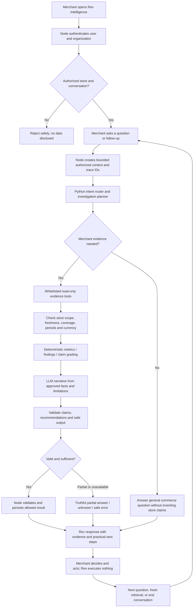
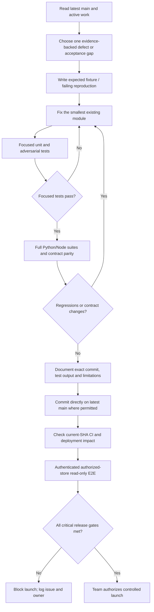

# Rev Intelligence — AI engineering modules, execution lifecycle and six-day working plan

**Date:** 20 Nov 2026. **Starting baseline inspected:** `main@6bcf737a66515266b9eeac5b37e21386039d3560`. **Audience:** AI/LLM engineering team and product integration owner. **MVP:** read-only Shopify operations advice.
**Status:** implementation guide and proposed acceptance gates — not a report that six days of work or product launch have been completed.
**Companion documents:** [audit](AI-ENGINEERING-HANDOFF-2026-11-20.md) · [evaluation matrix](AI-EVALUATION-MATRIX-2026-11-20.md) · [existing master plan](MASTER-PLAN.md).

## 1. Product lifecycle (what a merchant experiences)



Node is the **identity/authorization and conversation persistence trust boundary**. Python uses only authorized scope, existing read-only tools and validated evidence. Existing Python organization-scoped database tools must be reviewed with the backend owner; never assume this flow means all records are pre-retrieved in Node.

## 2. Engineering lifecycle (how we safely change the existing app)



**Current user instruction:** no new branches; write to `main` only. The repository contains older feature-branch/PR policies and reports. Respect protection gates; do not bypass CI, force-push, or merge someone else's unreviewed work. Documentation commits are not code certification.

## 3. Modules to learn and execute

| Module | Engineering skill | Existing source to inspect | Concrete exercise / deliverable |
| --- | --- | --- | --- |
| M0 — Baseline map | Python, FastAPI, JavaScript/HTTP, repository audit | `python/src/serving/api.py`, `Backend/src/services/mlService.js`, `Backend/src/controller/revController.js` | Trace JSON and SSE request; document payload, correlation/execution IDs, ownership checks and failure boundaries |
| M1 — Evidence model | Pydantic, `Decimal`, SQL aggregates, provenance, data quality | `python/src/intelligence/evidence.py`, `evidence_schema.py`, `evidence_quality.py`, `revenue_evidence.py` | Explain one revenue claim using period, exact currency, source ID, refund semantics, coverage and freshness; test missing currency and zero denominator |
| M2 — Investigation/tools | Tool schemas, constrained orchestration, retrieval, dependency isolation | `python/src/agents/tools.py`, `investigation.py` | Trace a revenue-decline question through only approved tools; show unavailable result rather than made-up metric; coordinate schema with Node owner |
| M3 — Grounded reasoning | Claim grading, numerical validation, causal reasoning | `python/src/intelligence/epistemics.py`, `python/src/agents/rev_system_prompt.py` | Produce verified fact/calculation/hypothesis/unknown from the same fixture; a missing input must block unsupported numbers |
| M4 — AI security | Prompt injection, tenant data boundary, fail-closed output | `investigation.py` quarantine, `epistemics.py`, Node contract validators | Add tests with hostile Shopify product titles/order notes, cross-tenant IDs, contradictory/stale observations, forbidden actions |
| M5 — Conversation quality | Session state, bounded context, follow-up reference tracking | `python/src/intelligence/conversation_reliability.py`, `python/src/agents/responder.py` | 20+ scripted turns: period-follow-up, correction, switch thread/store, cancel, retry; verify no old evidence treated as fresh |
| M6 — Evaluation | Pytest fixtures, golden questions, negative tests, error taxonomy | `python/tests/test_golden_set.py`, `test_rev_investigation_scenarios.py`, `test_task212_reliability_matrix.py` | Extend proven gaps, not duplicate old tests; track results against the companion matrix with exact test IDs |
| M7 — Provider/production | LLM APIs, fast/deep roles, structured output, tracing, timeout/cost analysis | `python/src/agents/model_gateway.py`, `Backend/src/services/mlService.js` | Verify current deployed model/config nonsecret names, bound retries, measure p50/p95, token use and real estimated cost |
| M8 — Release certification | Cross-stack regression, merchant acceptance, incident triage | `docs/mvp-execution`, `docs/rev-intelligence`, GitHub Actions | Provide current SHA, CI run, verified merchant conversation cases, residual risk and go/no-go record |

**Machine-learning vs AI-engineering distinction:** For this MVP, prioritize **inference integration, evidence quality, deterministic numerical reasoning, evaluation, prompt/model safety and production reliability**. Custom training, fine-tuning, churn/offer-model expansion and autonomous recovery are **not** assigned work. Review legacy predictive models only if they directly affect a verified Rev evidence path.

## 4. Six-day target schedule (gates, not guaranteed calendar completion)

| Day | Focus | Done only when |
| --- | --- | --- |
| 1 | M0 + architecture audit + current-main baseline | Exact file map, current test status, unresolved authorization-contract decision, top defects recorded |
| 2 | M1 + M2 + M3 | Currency/period/coverage and four claim-grade checks pass on synthetic cases; Node context contract reviewed with backend owner |
| 3 | M4 | Injection, missing/contradictory/stale data, forbidden action and cross-tenant negative tests are deterministic and green |
| 4 | M5 + M6 | Merchant scenario matrix executed; follow-up behavior measured; failures logged with reproducible fixtures |
| 5 | M7 + cross-component integration | Python and Node suites, CI, model failure tests, performance/cost evidence and two-tenant checks assessed on exact revisions |
| 6 | M8 + controlled launch decision | Authenticated real-store JSON + SSE, history/retry, data freshness and safety gates verified; unresolved critical failures mean **no launch** |

If a gate fails, continue fixing it rather than reporting the day as completed.

## 5. Daily operating routine

1. Check `main` for new commits, unresolved CI and other developers' changes. Never use an outdated code snapshot as proof of the current system.
2. Take one scoped failing example. Write expected output and an automated negative assertion first.
3. Change only the relevant Python intelligence module or approved Node schema adapter. Never weaken a guardrail to make a test green.
4. Run focused tests then entire affected suites; retain skipped/error counts and say which require real PostgreSQL or live provider access.
5. Record path, scenario ID, sanitized correlation ID, commit SHA, commands, output, cost and next owner; only then advance.
6. In group handoff, distinguish **implemented**, **test-passed**, **deployed**, **production-verified** and **blocked**. These are not synonyms.

## 6. Working commands (run in a complete checkout with dependencies)

```bash
# Python: offline deterministic/contract checks, then full suite
PYTHONPATH=python python3 -m pytest python/tests/test_rev_investigation_scenarios.py -q
PYTHONPATH=python python3 -m pytest python/tests/test_golden_set.py -q
PYTHONPATH=python python3 -m pytest python/tests -q

# Node (requires installed dependencies and generated Prisma client)
cd Backend
npm test

# Dashboard (separate checkout directory or return to repository root first)
cd ../Frontend/Dashboard
npm test -- --run
npm run build
```

Some integration tests need a disposable PostgreSQL instance and configured schema. Mock or placeholder URLs do not certify database integration. Paid live-LLM judge tests are **opt-in** and need a working authorized provider key; deterministic tests must not spend API quota.

## 7. Release handoff template

```text
Workstream:
Date / engineer:
Main SHA before / after:
Files changed:
Observed defect and reproduction:
Synthetic tests: command / pass / fail / skip:
Node-Python contract parity:
CI run and verdict:
Model/provider test (if actually run):
Real authorized-store JSON/SSE (if actually run):
Tenant separation tested:
p50/p95, tokens/turn, cost assumptions:
Deployment identity:
Critical failures / remaining risks:
Decision: GO / NO-GO / NOT YET ASSESSED
```

All release decisions require evidence. The frontend, Node and AI owners must agree on the same deployed contract before claiming readiness.
